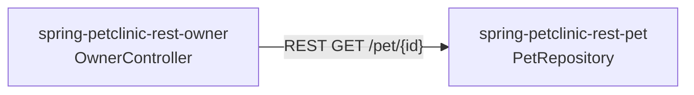

# MS010 — Call Graph
**System:** `amazon-ecs-java-microservices`  
**Stack:** Java · Spring Boot · AWS ECS · RestTemplate  
**Branch:** `phase_01/eshin` · Commit: `d467506`

> **Scope:** Only inter-microservice interfaces are listed (interfaces actually called by another service).

---

## Architecture Overview

5 isolated Spring Boot microservices on AWS ECS. The `spring-petclinic-rest-owner` service calls `spring-petclinic-rest-pet` over HTTP using `RestTemplate` — this is the **only** inter-service call in this system.

---

## Call Graph Diagram

---

## Inter-Microservice Interfaces (1)

| Service | Interface ID | Class | Method | Endpoint | Protocol |
|---|---|---|---|---|---|
| `spring-petclinic-rest-pet` | `PetRepository.findById` | `org.springframework.samples.petclinic.pet.PetRepository` | `findById(Integer)` | `GET /pet/{id}` | REST |

---

## Inter-Service Calls (1)

| # | From Service | From Method | → To Service | To Interface | Protocol | Evidence |
|---|---|---|---|---|---|---|
| 1 | `spring-petclinic-rest-owner` | `OwnerController.getOwnerVisits` | → `spring-petclinic-rest-pet` | `PetRepository.findById` | REST | `OwnerController.java:59` — `restTemplate.getForObject("http://"+serviceEndpoint+"/pet/"+petId, Pet.class)` |
