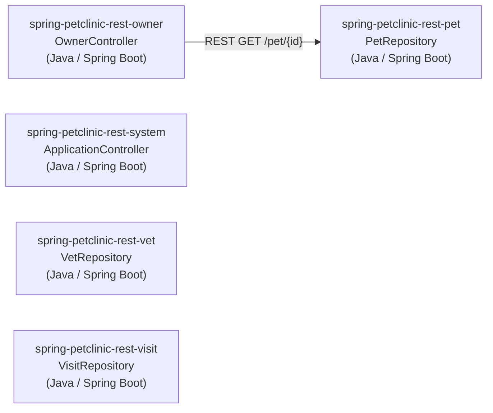

# MS010 — Call Graph
**System:** `amazon-ecs-java-microservices`  
**Stack:** Java · Spring Boot · AWS ECS · RestTemplate  
**Branch:** `phase_01/eshin` · Commit: `d467506`

---

## Architecture Overview

5 isolated Spring Boot microservices deployed on AWS ECS. Each service owns its own Spring Data REST `@RepositoryRestResource`. The `spring-petclinic-rest-owner` service uses a `RestTemplate` to call the `pet` service over HTTP at runtime.

---

## Call Graph Diagram

---

## Exposed Interfaces (9 total)

| Service | Class | Method | Endpoint | Return Type |
|---|---|---|---|---|
| `spring-petclinic-rest-owner` | `OwnerController` | `getOwnerVisits(int)` | `GET /owner/{ownerId}/getVisits` | `List<Visit>` |
| `spring-petclinic-rest-owner` | `OwnerRepository` | `findById(Integer)` | `GET /owner/{id}` | `Owner` |
| `spring-petclinic-rest-owner` | `OwnerRepository` | `findByLastName(String)` | `GET /owner/search/findByLastName` | `List<Owner>` |
| `spring-petclinic-rest-pet` | `PetRepository` | `findById(Integer)` | `GET /pet/{id}` | `Pet` |
| `spring-petclinic-rest-pet` | `PetRepository` | `findPetTypes()` | `GET /pet/search/findPetTypes` | `List<PetType>` |
| `spring-petclinic-rest-system` | `ApplicationController` | `home()` | `GET /` | `String` |
| `spring-petclinic-rest-system` | `CrashController` | `triggerException()` | `GET /oups` | `String` |
| `spring-petclinic-rest-vet` | `VetRepository` | `findAll()` | `GET /vet` | `List<Vet>` |
| `spring-petclinic-rest-visit` | `VisitRepository` | `findByPetId(Integer)` | `GET /visit/search/findByPetId` | `List<Visit>` |

---

## Inter-Service Calls (1 total)

| # | From Service | From Class | From Method | → | To Service | To Method | Protocol | Evidence |
|---|---|---|---|---|---|---|---|---|
| 1 | `spring-petclinic-rest-owner` | `OwnerController` | `getOwnerVisits` | → | `spring-petclinic-rest-pet` | `PetRepository.findById` | **REST** | `OwnerController.java:59` — `restTemplate.getForObject("http://"+serviceEndpoint+"/pet/"+petId, Pet.class)` |

---

## Notes

- Only 1 inter-service call in the entire system — low coupling.
- The call is made via a raw `RestTemplate` with environment variable `SERVICE_ENDPOINT` for the host address.
- `spring-petclinic-rest-system`, `spring-petclinic-rest-vet`, `spring-petclinic-rest-visit` are **isolated** — no outbound inter-service calls.
