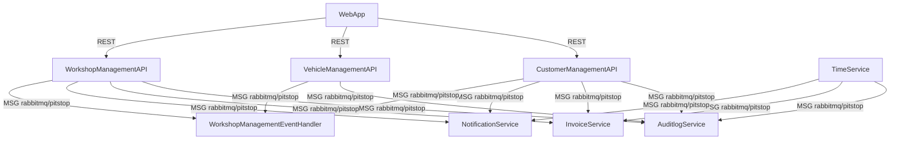

# MS016 — Call Graph
**System:** `pitstop`  
**Stack:** C# · .NET · Refit · RabbitMQ  
**Branch:** `phase_01/eshin` · Commit: `09698bc`

> **Scope:** Only inter-microservice interfaces are listed (interfaces actually called by another service).

---

## Architecture Overview

Event-driven automotive workshop system. `WebApp` calls 3 REST APIs via Refit. All mutation operations publish domain events to `rabbitmq/pitstop` consumed by 4 worker services. `TimeService` emits periodic time events.

---

## Call Graph Diagram

---

## Inter-Microservice Interfaces (17)

### REST Interfaces (13)

| Service | Interface ID | Method | Endpoint | Called By |
|---|---|---|---|---|
| `CustomerManagementAPI` | `CustomersController.GetAllAsync` | `GetAllAsync()` | `GET /api/customers` | `WebApp` |
| `CustomerManagementAPI` | `CustomersController.GetByCustomerId` | `GetByCustomerId(string)` | `GET /api/customers/{customerId}` | `WebApp` |
| `CustomerManagementAPI` | `CustomersController.RegisterAsync` | `RegisterAsync(RegisterCustomer)` | `POST /api/customers` | `WebApp` |
| `VehicleManagementAPI` | `VehiclesController.GetAllAsync` | `GetAllAsync()` | `GET /api/vehicles` | `WebApp` |
| `VehicleManagementAPI` | `VehiclesController.GetByLicenseNumber` | `GetByLicenseNumber(string)` | `GET /api/vehicles/{licenseNumber}` | `WebApp` |
| `VehicleManagementAPI` | `VehiclesController.RegisterAsync` | `RegisterAsync(RegisterVehicle)` | `POST /api/vehicles` | `WebApp` |
| `WorkshopManagementAPI` | `WorkshopPlanningController.GetByDate` | `GetByDate(DateTime)` | `GET /api/workshopplanning/{planningDate}` | `WebApp` |
| `WorkshopManagementAPI` | `WorkshopPlanningController.GetMaintenanceJobAsync` | `GetMaintenanceJobAsync(DateTime,Guid)` | `GET /api/workshopplanning/{planningDate}/jobs/{jobId}` | `WebApp` |
| `WorkshopManagementAPI` | `WorkshopPlanningController.PlanMaintenanceJobAsync` | `PlanMaintenanceJobAsync(DateTime,PlanMaintenanceJob)` | `POST /api/workshopplanning/{planningDate}/jobs` | `WebApp` |
| `WorkshopManagementAPI` | `WorkshopPlanningController.FinishMaintenanceJobAsync` | `FinishMaintenanceJobAsync(DateTime,Guid,FinishMaintenanceJob)` | `PUT /api/workshopplanning/{planningDate}/jobs/{jobId}/finish` | `WebApp` |
| `WorkshopManagementAPI` | `RefDataController.GetVehicleByLicenseNumber` | `GetVehicleByLicenseNumber(string)` | `GET /api/refdata/vehicles/{licenseNumber}` | `WebApp` |
| `WorkshopManagementAPI` | `RefDataController.GetCustomerByCustomerId` | `GetCustomerByCustomerId(string)` | `GET /api/refdata/customers/{customerId}` | `WebApp` |
| `WorkshopManagementAPI` | `RefDataController.GetVehicles` | `GetVehicles()` | `GET /api/refdata/vehicles` | `WebApp` |

### Messaging Interfaces (4)

| Service | Interface ID | Method | Queue | Called By |
|---|---|---|---|---|
| `AuditlogService` | `AuditLogWorker.HandleMessageAsync` | `HandleMessageAsync(string,string)` | `rabbitmq/pitstop` | `CustomerManagementAPI`, `VehicleManagementAPI`, `WorkshopManagementAPI`, `TimeService` |
| `InvoiceService` | `InvoiceWorker.HandleMessageAsync` | `HandleMessageAsync(string,string)` | `rabbitmq/pitstop` | `CustomerManagementAPI`, `WorkshopManagementAPI`, `TimeService` |
| `NotificationService` | `NotificationWorker.HandleMessageAsync` | `HandleMessageAsync(string,string)` | `rabbitmq/pitstop` | `CustomerManagementAPI`, `WorkshopManagementAPI`, `TimeService` |
| `WorkshopManagementEventHandler` | `EventHandlerWorker.HandleMessageAsync` | `HandleMessageAsync(string,string)` | `rabbitmq/pitstop` | `CustomerManagementAPI`, `VehicleManagementAPI`, `WorkshopManagementAPI` |

---

## Inter-Service Calls (33)

### REST Calls — WebApp → APIs (16)

| # | From Method | → To Service | To Interface | Evidence |
|---|---|---|---|---|
| 1 | `CustomerManagementController.Index` | → `CustomerManagementAPI` | `CustomersController.GetAllAsync` | `CustomerManagementController.cs:23` |
| 2 | `CustomerManagementController.Details` | → `CustomerManagementAPI` | `CustomersController.GetByCustomerId` | `CustomerManagementController.cs:36` |
| 3 | `CustomerManagementController.Register` | → `CustomerManagementAPI` | `CustomersController.RegisterAsync` | `CustomerManagementController.cs:60` |
| 4 | `VehicleManagementController.Index` | → `VehicleManagementAPI` | `VehiclesController.GetAllAsync` | `VehicleManagementController.cs:26` |
| 5 | `VehicleManagementController.Details` | → `VehicleManagementAPI` | `VehiclesController.GetByLicenseNumber` | `VehicleManagementController.cs:37` |
| 6 | `VehicleManagementController.Details` | → `CustomerManagementAPI` | `CustomersController.GetByCustomerId` | `VehicleManagementController.cs:38` |
| 7 | `VehicleManagementController.New` | → `CustomerManagementAPI` | `CustomersController.GetAllAsync` | `VehicleManagementController.cs:55` |
| 8 | `VehicleManagementController.Register` | → `VehicleManagementAPI` | `VehiclesController.RegisterAsync` | `VehicleManagementController.cs:74` |
| 9 | `WorkshopManagementController.Index` | → `WorkshopManagementAPI` | `WorkshopPlanningController.GetByDate` | `WorkshopManagementController.cs:34` |
| 10 | `WorkshopManagementController.Details` | → `WorkshopManagementAPI` | `WorkshopPlanningController.GetMaintenanceJobAsync` | `WorkshopManagementController.cs:53` |
| 11 | `WorkshopManagementController.Finish` | → `WorkshopManagementAPI` | `WorkshopPlanningController.GetMaintenanceJobAsync` | `WorkshopManagementController.cs:84` |
| 12 | `WorkshopManagementController.RegisterMaintenanceJob` | → `WorkshopManagementAPI` | `RefDataController.GetVehicleByLicenseNumber` | `WorkshopManagementController.cs:110` |
| 13 | `WorkshopManagementController.RegisterMaintenanceJob` | → `WorkshopManagementAPI` | `RefDataController.GetCustomerByCustomerId` | `WorkshopManagementController.cs:111` |
| 14 | `WorkshopManagementController.RegisterMaintenanceJob` | → `WorkshopManagementAPI` | `WorkshopPlanningController.PlanMaintenanceJobAsync` | `WorkshopManagementController.cs:116` |
| 15 | `WorkshopManagementController.FinishMaintenanceJob` | → `WorkshopManagementAPI` | `WorkshopPlanningController.FinishMaintenanceJobAsync` | `WorkshopManagementController.cs:158` |
| 16 | `WorkshopManagementController.New` | → `WorkshopManagementAPI` | `RefDataController.GetVehicles` | `WorkshopManagementController.cs:176` |

### Messaging Calls — RabbitMQ (17)

| # | From Service | From Method | → To Service | To Interface | Evidence |
|---|---|---|---|---|---|
| 17 | `CustomerManagementAPI` | `CustomersController.RegisterAsync` | → `AuditlogService` | `AuditLogWorker.HandleMessageAsync` | `CustomersController.cs:47` |
| 18 | `CustomerManagementAPI` | `CustomersController.RegisterAsync` | → `InvoiceService` | `InvoiceWorker.HandleMessageAsync` | `CustomersController.cs:47` |
| 19 | `CustomerManagementAPI` | `CustomersController.RegisterAsync` | → `NotificationService` | `NotificationWorker.HandleMessageAsync` | `CustomersController.cs:47` |
| 20 | `CustomerManagementAPI` | `CustomersController.RegisterAsync` | → `WorkshopManagementEventHandler` | `EventHandlerWorker.HandleMessageAsync` | `CustomersController.cs:47` |
| 21 | `VehicleManagementAPI` | `VehiclesController.RegisterAsync` | → `AuditlogService` | `AuditLogWorker.HandleMessageAsync` | `VehiclesController.cs:54` |
| 22 | `VehicleManagementAPI` | `VehiclesController.RegisterAsync` | → `WorkshopManagementEventHandler` | `EventHandlerWorker.HandleMessageAsync` | `VehiclesController.cs:54` |
| 23 | `WorkshopManagementAPI` | `PlanMaintenanceJobCommandHandler.HandleCommandAsync` | → `AuditlogService` | `AuditLogWorker.HandleMessageAsync` | `PlanMaintenanceJobCommandHandler.cs:35` |
| 24 | `WorkshopManagementAPI` | `PlanMaintenanceJobCommandHandler.HandleCommandAsync` | → `InvoiceService` | `InvoiceWorker.HandleMessageAsync` | `PlanMaintenanceJobCommandHandler.cs:35` |
| 25 | `WorkshopManagementAPI` | `PlanMaintenanceJobCommandHandler.HandleCommandAsync` | → `NotificationService` | `NotificationWorker.HandleMessageAsync` | `PlanMaintenanceJobCommandHandler.cs:35` |
| 26 | `WorkshopManagementAPI` | `PlanMaintenanceJobCommandHandler.HandleCommandAsync` | → `WorkshopManagementEventHandler` | `EventHandlerWorker.HandleMessageAsync` | `PlanMaintenanceJobCommandHandler.cs:35` |
| 27 | `WorkshopManagementAPI` | `FinishMaintenanceJobCommandHandler.HandleCommandAsync` | → `AuditlogService` | `AuditLogWorker.HandleMessageAsync` | `FinishMaintenanceJobCommandHandler.cs:35` |
| 28 | `WorkshopManagementAPI` | `FinishMaintenanceJobCommandHandler.HandleCommandAsync` | → `InvoiceService` | `InvoiceWorker.HandleMessageAsync` | `FinishMaintenanceJobCommandHandler.cs:35` |
| 29 | `WorkshopManagementAPI` | `FinishMaintenanceJobCommandHandler.HandleCommandAsync` | → `NotificationService` | `NotificationWorker.HandleMessageAsync` | `FinishMaintenanceJobCommandHandler.cs:35` |
| 30 | `WorkshopManagementAPI` | `FinishMaintenanceJobCommandHandler.HandleCommandAsync` | → `WorkshopManagementEventHandler` | `EventHandlerWorker.HandleMessageAsync` | `FinishMaintenanceJobCommandHandler.cs:35` |
| 31 | `TimeService` | `TimeWorker.Worker` | → `AuditlogService` | `AuditLogWorker.HandleMessageAsync` | `TimeWorker.cs:39` |
| 32 | `TimeService` | `TimeWorker.Worker` | → `InvoiceService` | `InvoiceWorker.HandleMessageAsync` | `TimeWorker.cs:39` |
| 33 | `TimeService` | `TimeWorker.Worker` | → `NotificationService` | `NotificationWorker.HandleMessageAsync` | `TimeWorker.cs:39` |
