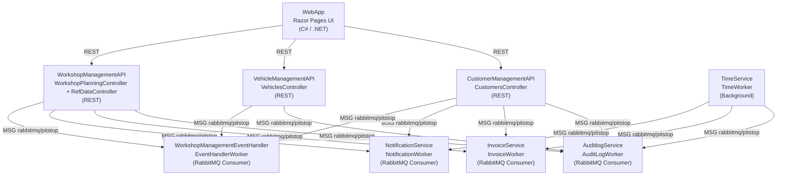

# MS016 — Call Graph
**System:** `pitstop`  
**Stack:** C# · .NET · Refit (REST client) · RabbitMQ  
**Branch:** `phase_01/eshin` · Commit: `09698bc`

---

## Architecture Overview

Event-driven automotive workshop management system. `WebApp` is a Razor Pages UI that calls 3 backend REST APIs via **Refit** typed HTTP clients. All mutation operations publish domain events to a shared **RabbitMQ** exchange (`rabbitmq/pitstop`), consumed by 4 downstream worker services. `TimeService` is a background timer that emits time-passed events periodically.

---

## Call Graph Diagram

---

## Exposed Interfaces (18 total)

| Service | Class | Method | Endpoint | Protocol |
|---|---|---|---|---|
| `AuditlogService` | `AuditLogWorker` | `HandleMessageAsync(string,string)` | `rabbitmq/pitstop` | Messaging |
| `CustomerManagementAPI` | `CustomersController` | `GetAllAsync()` | `GET /api/customers` | REST |
| `CustomerManagementAPI` | `CustomersController` | `GetByCustomerId(string)` | `GET /api/customers/{customerId}` | REST |
| `CustomerManagementAPI` | `CustomersController` | `RegisterAsync(RegisterCustomer)` | `POST /api/customers` | REST |
| `InvoiceService` | `InvoiceWorker` | `HandleMessageAsync(string,string)` | `rabbitmq/pitstop` | Messaging |
| `NotificationService` | `NotificationWorker` | `HandleMessageAsync(string,string)` | `rabbitmq/pitstop` | Messaging |
| `TimeService` | — | *(no exposed interfaces — pure publisher)* | — | — |
| `VehicleManagementAPI` | `VehiclesController` | `GetAllAsync()` | `GET /api/vehicles` | REST |
| `VehicleManagementAPI` | `VehiclesController` | `GetByLicenseNumber(string)` | `GET /api/vehicles/{licenseNumber}` | REST |
| `VehicleManagementAPI` | `VehiclesController` | `RegisterAsync(RegisterVehicle)` | `POST /api/vehicles` | REST |
| `WebApp` | — | *(no exposed interfaces — pure UI caller)* | — | — |
| `WorkshopManagementAPI` | `RefDataController` | `GetCustomers()` | `GET /api/refdata/customers` | REST |
| `WorkshopManagementAPI` | `RefDataController` | `GetCustomerByCustomerId(string)` | `GET /api/refdata/customers/{customerId}` | REST |
| `WorkshopManagementAPI` | `RefDataController` | `GetVehicles()` | `GET /api/refdata/vehicles` | REST |
| `WorkshopManagementAPI` | `RefDataController` | `GetVehicleByLicenseNumber(string)` | `GET /api/refdata/vehicles/{licenseNumber}` | REST |
| `WorkshopManagementAPI` | `WorkshopPlanningController` | `GetByDate(DateTime)` | `GET /api/workshopplanning/{date}` | REST |
| `WorkshopManagementAPI` | `WorkshopPlanningController` | `GetMaintenanceJobAsync(DateTime,Guid)` | `GET /api/workshopplanning/{date}/jobs/{jobId}` | REST |
| `WorkshopManagementAPI` | `WorkshopPlanningController` | `PlanMaintenanceJobAsync(DateTime,PlanMaintenanceJob)` | `POST /api/workshopplanning/{date}/jobs` | REST |
| `WorkshopManagementAPI` | `WorkshopPlanningController` | `FinishMaintenanceJobAsync(DateTime,Guid,FinishMaintenanceJob)` | `PUT /api/workshopplanning/{date}/jobs/{jobId}/finish` | REST |
| `WorkshopManagementEventHandler` | `EventHandlerWorker` | `HandleMessageAsync(string,string)` | `rabbitmq/pitstop` | Messaging |

---

## Inter-Service Calls (33 total)

### REST Calls — WebApp → APIs (16 calls)

| # | Src Method | → Dst Service | Dst Method | Evidence |
|---|---|---|---|---|
| 1 | `CustomerManagementController.Index` | → `CustomerManagementAPI` | `CustomersController.GetAllAsync` | `CustomerManagementController.cs:23` |
| 2 | `CustomerManagementController.Details` | → `CustomerManagementAPI` | `CustomersController.GetByCustomerId` | `CustomerManagementController.cs:36` |
| 3 | `CustomerManagementController.Register` | → `CustomerManagementAPI` | `CustomersController.RegisterAsync` | `CustomerManagementController.cs:60` |
| 4 | `VehicleManagementController.Index` | → `VehicleManagementAPI` | `VehiclesController.GetAllAsync` | `VehicleManagementController.cs:26` |
| 5 | `VehicleManagementController.Details` | → `VehicleManagementAPI` | `VehiclesController.GetByLicenseNumber` | `VehicleManagementController.cs:37` |
| 6 | `VehicleManagementController.Details` | → `CustomerManagementAPI` | `CustomersController.GetByCustomerId` | `VehicleManagementController.cs:38` |
| 7 | `VehicleManagementController.New` | → `CustomerManagementAPI` | `CustomersController.GetAllAsync` | `VehicleManagementController.cs:55` |
| 8 | `VehicleManagementController.Register` | → `VehicleManagementAPI` | `VehiclesController.RegisterAsync` | `VehicleManagementController.cs:74` |
| 9 | `WorkshopManagementController.Index` | → `WorkshopManagementAPI` | `WorkshopPlanningController.GetByDate` | `WorkshopManagementController.cs:34` |
| 10 | `WorkshopManagementController.Details` | → `WorkshopManagementAPI` | `WorkshopPlanningController.GetMaintenanceJobAsync` | `WorkshopManagementController.cs:53` |
| 11 | `WorkshopManagementController.Finish` | → `WorkshopManagementAPI` | `WorkshopPlanningController.GetMaintenanceJobAsync` | `WorkshopManagementController.cs:84` |
| 12 | `WorkshopManagementController.RegisterMaintenanceJob` | → `WorkshopManagementAPI` | `RefDataController.GetVehicleByLicenseNumber` | `WorkshopManagementController.cs:110` |
| 13 | `WorkshopManagementController.RegisterMaintenanceJob` | → `WorkshopManagementAPI` | `RefDataController.GetCustomerByCustomerId` | `WorkshopManagementController.cs:111` |
| 14 | `WorkshopManagementController.RegisterMaintenanceJob` | → `WorkshopManagementAPI` | `WorkshopPlanningController.PlanMaintenanceJobAsync` | `WorkshopManagementController.cs:116` |
| 15 | `WorkshopManagementController.FinishMaintenanceJob` | → `WorkshopManagementAPI` | `WorkshopPlanningController.FinishMaintenanceJobAsync` | `WorkshopManagementController.cs:158` |
| 16 | `WorkshopManagementController.New` | → `WorkshopManagementAPI` | `RefDataController.GetVehicles` | `WorkshopManagementController.cs:176` |

### Messaging Calls — RabbitMQ `rabbitmq/pitstop` (17 calls)

| # | Src Service | Src Method | → Dst Service | Dst Worker | Evidence |
|---|---|---|---|---|---|
| 17 | `CustomerManagementAPI` | `CustomersController.RegisterAsync` | → `AuditlogService` | `AuditLogWorker.HandleMessageAsync` | `CustomersController.cs:47` |
| 18 | `CustomerManagementAPI` | `CustomersController.RegisterAsync` | → `InvoiceService` | `InvoiceWorker.HandleMessageAsync` | `CustomersController.cs:47` |
| 19 | `CustomerManagementAPI` | `CustomersController.RegisterAsync` | → `NotificationService` | `NotificationWorker.HandleMessageAsync` | `CustomersController.cs:47` |
| 20 | `CustomerManagementAPI` | `CustomersController.RegisterAsync` | → `WorkshopManagementEventHandler` | `EventHandlerWorker.HandleMessageAsync` | `CustomersController.cs:47` |
| 21 | `VehicleManagementAPI` | `VehiclesController.RegisterAsync` | → `AuditlogService` | `AuditLogWorker.HandleMessageAsync` | `VehiclesController.cs:54` |
| 22 | `VehicleManagementAPI` | `VehiclesController.RegisterAsync` | → `WorkshopManagementEventHandler` | `EventHandlerWorker.HandleMessageAsync` | `VehiclesController.cs:54` |
| 23 | `WorkshopManagementAPI` | `PlanMaintenanceJobCommandHandler.HandleCommandAsync` | → `AuditlogService` | `AuditLogWorker.HandleMessageAsync` | `PlanMaintenanceJobCommandHandler.cs:35` |
| 24 | `WorkshopManagementAPI` | `PlanMaintenanceJobCommandHandler.HandleCommandAsync` | → `InvoiceService` | `InvoiceWorker.HandleMessageAsync` | `PlanMaintenanceJobCommandHandler.cs:35` |
| 25 | `WorkshopManagementAPI` | `PlanMaintenanceJobCommandHandler.HandleCommandAsync` | → `NotificationService` | `NotificationWorker.HandleMessageAsync` | `PlanMaintenanceJobCommandHandler.cs:35` |
| 26 | `WorkshopManagementAPI` | `PlanMaintenanceJobCommandHandler.HandleCommandAsync` | → `WorkshopManagementEventHandler` | `EventHandlerWorker.HandleMessageAsync` | `PlanMaintenanceJobCommandHandler.cs:35` |
| 27 | `WorkshopManagementAPI` | `FinishMaintenanceJobCommandHandler.HandleCommandAsync` | → `AuditlogService` | `AuditLogWorker.HandleMessageAsync` | `FinishMaintenanceJobCommandHandler.cs:35` |
| 28 | `WorkshopManagementAPI` | `FinishMaintenanceJobCommandHandler.HandleCommandAsync` | → `InvoiceService` | `InvoiceWorker.HandleMessageAsync` | `FinishMaintenanceJobCommandHandler.cs:35` |
| 29 | `WorkshopManagementAPI` | `FinishMaintenanceJobCommandHandler.HandleCommandAsync` | → `NotificationService` | `NotificationWorker.HandleMessageAsync` | `FinishMaintenanceJobCommandHandler.cs:35` |
| 30 | `WorkshopManagementAPI` | `FinishMaintenanceJobCommandHandler.HandleCommandAsync` | → `WorkshopManagementEventHandler` | `EventHandlerWorker.HandleMessageAsync` | `FinishMaintenanceJobCommandHandler.cs:35` |
| 31 | `TimeService` | `TimeWorker.Worker` | → `AuditlogService` | `AuditLogWorker.HandleMessageAsync` | `TimeWorker.cs:39` |
| 32 | `TimeService` | `TimeWorker.Worker` | → `InvoiceService` | `InvoiceWorker.HandleMessageAsync` | `TimeWorker.cs:39` |
| 33 | `TimeService` | `TimeWorker.Worker` | → `NotificationService` | `NotificationWorker.HandleMessageAsync` | `TimeWorker.cs:39` |
