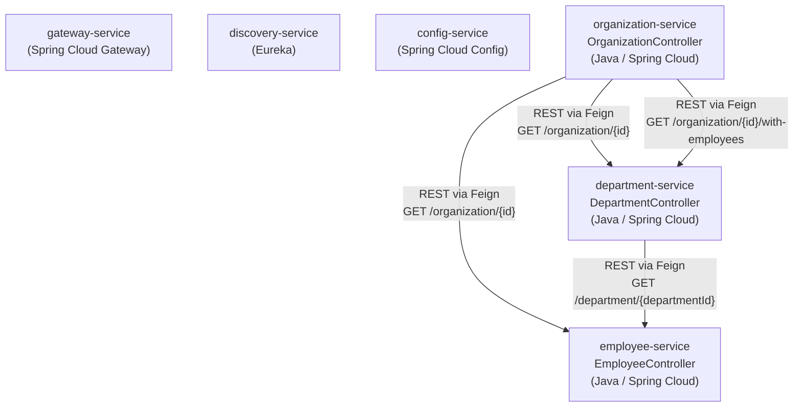

# MS031 — Call Graph
**System:** `sample-spring-microservices-new`  
**Stack:** Java · Spring Cloud · OpenFeign · Eureka Discovery · Spring Cloud Gateway  
**Branch:** `phase_01/eshin` · Commit: `ff2e591`

---

## Architecture Overview

Classic 3-tier Spring Cloud microservices demo. `organization-service` is the top-level aggregator, calling `department-service` and `employee-service` via `@FeignClient` stubs registered in Eureka (`discovery-service`). `department-service` also calls `employee-service` to enrich department responses with employee lists. All traffic is routable through `gateway-service`.

> **Note:** `@FeignClient` stubs are **caller-side** proxies and are **not** listed in `exposed_interfaces`. Only the real `@RestController` endpoints are listed.

---

## Call Graph Diagram

---

## Exposed Interfaces (16 total)

### employee-service (5 interfaces)

| Class | Method | Endpoint | Params | Return Type |
|---|---|---|---|---|
| `EmployeeController` | `add` | `POST /` | `Employee` | `Employee` |
| `EmployeeController` | `findAll` | `GET /` | — | `List<Employee>` |
| `EmployeeController` | `findById` | `GET /{id}` | `Long` | `Employee` |
| `EmployeeController` | `findByDepartment` | `GET /department/{departmentId}` | `Long` | `List<Employee>` |
| `EmployeeController` | `findByOrganization` | `GET /organization/{organizationId}` | `Long` | `List<Employee>` |

### department-service (5 interfaces)

| Class | Method | Endpoint | Params | Return Type |
|---|---|---|---|---|
| `DepartmentController` | `add` | `POST /` | `Department` | `Department` |
| `DepartmentController` | `findAll` | `GET /` | — | `List<Department>` |
| `DepartmentController` | `findById` | `GET /{id}` | `Long` | `Department` |
| `DepartmentController` | `findByOrganization` | `GET /organization/{organizationId}` | `Long` | `List<Department>` |
| `DepartmentController` | `findByOrganizationWithEmployees` | `GET /organization/{organizationId}/with-employees` | `Long` | `List<Department>` |

### organization-service (6 interfaces)

| Class | Method | Endpoint | Params | Return Type |
|---|---|---|---|---|
| `OrganizationController` | `add` | `POST /` | `Organization` | `Organization` |
| `OrganizationController` | `findAll` | `GET /` | — | `List<Organization>` |
| `OrganizationController` | `findById` | `GET /{id}` | `Long` | `Organization` |
| `OrganizationController` | `findByIdWithDepartments` | `GET /{id}/with-departments` | `Long` | `Organization` |
| `OrganizationController` | `findByIdWithDepartmentsAndEmployees` | `GET /{id}/with-departments-and-employees` | `Long` | `Organization` |
| `OrganizationController` | `findByIdWithEmployees` | `GET /{id}/with-employees` | `Long` | `Organization` |

### Infrastructure services (no exposed interfaces)

| Service | Role |
|---|---|
| `discovery-service` | Eureka server — service registration only |
| `config-service` | Spring Cloud Config server |
| `gateway-service` | API gateway / reverse proxy |

---

## Inter-Service Calls (4 total)

| # | From Service | From Method | → To Service | To Method | Protocol | Evidence |
|---|---|---|---|---|---|---|
| 1 | `department-service` | `DepartmentController.findByOrganizationWithEmployees` | → `employee-service` | `EmployeeController.findByDepartment` | REST (Feign) | `DepartmentController.java:53` — `employeeClient.findByDepartment(d.getId())` |
| 2 | `organization-service` | `OrganizationController.findByIdWithDepartments` | → `department-service` | `DepartmentController.findByOrganization` | REST (Feign) | `OrganizationController.java:56` — `departmentClient.findByOrganization(organization.getId())` |
| 3 | `organization-service` | `OrganizationController.findByIdWithDepartmentsAndEmployees` | → `department-service` | `DepartmentController.findByOrganizationWithEmployees` | REST (Feign) | `OrganizationController.java:64` — `departmentClient.findByOrganizationWithEmployees(organization.getId())` |
| 4 | `organization-service` | `OrganizationController.findByIdWithEmployees` | → `employee-service` | `EmployeeController.findByOrganization` | REST (Feign) | `OrganizationController.java:72` — `employeeClient.findByOrganization(organization.getId())` |

---

## Notes

- `organization-service` is the root aggregator — it fans out to both `department-service` and `employee-service`.
- `department-service` enriches its own responses by calling `employee-service` (nested call pattern).
- No circular calls exist in this system.
