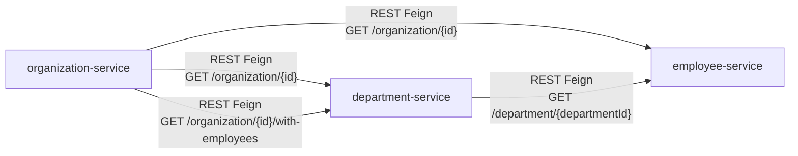

# MS031 — Call Graph
**System:** `sample-spring-microservices-new`  
**Stack:** Java · Spring Cloud · OpenFeign · Eureka  
**Branch:** `phase_01/eshin` · Commit: `ff2e591`

> **Scope:** Only inter-microservice interfaces are listed (interfaces actually called by another service).

---

## Architecture Overview

3-tier Spring Cloud system. `organization-service` fans out to `department-service` and `employee-service` via Feign. `department-service` also calls `employee-service` to enrich responses. Infrastructure services (`discovery`, `config`, `gateway`) have no inter-MS interfaces.

---

## Call Graph Diagram

---

## Inter-Microservice Interfaces (4)

| Service | Interface ID | Class | Method | Endpoint | Protocol | Called By |
|---|---|---|---|---|---|---|
| `employee-service` | `EmployeeController.findByDepartment` | `EmployeeController` | `findByDepartment(Long)` | `GET /department/{departmentId}` | REST | `department-service` |
| `employee-service` | `EmployeeController.findByOrganization` | `EmployeeController` | `findByOrganization(Long)` | `GET /organization/{organizationId}` | REST | `organization-service` |
| `department-service` | `DepartmentController.findByOrganization` | `DepartmentController` | `findByOrganization(Long)` | `GET /organization/{organizationId}` | REST | `organization-service` |
| `department-service` | `DepartmentController.findByOrganizationWithEmployees` | `DepartmentController` | `findByOrganizationWithEmployees(Long)` | `GET /organization/{organizationId}/with-employees` | REST | `organization-service` |

---

## Inter-Service Calls (4)

| # | From Service | From Method | → To Service | To Interface | Evidence |
|---|---|---|---|---|---|
| 1 | `department-service` | `DepartmentController.findByOrganizationWithEmployees` | → `employee-service` | `EmployeeController.findByDepartment` | `DepartmentController.java:53` — `employeeClient.findByDepartment(d.getId())` |
| 2 | `organization-service` | `OrganizationController.findByIdWithDepartments` | → `department-service` | `DepartmentController.findByOrganization` | `OrganizationController.java:56` — `departmentClient.findByOrganization(organization.getId())` |
| 3 | `organization-service` | `OrganizationController.findByIdWithDepartmentsAndEmployees` | → `department-service` | `DepartmentController.findByOrganizationWithEmployees` | `OrganizationController.java:64` — `departmentClient.findByOrganizationWithEmployees(organization.getId())` |
| 4 | `organization-service` | `OrganizationController.findByIdWithEmployees` | → `employee-service` | `EmployeeController.findByOrganization` | `OrganizationController.java:72` — `employeeClient.findByOrganization(organization.getId())` |
