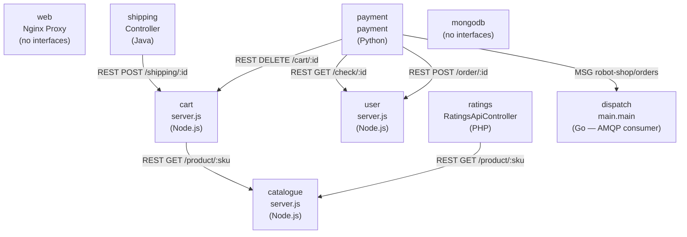

# MS047 — Call Graph
**System:** `robot-shop`  
**Stack:** Polyglot — Node.js · Python · Java (Spring Boot) · PHP (Symfony) · Go · Nginx  
**Branch:** `phase_01/eshin` · Commit: `ace0d17`

---

## Architecture Overview

Polyglot e-commerce robot parts shop. `web` (Nginx) is a pure reverse proxy with no application logic. `payment` is the central payment orchestrator — it validates the user, records the order, clears the cart, and dispatches to fulfillment via RabbitMQ. `cart` validates product existence by calling `catalogue`. `shipping` confirms delivery by calling `cart` to finalize the cart. `dispatch` is a Go consumer on the `robot-shop/orders` RabbitMQ exchange.

---

## Call Graph Diagram

---

## Exposed Interfaces (34 total)

### catalogue — Node.js (6 interfaces)

| Method | Endpoint | Return |
|---|---|---|
| `get_health` | `GET /health` | `object` |
| `get_products` | `GET /products` | `List<object>` |
| `get_product_sku` | `GET /product/:sku` | `object` |
| `get_products_cat` | `GET /products/:cat` | `List<object>` |
| `get_categories` | `GET /categories` | `List<string>` |
| `get_search_text` | `GET /search/:text` | `List<object>` |

### user — Node.js (8 interfaces)

| Method | Endpoint | Return |
|---|---|---|
| `get_health` | `GET /health` | `object` |
| `get_uniqueid` | `GET /uniqueid` | `object` |
| `get_check_id` | `GET /check/:id` | `string` |
| `get_users` | `GET /users` | `List<object>` |
| `post_login` | `POST /login` | `object` |
| `post_register` | `POST /register` | `string` |
| `post_order_id` | `POST /order/:id` | `string` |
| `get_history_id` | `GET /history/:id` | `object` |

### cart — Node.js (7 interfaces)

| Method | Endpoint | Return |
|---|---|---|
| `get_health` | `GET /health` | `object` |
| `get_cart_id` | `GET /cart/:id` | `object` |
| `delete_cart_id` | `DELETE /cart/:id` | `string` |
| `get_add_id_sku_qty` | `GET /add/:id/:sku/:qty` | `object` |
| `get_update_id_sku_qty` | `GET /update/:id/:sku/:qty` | `object` |
| `get_item_delete_id_sku` | `GET /item/delete/:id/:sku` | `object` |
| `post_shipping_id` | `POST /shipping/:id` | `object` |

### shipping — Java / Spring Boot (7 interfaces)

| Class | Method | Endpoint | Return |
|---|---|---|---|
| `Controller` | `health` | `GET /health` | `String` |
| `Controller` | `count` | `GET /count` | `String` |
| `Controller` | `codes` | `GET /codes` | `List<Code>` |
| `Controller` | `cities(String)` | `GET /cities/{code}` | `List<City>` |
| `Controller` | `match(String,String)` | `GET /match/{code}/{text}` | `List<City>` |
| `Controller` | `caclc(long)` | `GET /calc/{id}` | `Ship` |
| `Controller` | `confirm(String,String)` | `POST /confirm/{id}` | `String` |

### ratings — PHP / Symfony (3 interfaces)

| Class | Method | Endpoint | Return |
|---|---|---|---|
| `HealthController` | `__invoke()` | `GET /_health` | `JsonResponse` |
| `RatingsApiController` | `put(string,int)` | `PUT /api/rate/{sku}/{score}` | `JsonResponse` |
| `RatingsApiController` | `get(string)` | `GET /api/fetch/{sku}` | `JsonResponse` |

### payment — Python (2 interfaces)

| Class | Method | Endpoint | Return |
|---|---|---|---|
| `payment` | `health` | `GET /health` | `string` |
| `payment` | `pay(string)` | `POST /pay/<id>` | `object` |

### dispatch — Go (1 interface — AMQP consumer)

| Class | Method | Queue | Protocol |
|---|---|---|---|
| `main.main` | `main` | `robot-shop/orders` | Messaging |

### web, mongodb — no exposed interfaces

---

## Inter-Service Calls (7 total)

| # | From Service | From Class | From Method | → To Service | To Method | Protocol | Evidence |
|---|---|---|---|---|---|---|---|
| 1 | `cart` | `server.js` | `get_add_id_sku_qty` | → `catalogue` | `server.js.get_product_sku` | REST | `server.js:362` — `request('http://'+catalogueHost+':8080/product/'+sku, ...)` |
| 2 | `shipping` | `Controller` | `confirm` | → `cart` | `server.js.post_shipping_id` | REST | `Controller.java:137` — `helper.addToCart(id, body)` |
| 3 | `ratings` | `RatingsApiController` | `put` | → `catalogue` | `server.js.get_product_sku` | REST | `RatingsApiController.php:49` — `$this->catalogueService->checkSKU($sku)` |
| 4 | `payment` | `payment` | `pay` | → `user` | `server.js.get_check_id` | REST | `payment.py:64` — `requests.get('http://{user}:8080/check/{id}')` |
| 5 | `payment` | `payment` | `pay` | → `user` | `server.js.post_order_id` | REST | `payment.py:106` — `requests.post('http://{user}:8080/order/{id}', ...)` |
| 6 | `payment` | `payment` | `pay` | → `cart` | `server.js.delete_cart_id` | REST | `payment.py:116` — `requests.delete('http://{cart}:8080/cart/{id}')` |
| 7 | `payment` | `payment` | `pay` | → `dispatch` | `main.main` | Messaging | `payment.py:101` — `queueOrder({'orderid': orderid, 'user': id, 'cart': cart})` |

---

## Notes

- `payment` is the most connected service: 4 outbound calls (2 to `user`, 1 to `cart`, 1 to `dispatch`).
- `catalogue` is the most called service: receives calls from both `cart` and `ratings`.
- `web` and `mongodb` have **no** exposed application-layer interfaces.
- `dispatch` is a **pure consumer** — it only receives messages and has no outbound calls in-scope.
