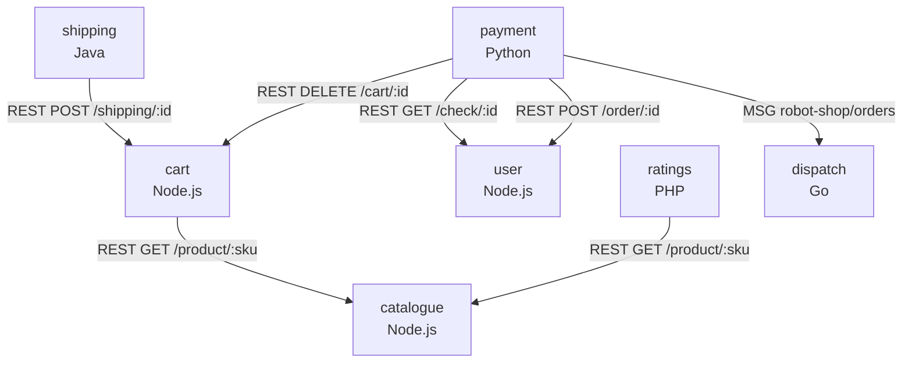

# MS047 — Call Graph
**System:** `robot-shop`  
**Stack:** Polyglot — Node.js · Python · Java · PHP · Go  
**Branch:** `phase_01/eshin` · Commit: `ace0d17`

> **Scope:** Only inter-microservice interfaces are listed (interfaces actually called by another service).

---

## Architecture Overview

Polyglot e-commerce shop. `payment` orchestrates the checkout flow by calling `user`, `cart`, and `dispatch`. `cart` validates products via `catalogue`. `shipping` finalises delivery via `cart`. `ratings` validates SKUs via `catalogue`.

---

## Call Graph Diagram

---

## Inter-Microservice Interfaces (6)

| Service | Interface ID | Class | Method | Endpoint | Protocol | Called By |
|---|---|---|---|---|---|---|
| `catalogue` | `server.get_product_sku` | `server.js` | `get_product_sku(string)` | `GET /product/:sku` | REST | `cart`, `ratings` |
| `cart` | `server.post_shipping_id` | `server.js` | `post_shipping_id(string,object)` | `POST /shipping/:id` | REST | `shipping` |
| `cart` | `server.delete_cart_id` | `server.js` | `delete_cart_id(string)` | `DELETE /cart/:id` | REST | `payment` |
| `user` | `server.get_check_id` | `server.js` | `get_check_id(string)` | `GET /check/:id` | REST | `payment` |
| `user` | `server.post_order_id` | `server.js` | `post_order_id(string,object)` | `POST /order/:id` | REST | `payment` |
| `dispatch` | `main.main` | `main.main` | `main(object)` | `robot-shop/orders` | Messaging | `payment` |

---

## Inter-Service Calls (7)

| # | From Service | From Class | From Method | → To Service | To Interface | Protocol | Evidence |
|---|---|---|---|---|---|---|---|
| 1 | `cart` | `server.js` | `get_add_id_sku_qty` | → `catalogue` | `server.get_product_sku` | REST | `server.js:362` — `request('http://'+catalogueHost+':8080/product/'+sku, ...)` |
| 2 | `shipping` | `Controller` | `confirm` | → `cart` | `server.post_shipping_id` | REST | `Controller.java:137` — `helper.addToCart(id, body)` |
| 3 | `ratings` | `RatingsApiController` | `put` | → `catalogue` | `server.get_product_sku` | REST | `RatingsApiController.php:49` — `$this->catalogueService->checkSKU($sku)` |
| 4 | `payment` | `payment` | `pay` | → `user` | `server.get_check_id` | REST | `payment.py:64` — `requests.get('http://{user}:8080/check/{id}')` |
| 5 | `payment` | `payment` | `pay` | → `user` | `server.post_order_id` | REST | `payment.py:106` — `requests.post('http://{user}:8080/order/{id}', ...)` |
| 6 | `payment` | `payment` | `pay` | → `cart` | `server.delete_cart_id` | REST | `payment.py:116` — `requests.delete('http://{cart}:8080/cart/{id}')` |
| 7 | `payment` | `payment` | `pay` | → `dispatch` | `main.main` | Messaging | `payment.py:101` — `queueOrder({'orderid': orderid, 'user': id, 'cart': cart})` |
