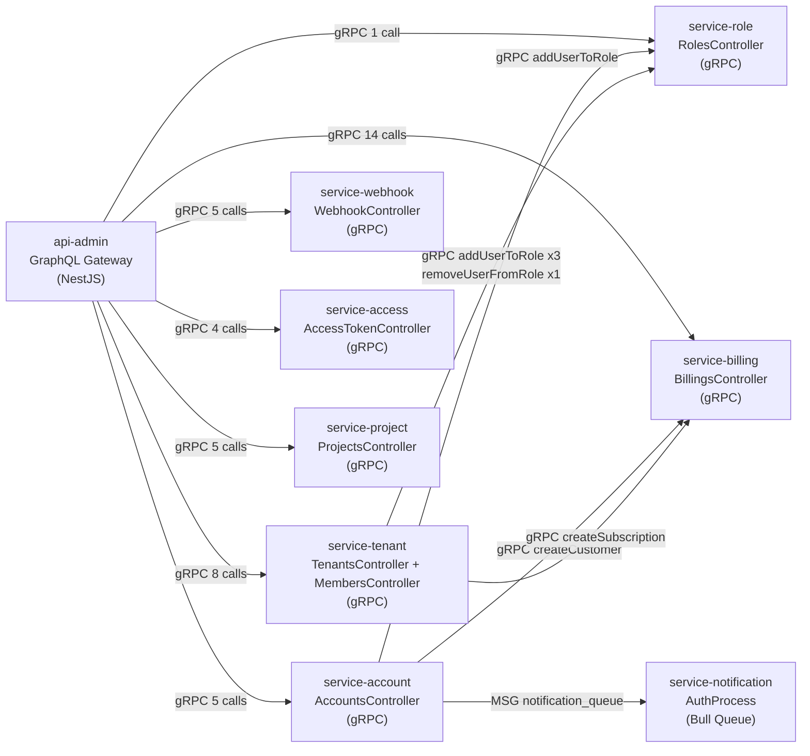

# MS098 — Call Graph
**System:** `ultimate-backend`  
**Stack:** TypeScript · NestJS · gRPC · GraphQL · Bull (Redis queue)  
**Branch:** `phase_01/eshin` · Commit: `9c19765`

---

## Architecture Overview

Multi-tenant SaaS backend. `api-admin` is a **GraphQL gateway** — it exposes a single GraphQL API to clients and resolves each query/mutation by calling downstream **gRPC** backend services. Backend services also make direct gRPC calls to each other (backend-to-backend). `service-notification` consumes async jobs from a **Bull** Redis queue.

> **`api-admin`** has `exposed_interfaces: []` — it is a pure caller/gateway with no gRPC server surface of its own.

---

## Call Graph Diagram

---

## Exposed Interfaces (69 total)

### service-webhook (5 interfaces — gRPC)

| Method | gRPC Endpoint | Params → Return |
|---|---|---|
| `createWebhook` | `WebhookService/CreateWebhook` | `CreateWebhookRequest` → `CreateWebhookResponse` |
| `deleteWebhook` | `WebhookService/DeleteWebhook` | `DeleteWebhookRequest` → `DeleteWebhookResponse` |
| `findWebhook` | `WebhookService/FindWebhook` | `FindWebhookRequest` → `FindWebhookResponse` |
| `readWebhook` | `WebhookService/ReadWebhook` | `ReadWebhookRequest` → `ReadWebhookResponse` |
| `updateWebhook` | `WebhookService/UpdateWebhook` | `UpdateWebhookRequest` → `UpdateWebhookResponse` |

### service-access (5 interfaces — gRPC)

| Method | gRPC Endpoint | Params → Return |
|---|---|---|
| `createAccess` | `AccessService/CreateAccess` | `CreateAccessRequest` → `CreateAccessResponse` |
| `deleteAccess` | `AccessService/DeleteAccess` | `DeleteAccessRequest` → `DeleteAccessResponse` |
| `findAccess` | `AccessService/FindAccess` | `FindAccessRequest` → `FindAccessResponse` |
| `hasRights` | `AccessService/HasRights` | `HasRightsRequest` → `HasRightsResponse` |
| `readAccess` | `AccessService/ReadAccess` | `ReadAccessRequest` → `ReadAccessResponse` |

### service-billing (19 interfaces — gRPC)

| Method | gRPC Endpoint |
|---|---|
| `cancelSubscription` | `BillingService/CancelSubscription` |
| `changeSubscription` | `BillingService/ChangeSubscription` |
| `createCard` | `BillingService/CreateCard` |
| `createCustomer` | `BillingService/CreateCustomer` |
| `createPlan` | `BillingService/CreatePlan` |
| `createSubscription` | `BillingService/CreateSubscription` |
| `deleteCard` | `BillingService/DeleteCard` |
| `deleteCustomer` | `BillingService/DeleteCustomer` |
| `findCards` | `BillingService/FindCards` |
| `findInvoices` | `BillingService/FindInvoices` |
| `findPlans` | `BillingService/FindPlans` |
| `findStripePlans` | `BillingService/FindStripePlans` |
| `findSubscriptions` | `BillingService/FindSubscriptions` |
| `readCard` | `BillingService/ReadCard` |
| `readCustomer` | `BillingService/ReadCustomer` |
| `readInvoice` | `BillingService/ReadInvoice` |
| `readPlan` | `BillingService/ReadPlan` |
| `readSubscription` | `BillingService/ReadSubscription` |
| `setDefaultCard` | `BillingService/SetDefaultCard` |

### service-account (13 interfaces — gRPC)

| Method | gRPC Endpoint |
|---|---|
| `create` | `AccountService/Create` |
| `delete` | `AccountService/Delete` |
| `forgotPassword` | `AccountService/ForgotPassword` |
| `login` | `AccountService/Login` |
| `logout` | `AccountService/Logout` |
| `read` | `AccountService/Read` |
| `readSession` | `AccountService/ReadSession` |
| `resendVerificationCode` | `AccountService/ResendVerificationCode` |
| `search` | `AccountService/Search` |
| `update` | `AccountService/Update` |
| `updatePassword` | `AccountService/UpdatePassword` |
| `verifyAccount` | `AccountService/VerifyAccount` |
| `verifyActivationLink` | `AccountService/VerifyActivationLink` |

### service-tenant (12 interfaces — gRPC)

| Method | gRPC Endpoint |
|---|---|
| `createTenant` | `TenantService/CreateTenant` |
| `deleteTenant` | `TenantService/DeleteTenant` |
| `findTenant` | `TenantService/FindTenant` |
| `readTenant` | `TenantService/ReadTenant` |
| `tenantAvailable` | `TenantService/TenantAvailable` |
| `updateTenant` | `TenantService/UpdateTenant` |
| `acceptMemberInvitation` | `TenantService/AcceptMemberInvitation` |
| `deleteMember` | `TenantService/DeleteMember` |
| `findMembers` | `TenantService/FindMembers` |
| `inviteMember` | `TenantService/InviteMember` |
| `readMember` | `TenantService/ReadMember` |
| `updateMember` | `TenantService/UpdateMember` |

### service-notification (1 interface — Messaging)

| Class | Method | Queue | Protocol |
|---|---|---|---|
| `AuthProcess` | `processUserRegister(Job<UserEntity>)` | `notification_queue` | Messaging (Bull) |

### service-project (5 interfaces — gRPC)

| Method | gRPC Endpoint |
|---|---|
| `createProject` | `ProjectService/CreateProject` |
| `deleteProject` | `ProjectService/DeleteProject` |
| `findProjects` | `ProjectService/FindProjects` |
| `readProject` | `ProjectService/ReadProject` |
| `updateProject` | `ProjectService/UpdateProject` |

### service-role (5 interfaces — gRPC)

| Method | gRPC Endpoint |
|---|---|
| `addUserToRole` | `RoleService/AddUserToRole` |
| `hasRights` | `RoleService/HasRights` |
| `readUserRoles` | `RoleService/ReadUserRoles` |
| `removeUserFromRole` | `RoleService/RemoveUserFromRole` |
| *(+ 1 more)* | `RoleService/*` |

### api-admin — no exposed interfaces (GraphQL gateway only)

---

## Inter-Service Calls (49 total)

### GraphQL Gateway → Backend gRPC (42 calls)

| # | Resolver File | GraphQL Operation | → Dst Service | Dst Method |
|---|---|---|---|---|
| 1 | `access-token.resolver.ts:22` | `accessToken` (create) | → `service-access` | `AccessTokenController.createAccess` |
| 2 | `access-token.resolver.ts:38` | `accessToken` (delete) | → `service-access` | `AccessTokenController.deleteAccess` |
| 3 | `access-token.resolver.ts:56` | `accessToken` (find) | → `service-access` | `AccessTokenController.findAccess` |
| 4 | `access-token.resolver.ts:62` | `accessToken` (read) | → `service-access` | `AccessTokenController.readAccess` |
| 5 | `accounts-mutation.resolver.ts:96` | `register` | → `service-account` | `AccountsController.create` |
| 6 | `accounts-mutation.resolver.ts:104` | `sendResetPasswordEmail` | → `service-account` | `AccountsController.forgotPassword` |
| 7 | `accounts-mutation.resolver.ts:114` | `sendVerificationEmail` | → `service-account` | `AccountsController.resendVerificationCode` |
| 8 | `accounts-mutation.resolver.ts:142` | `verifyAccount` | → `service-account` | `AccountsController.verifyAccount` |
| 9 | `accounts-mutation.resolver.ts:163` | `verifyActivationLink` | → `service-account` | `AccountsController.verifyActivationLink` |
| 10 | `billings-mutation.resolver.ts:31` | `changeSubscription` | → `service-billing` | `BillingsController.changeSubscription` |
| 11 | `billings-mutation.resolver.ts:59` | `cancelSubscription` | → `service-billing` | `BillingsController.cancelSubscription` |
| 12 | `billings.resolver.ts:34` | `invoice` | → `service-billing` | `BillingsController.readInvoice` |
| 13 | `billings.resolver.ts:49` | `invoices` | → `service-billing` | `BillingsController.findInvoices` |
| 14 | `billings.resolver.ts:73` | `subscription` | → `service-billing` | `BillingsController.readSubscription` |
| 15 | `billings.resolver.ts:91` | `subscriptions` | → `service-billing` | `BillingsController.findSubscriptions` |
| 16 | `cards.resolver.ts:33` | `card` | → `service-billing` | `BillingsController.readCard` |
| 17 | `cards.resolver.ts:48` | `cards` | → `service-billing` | `BillingsController.findCards` |
| 18 | `cards.resolver.ts:83` | `create` (card) | → `service-billing` | `BillingsController.createCard` |
| 19 | `cards.resolver.ts:106` | `delete` (card) | → `service-billing` | `BillingsController.deleteCard` |
| 20 | `cards.resolver.ts:122` | `setDefault` | → `service-billing` | `BillingsController.setDefaultCard` |
| 21 | `plans.resolver.ts:24` | `plan` | → `service-billing` | `BillingsController.readPlan` |
| 22 | `plans.resolver.ts:30` | `plans` | → `service-billing` | `BillingsController.findPlans` |
| 23 | `plans.resolver.ts:39` | `prices` | → `service-billing` | `BillingsController.findStripePlans` |
| 24 | `tenant-members-mutation.resolver.ts:32` | `invite` | → `service-tenant` | `MembersController.inviteMember` |
| 25 | `tenant-members-mutation.resolver.ts:58` | `update` (member) | → `service-tenant` | `MembersController.updateMember` |
| 26 | `tenant-members-mutation.resolver.ts:84` | `delete` (member) | → `service-tenant` | `MembersController.deleteMember` |
| 27 | `tenant-members.resolver.ts:39` | `member` | → `service-tenant` | `MembersController.readMember` |
| 28 | `tenant-members.resolver.ts:59` | `members` | → `service-tenant` | `MembersController.findMembers` |
| 29 | `tenant-members.resolver.ts:86` | `fullName` | → `service-account` | `AccountsController.read` |
| 30 | `tenants-mutation.resolver.ts:36` | `create` (tenant) | → `service-tenant` | `TenantsController.createTenant` |
| 31 | `tenants-mutation.resolver.ts:55` | `update` (tenant) | → `service-tenant` | `TenantsController.updateTenant` |
| 32 | `tenants-mutation.resolver.ts:80` | `delete` (tenant) | → `service-tenant` | `TenantsController.deleteTenant` |
| 33 | `tenants.resolver.ts:41` | `tenantAvailable` | → `service-tenant` | `TenantsController.tenantAvailable` |
| 34 | `tenants.resolver.ts:64` | `tenant` | → `service-tenant` | `TenantsController.readTenant` |
| 35 | `tenants.resolver.ts:84` | `tenants` | → `service-tenant` | `TenantsController.findTenant` |
| 36 | `tenants.resolver.ts:102` | `owner` | → `service-account` | `AccountsController.read` |
| 37 | `users.resolver.ts:45` | `roles` | → `service-role` | `RolesController.readUserRoles` |
| 38 | `webhooks-mutation.resolver.ts:62` | `create` (webhook) | → `service-webhook` | `WebhookController.createWebhook` |
| 39 | `webhooks-mutation.resolver.ts:81` | `update` (webhook) | → `service-webhook` | `WebhookController.updateWebhook` |
| 40 | `webhooks-mutation.resolver.ts:106` | `remove` (webhook) | → `service-webhook` | `WebhookController.deleteWebhook` |
| 41 | `webhooks.resolver.ts:14` | `webhook` | → `service-webhook` | `WebhookController.readWebhook` |
| 42 | `webhooks.resolver.ts:31` | `webhooks` | → `service-webhook` | `WebhookController.findWebhook` |

### Backend-to-Backend (7 calls)

| # | From Service | Handler File | → To Service | To Method | Protocol | Evidence |
|---|---|---|---|---|---|---|
| 43 | `service-account` | `register-user.handler.ts:145` | → `service-role` | `RolesController.addUserToRole` | gRPC | line 145 |
| 44 | `service-account` | `register-user.handler.ts:153` | → `service-billing` | `BillingsController.createCustomer` | gRPC | line 153 |
| 45 | `service-tenant` | `create-tenant.handler.ts:105` | → `service-billing` | `BillingsController.createSubscription` | gRPC | line 105 |
| 46 | `service-tenant` | `create-tenant.handler.ts:127` | → `service-role` | `RolesController.addUserToRole` | gRPC | line 127 |
| 47 | `service-tenant` | `accept-invitation.handler.ts:67` | → `service-role` | `RolesController.addUserToRole` | gRPC | line 67 |
| 48 | `service-tenant` | `remove-member.handler.ts:93` | → `service-role` | `RolesController.removeUserFromRole` | gRPC | line 93 |
| 49 | `service-tenant` | `invite-member.handler.ts:111` | → `service-role` | `RolesController.addUserToRole` | gRPC | line 111 |

---

## Notes

- `api-admin` is the heaviest caller: **42 outbound gRPC calls** across 7 services.
- `service-role` is the most called backend service: receives calls from `api-admin`, `service-account` (1), and `service-tenant` (4) = **6 total callers**.
- `service-tenant` makes **5 backend-to-backend gRPC calls** on lifecycle events (create tenant, invite, remove member).
- `service-notification` is a **pure consumer** — receives Bull queue jobs and sends emails; no outbound service calls.
