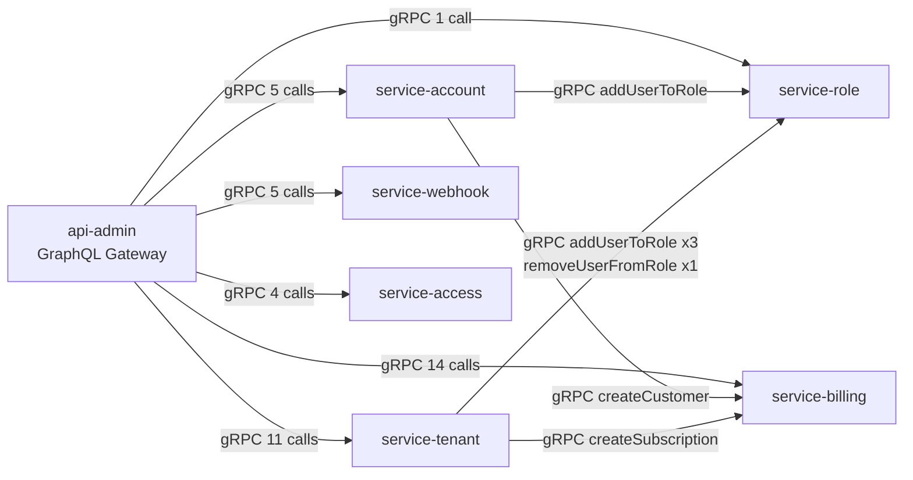

# MS098 — Call Graph
**System:** `ultimate-backend`  
**Stack:** TypeScript · NestJS · gRPC · GraphQL · Bull  
**Branch:** `phase_01/eshin` · Commit: `9c19765`

> **Scope:** Only inter-microservice interfaces are listed (interfaces actually called by another service).

---

## Architecture Overview

Multi-tenant SaaS backend. `api-admin` is a GraphQL gateway that resolves queries/mutations by calling 6 downstream gRPC services. `service-account` and `service-tenant` additionally make direct backend-to-backend gRPC calls. `service-notification` consumes Bull queue jobs.

> `service-project` and `service-notification.AuthProcess` are exposed but **not called** in the verified inter-service call graph.

---

## Call Graph Diagram

---

## Inter-Microservice Interfaces (45)

### service-webhook — 5 interfaces

| Interface ID | Method | gRPC Endpoint | Called By |
|---|---|---|---|
| `WebhookController.createWebhook` | `createWebhook` | `WebhookService/CreateWebhook` | `api-admin` |
| `WebhookController.updateWebhook` | `updateWebhook` | `WebhookService/UpdateWebhook` | `api-admin` |
| `WebhookController.deleteWebhook` | `deleteWebhook` | `WebhookService/DeleteWebhook` | `api-admin` |
| `WebhookController.readWebhook` | `readWebhook` | `WebhookService/ReadWebhook` | `api-admin` |
| `WebhookController.findWebhook` | `findWebhook` | `WebhookService/FindWebhook` | `api-admin` |

### service-access — 4 interfaces

| Interface ID | Method | gRPC Endpoint | Called By |
|---|---|---|---|
| `AccessTokenController.createAccess` | `createAccess` | `AccessService/CreateAccess` | `api-admin` |
| `AccessTokenController.deleteAccess` | `deleteAccess` | `AccessService/DeleteAccess` | `api-admin` |
| `AccessTokenController.findAccess` | `findAccess` | `AccessService/FindAccess` | `api-admin` |
| `AccessTokenController.readAccess` | `readAccess` | `AccessService/ReadAccess` | `api-admin` |

### service-billing — 16 interfaces

| Interface ID | Method | gRPC Endpoint | Called By |
|---|---|---|---|
| `BillingsController.changeSubscription` | `changeSubscription` | `BillingService/ChangeSubscription` | `api-admin` |
| `BillingsController.cancelSubscription` | `cancelSubscription` | `BillingService/CancelSubscription` | `api-admin` |
| `BillingsController.readInvoice` | `readInvoice` | `BillingService/ReadInvoice` | `api-admin` |
| `BillingsController.findInvoices` | `findInvoices` | `BillingService/FindInvoices` | `api-admin` |
| `BillingsController.readSubscription` | `readSubscription` | `BillingService/ReadSubscription` | `api-admin` |
| `BillingsController.findSubscriptions` | `findSubscriptions` | `BillingService/FindSubscriptions` | `api-admin` |
| `BillingsController.readCard` | `readCard` | `BillingService/ReadCard` | `api-admin` |
| `BillingsController.findCards` | `findCards` | `BillingService/FindCards` | `api-admin` |
| `BillingsController.createCard` | `createCard` | `BillingService/CreateCard` | `api-admin` |
| `BillingsController.deleteCard` | `deleteCard` | `BillingService/DeleteCard` | `api-admin` |
| `BillingsController.setDefaultCard` | `setDefaultCard` | `BillingService/SetDefaultCard` | `api-admin` |
| `BillingsController.readPlan` | `readPlan` | `BillingService/ReadPlan` | `api-admin` |
| `BillingsController.findPlans` | `findPlans` | `BillingService/FindPlans` | `api-admin` |
| `BillingsController.findStripePlans` | `findStripePlans` | `BillingService/FindStripePlans` | `api-admin` |
| `BillingsController.createCustomer` | `createCustomer` | `BillingService/CreateCustomer` | `service-account` |
| `BillingsController.createSubscription` | `createSubscription` | `BillingService/CreateSubscription` | `service-tenant` |

### service-account — 6 interfaces

| Interface ID | Method | gRPC Endpoint | Called By |
|---|---|---|---|
| `AccountsController.create` | `create` | `AccountService/Create` | `api-admin` |
| `AccountsController.forgotPassword` | `forgotPassword` | `AccountService/ForgotPassword` | `api-admin` |
| `AccountsController.resendVerificationCode` | `resendVerificationCode` | `AccountService/ResendVerificationCode` | `api-admin` |
| `AccountsController.verifyAccount` | `verifyAccount` | `AccountService/VerifyAccount` | `api-admin` |
| `AccountsController.verifyActivationLink` | `verifyActivationLink` | `AccountService/VerifyActivationLink` | `api-admin` |
| `AccountsController.read` | `read` | `AccountService/Read` | `api-admin` (×2) |

### service-tenant — 11 interfaces

| Interface ID | Method | gRPC Endpoint | Called By |
|---|---|---|---|
| `MembersController.inviteMember` | `inviteMember` | `TenantService/InviteMember` | `api-admin` |
| `MembersController.updateMember` | `updateMember` | `TenantService/UpdateMember` | `api-admin` |
| `MembersController.deleteMember` | `deleteMember` | `TenantService/DeleteMember` | `api-admin` |
| `MembersController.readMember` | `readMember` | `TenantService/ReadMember` | `api-admin` |
| `MembersController.findMembers` | `findMembers` | `TenantService/FindMembers` | `api-admin` |
| `TenantsController.createTenant` | `createTenant` | `TenantService/CreateTenant` | `api-admin` |
| `TenantsController.updateTenant` | `updateTenant` | `TenantService/UpdateTenant` | `api-admin` |
| `TenantsController.deleteTenant` | `deleteTenant` | `TenantService/DeleteTenant` | `api-admin` |
| `TenantsController.tenantAvailable` | `tenantAvailable` | `TenantService/TenantAvailable` | `api-admin` |
| `TenantsController.readTenant` | `readTenant` | `TenantService/ReadTenant` | `api-admin` |
| `TenantsController.findTenant` | `findTenant` | `TenantService/FindTenant` | `api-admin` |

### service-role — 3 interfaces

| Interface ID | Method | gRPC Endpoint | Called By |
|---|---|---|---|
| `RolesController.readUserRoles` | `readUserRoles` | `RoleService/ReadUserRoles` | `api-admin` |
| `RolesController.addUserToRole` | `addUserToRole` | `RoleService/AddUserToRole` | `service-account`, `service-tenant` (×3) |
| `RolesController.removeUserFromRole` | `removeUserFromRole` | `RoleService/RemoveUserFromRole` | `service-tenant` |

---

## Inter-Service Calls (49)

### GraphQL Gateway → Backend gRPC (42 calls)

| # | Resolver File | GraphQL Op | → Dst Service | To Interface |
|---|---|---|---|---|
| 1 | `access-token.resolver.ts:22` | `accessToken` (create) | → `service-access` | `AccessTokenController.createAccess` |
| 2 | `access-token.resolver.ts:38` | `accessToken` (delete) | → `service-access` | `AccessTokenController.deleteAccess` |
| 3 | `access-token.resolver.ts:56` | `accessToken` (find) | → `service-access` | `AccessTokenController.findAccess` |
| 4 | `access-token.resolver.ts:62` | `accessToken` (read) | → `service-access` | `AccessTokenController.readAccess` |
| 5 | `accounts-mutation.resolver.ts:96` | `register` | → `service-account` | `AccountsController.create` |
| 6 | `accounts-mutation.resolver.ts:104` | `sendResetPasswordEmail` | → `service-account` | `AccountsController.forgotPassword` |
| 7 | `accounts-mutation.resolver.ts:114` | `sendVerificationEmail` | → `service-account` | `AccountsController.resendVerificationCode` |
| 8 | `accounts-mutation.resolver.ts:142` | `verifyAccount` | → `service-account` | `AccountsController.verifyAccount` |
| 9 | `accounts-mutation.resolver.ts:163` | `verifyActivationLink` | → `service-account` | `AccountsController.verifyActivationLink` |
| 10 | `billings-mutation.resolver.ts:31` | `changeSubscription` | → `service-billing` | `BillingsController.changeSubscription` |
| 11 | `billings-mutation.resolver.ts:59` | `cancelSubscription` | → `service-billing` | `BillingsController.cancelSubscription` |
| 12 | `billings.resolver.ts:34` | `invoice` | → `service-billing` | `BillingsController.readInvoice` |
| 13 | `billings.resolver.ts:49` | `invoices` | → `service-billing` | `BillingsController.findInvoices` |
| 14 | `billings.resolver.ts:73` | `subscription` | → `service-billing` | `BillingsController.readSubscription` |
| 15 | `billings.resolver.ts:91` | `subscriptions` | → `service-billing` | `BillingsController.findSubscriptions` |
| 16 | `cards.resolver.ts:33` | `card` | → `service-billing` | `BillingsController.readCard` |
| 17 | `cards.resolver.ts:48` | `cards` | → `service-billing` | `BillingsController.findCards` |
| 18 | `cards.resolver.ts:83` | `create` (card) | → `service-billing` | `BillingsController.createCard` |
| 19 | `cards.resolver.ts:106` | `delete` (card) | → `service-billing` | `BillingsController.deleteCard` |
| 20 | `cards.resolver.ts:122` | `setDefault` | → `service-billing` | `BillingsController.setDefaultCard` |
| 21 | `plans.resolver.ts:24` | `plan` | → `service-billing` | `BillingsController.readPlan` |
| 22 | `plans.resolver.ts:30` | `plans` | → `service-billing` | `BillingsController.findPlans` |
| 23 | `plans.resolver.ts:39` | `prices` | → `service-billing` | `BillingsController.findStripePlans` |
| 24 | `tenant-members-mutation.resolver.ts:32` | `invite` | → `service-tenant` | `MembersController.inviteMember` |
| 25 | `tenant-members-mutation.resolver.ts:58` | `update` (member) | → `service-tenant` | `MembersController.updateMember` |
| 26 | `tenant-members-mutation.resolver.ts:84` | `delete` (member) | → `service-tenant` | `MembersController.deleteMember` |
| 27 | `tenant-members.resolver.ts:39` | `member` | → `service-tenant` | `MembersController.readMember` |
| 28 | `tenant-members.resolver.ts:59` | `members` | → `service-tenant` | `MembersController.findMembers` |
| 29 | `tenant-members.resolver.ts:86` | `fullName` | → `service-account` | `AccountsController.read` |
| 30 | `tenants-mutation.resolver.ts:36` | `create` (tenant) | → `service-tenant` | `TenantsController.createTenant` |
| 31 | `tenants-mutation.resolver.ts:55` | `update` (tenant) | → `service-tenant` | `TenantsController.updateTenant` |
| 32 | `tenants-mutation.resolver.ts:80` | `delete` (tenant) | → `service-tenant` | `TenantsController.deleteTenant` |
| 33 | `tenants.resolver.ts:41` | `tenantAvailable` | → `service-tenant` | `TenantsController.tenantAvailable` |
| 34 | `tenants.resolver.ts:64` | `tenant` | → `service-tenant` | `TenantsController.readTenant` |
| 35 | `tenants.resolver.ts:84` | `tenants` | → `service-tenant` | `TenantsController.findTenant` |
| 36 | `tenants.resolver.ts:102` | `owner` | → `service-account` | `AccountsController.read` |
| 37 | `users.resolver.ts:45` | `roles` | → `service-role` | `RolesController.readUserRoles` |
| 38 | `webhooks-mutation.resolver.ts:62` | `create` (webhook) | → `service-webhook` | `WebhookController.createWebhook` |
| 39 | `webhooks-mutation.resolver.ts:81` | `update` (webhook) | → `service-webhook` | `WebhookController.updateWebhook` |
| 40 | `webhooks-mutation.resolver.ts:106` | `remove` (webhook) | → `service-webhook` | `WebhookController.deleteWebhook` |
| 41 | `webhooks.resolver.ts:14` | `webhook` | → `service-webhook` | `WebhookController.readWebhook` |
| 42 | `webhooks.resolver.ts:31` | `webhooks` | → `service-webhook` | `WebhookController.findWebhook` |

### Backend-to-Backend gRPC (7 calls)

| # | From Service | Handler File | → To Service | To Interface | Evidence |
|---|---|---|---|---|---|
| 43 | `service-account` | `register-user.handler.ts:145` | → `service-role` | `RolesController.addUserToRole` | line 145 |
| 44 | `service-account` | `register-user.handler.ts:153` | → `service-billing` | `BillingsController.createCustomer` | line 153 |
| 45 | `service-tenant` | `create-tenant.handler.ts:105` | → `service-billing` | `BillingsController.createSubscription` | line 105 |
| 46 | `service-tenant` | `create-tenant.handler.ts:127` | → `service-role` | `RolesController.addUserToRole` | line 127 |
| 47 | `service-tenant` | `accept-invitation.handler.ts:67` | → `service-role` | `RolesController.addUserToRole` | line 67 |
| 48 | `service-tenant` | `remove-member.handler.ts:93` | → `service-role` | `RolesController.removeUserFromRole` | line 93 |
| 49 | `service-tenant` | `invite-member.handler.ts:111` | → `service-role` | `RolesController.addUserToRole` | line 111 |
