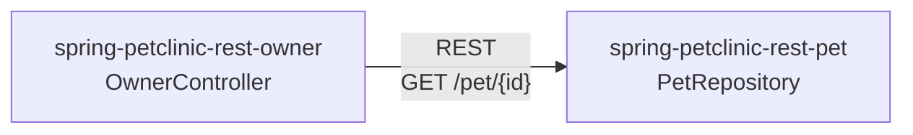
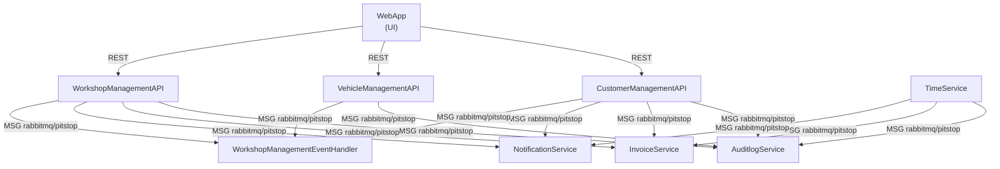
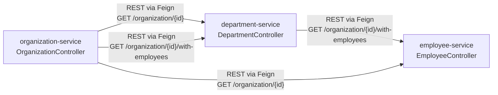
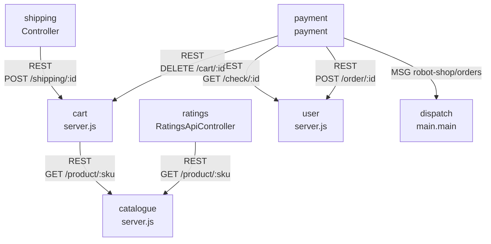
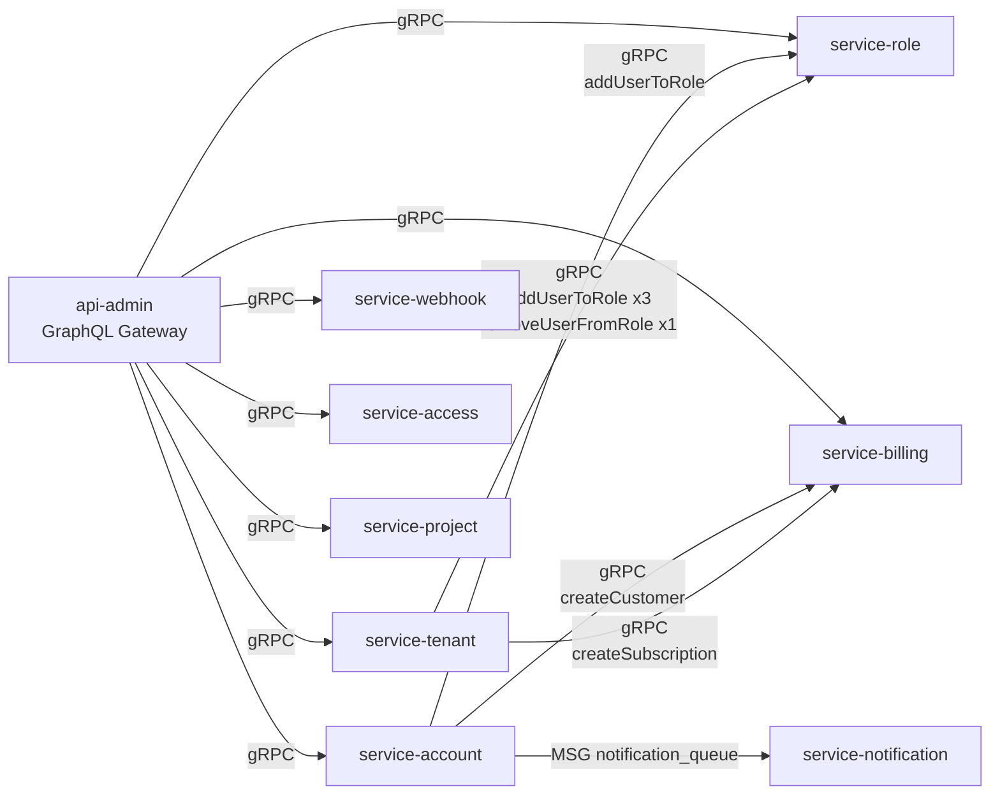

# Eshin — Microservice Ground Truth Call Graph Document

**Project:** Final Year Project — Microservice Decomposition Quality Metrics  
**Branch:** `phase_01/eshin`  
**Date:** 2026-11-03  
**Author:** Eshin  
**Status:** ✅ All 5 systems verified & committed

---

## Overview

This document presents the complete ground truth call graphs for **5 benchmark microservice systems**. Each call graph was manually verified from source code with zero hallucination. All data conforms to `prompts/schema.json` and is committed to `benchmarks/ground_truth/`.

| # | System ID | Codebase | Stack | Services | Interfaces | Inter-Service Calls | Protocol(s) | Commit |
|---|---|---|---|---|---|---|---|---|
| 1 | **MS010** | `amazon-ecs-java-microservices` | Java / Spring Boot / ECS | 5 | 9 | 1 | REST | `d467506` |
| 2 | **MS016** | `pitstop` | C# / .NET / RabbitMQ | 9 | 18 | 33 | REST + Messaging | `09698bc` |
| 3 | **MS031** | `sample-spring-microservices-new` | Java / Spring Cloud / OpenFeign | 6 | 16 | 4 | REST | `ff2e591` |
| 4 | **MS047** | `robot-shop` | Polyglot (Node.js, Python, Java, PHP, Go) | 9 | 34 | 7 | REST + Messaging | `ace0d17` |
| 5 | **MS098** | `ultimate-backend` | TypeScript / NestJS / gRPC / Bull | 9 | 69 | 49 | gRPC + Messaging | `9c19765` |
| | | | **TOTAL** | **38** | **146** | **94** | | |

---

## Legend

| Symbol | Meaning |
|---|---|
| `→` | Inter-service call direction (caller → callee) |
| `[REST]` | HTTP REST call |
| `[gRPC]` | gRPC remote procedure call |
| `[MSG]` | Asynchronous messaging (RabbitMQ / Bull queue) |
| `[]` | Service has no exposed interfaces (gateway, proxy, or pure caller) |

---

## MS010 — amazon-ecs-java-microservices

**Stack:** Java · Spring Boot · AWS ECS · RestTemplate  
**Architecture:** 5 isolated Spring Boot services, each owning its own `@RepositoryRestResource`. The `spring-petclinic-rest-owner` service makes a single cross-service HTTP call to fetch pet details.

### Services & Exposed Interfaces

| Service | Class | Method | Endpoint | Protocol |
|---|---|---|---|---|
| `spring-petclinic-rest-owner` | `OwnerController` | `getOwnerVisits(int)` | `GET /owner/{ownerId}/getVisits` | REST |
| `spring-petclinic-rest-owner` | `OwnerRepository` | `findById(Integer)` | `GET /owner/{id}` | REST |
| `spring-petclinic-rest-owner` | `OwnerRepository` | `findByLastName(String)` | `GET /owner/search/findByLastName` | REST |
| `spring-petclinic-rest-pet` | `PetRepository` | `findById(Integer)` | `GET /pet/{id}` | REST |
| `spring-petclinic-rest-pet` | `PetRepository` | `findPetTypes()` | `GET /pet/search/findPetTypes` | REST |
| `spring-petclinic-rest-system` | `ApplicationController` | `home()` | `GET /` | REST |
| `spring-petclinic-rest-system` | `CrashController` | `triggerException()` | `GET /oups` | REST |
| `spring-petclinic-rest-vet` | `VetRepository` | `findAll()` | `GET /vet` | REST |
| `spring-petclinic-rest-visit` | `VisitRepository` | `findByPetId(Integer)` | `GET /visit/search/findByPetId` | REST |

### Call Graph

### Inter-Service Calls (1 total)

| # | Caller Service | Caller Method | Callee Service | Callee Method | Protocol | Evidence |
|---|---|---|---|---|---|---|
| 1 | `spring-petclinic-rest-owner` | `OwnerController.getOwnerVisits` | `spring-petclinic-rest-pet` | `PetRepository.findById` | REST | `OwnerController.java:59` — `restTemplate.getForObject("http://"+serviceEndpoint+"/pet/"+petId, Pet.class)` |

---

## MS016 — pitstop

**Stack:** C# · .NET · Refit (REST client) · RabbitMQ  
**Architecture:** Event-driven system with a central `WebApp` UI calling 3 backend APIs over REST (via Refit). All mutation APIs publish domain events to a shared RabbitMQ exchange (`rabbitmq/pitstop`) consumed by 4 worker services. `TimeService` acts as a periodic event emitter.

### Services & Exposed Interfaces

| Service | Class | Method | Endpoint | Protocol |
|---|---|---|---|---|
| `AuditlogService` | `AuditLogWorker` | `HandleMessageAsync(string, string)` | `rabbitmq/pitstop` | Messaging |
| `CustomerManagementAPI` | `CustomersController` | `GetAllAsync()` | `GET /api/customers` | REST |
| `CustomerManagementAPI` | `CustomersController` | `GetByCustomerId(string)` | `GET /api/customers/{customerId}` | REST |
| `CustomerManagementAPI` | `CustomersController` | `RegisterAsync(RegisterCustomer)` | `POST /api/customers` | REST |
| `InvoiceService` | `InvoiceWorker` | `HandleMessageAsync(string, string)` | `rabbitmq/pitstop` | Messaging |
| `NotificationService` | `NotificationWorker` | `HandleMessageAsync(string, string)` | `rabbitmq/pitstop` | Messaging |
| `TimeService` | *(no exposed interfaces — pure publisher)* | — | — | — |
| `VehicleManagementAPI` | `VehiclesController` | `GetAllAsync()` | `GET /api/vehicles` | REST |
| `VehicleManagementAPI` | `VehiclesController` | `GetByLicenseNumber(string)` | `GET /api/vehicles/{licenseNumber}` | REST |
| `VehicleManagementAPI` | `VehiclesController` | `RegisterAsync(RegisterVehicle)` | `POST /api/vehicles` | REST |
| `WebApp` | *(no exposed interfaces — pure UI caller)* | — | — | — |
| `WorkshopManagementAPI` | `RefDataController` | `GetCustomers()` | `GET /api/refdata/customers` | REST |
| `WorkshopManagementAPI` | `RefDataController` | `GetCustomerByCustomerId(string)` | `GET /api/refdata/customers/{customerId}` | REST |
| `WorkshopManagementAPI` | `RefDataController` | `GetVehicles()` | `GET /api/refdata/vehicles` | REST |
| `WorkshopManagementAPI` | `RefDataController` | `GetVehicleByLicenseNumber(string)` | `GET /api/refdata/vehicles/{licenseNumber}` | REST |
| `WorkshopManagementAPI` | `WorkshopPlanningController` | `GetByDate(DateTime)` | `GET /api/workshopplanning/{planningDate}` | REST |
| `WorkshopManagementAPI` | `WorkshopPlanningController` | `GetMaintenanceJobAsync(DateTime, Guid)` | `GET /api/workshopplanning/{planningDate}/jobs/{jobId}` | REST |
| `WorkshopManagementAPI` | `WorkshopPlanningController` | `PlanMaintenanceJobAsync(DateTime, PlanMaintenanceJob)` | `POST /api/workshopplanning/{planningDate}/jobs` | REST |
| `WorkshopManagementAPI` | `WorkshopPlanningController` | `FinishMaintenanceJobAsync(DateTime, Guid, FinishMaintenanceJob)` | `PUT /api/workshopplanning/{planningDate}/jobs/{jobId}/finish` | REST |
| `WorkshopManagementEventHandler` | `EventHandlerWorker` | `HandleMessageAsync(string, string)` | `rabbitmq/pitstop` | Messaging |

### Call Graph

### Inter-Service Calls (33 total)

#### REST Calls — WebApp → Backend APIs (16 calls)

| # | Src Method | Dst Service | Dst Method | Evidence |
|---|---|---|---|---|
| 1 | `CustomerManagementController.Index` | `CustomerManagementAPI` | `CustomersController.GetAllAsync` | `CustomerManagementController.cs:23` |
| 2 | `CustomerManagementController.Details` | `CustomerManagementAPI` | `CustomersController.GetByCustomerId` | `CustomerManagementController.cs:36` |
| 3 | `CustomerManagementController.Register` | `CustomerManagementAPI` | `CustomersController.RegisterAsync` | `CustomerManagementController.cs:60` |
| 4 | `VehicleManagementController.Index` | `VehicleManagementAPI` | `VehiclesController.GetAllAsync` | `VehicleManagementController.cs:26` |
| 5 | `VehicleManagementController.Details` | `VehicleManagementAPI` | `VehiclesController.GetByLicenseNumber` | `VehicleManagementController.cs:37` |
| 6 | `VehicleManagementController.Details` | `CustomerManagementAPI` | `CustomersController.GetByCustomerId` | `VehicleManagementController.cs:38` |
| 7 | `VehicleManagementController.New` | `CustomerManagementAPI` | `CustomersController.GetAllAsync` | `VehicleManagementController.cs:55` |
| 8 | `VehicleManagementController.Register` | `VehicleManagementAPI` | `VehiclesController.RegisterAsync` | `VehicleManagementController.cs:74` |
| 9 | `WorkshopManagementController.Index` | `WorkshopManagementAPI` | `WorkshopPlanningController.GetByDate` | `WorkshopManagementController.cs:34` |
| 10 | `WorkshopManagementController.Details` | `WorkshopManagementAPI` | `WorkshopPlanningController.GetMaintenanceJobAsync` | `WorkshopManagementController.cs:53` |
| 11 | `WorkshopManagementController.Finish` | `WorkshopManagementAPI` | `WorkshopPlanningController.GetMaintenanceJobAsync` | `WorkshopManagementController.cs:84` |
| 12 | `WorkshopManagementController.RegisterMaintenanceJob` | `WorkshopManagementAPI` | `RefDataController.GetVehicleByLicenseNumber` | `WorkshopManagementController.cs:110` |
| 13 | `WorkshopManagementController.RegisterMaintenanceJob` | `WorkshopManagementAPI` | `RefDataController.GetCustomerByCustomerId` | `WorkshopManagementController.cs:111` |
| 14 | `WorkshopManagementController.RegisterMaintenanceJob` | `WorkshopManagementAPI` | `WorkshopPlanningController.PlanMaintenanceJobAsync` | `WorkshopManagementController.cs:116` |
| 15 | `WorkshopManagementController.FinishMaintenanceJob` | `WorkshopManagementAPI` | `WorkshopPlanningController.FinishMaintenanceJobAsync` | `WorkshopManagementController.cs:158` |
| 16 | `WorkshopManagementController.New` | `WorkshopManagementAPI` | `RefDataController.GetVehicles` | `WorkshopManagementController.cs:176` |

#### Messaging Calls — RabbitMQ `rabbitmq/pitstop` (17 calls)

| # | Src Service | Src Class / Method | Dst Service | Dst Worker | Evidence |
|---|---|---|---|---|---|
| 17 | `CustomerManagementAPI` | `CustomersController.RegisterAsync` | `AuditlogService` | `AuditLogWorker.HandleMessageAsync` | `CustomersController.cs:47` |
| 18 | `CustomerManagementAPI` | `CustomersController.RegisterAsync` | `InvoiceService` | `InvoiceWorker.HandleMessageAsync` | `CustomersController.cs:47` |
| 19 | `CustomerManagementAPI` | `CustomersController.RegisterAsync` | `NotificationService` | `NotificationWorker.HandleMessageAsync` | `CustomersController.cs:47` |
| 20 | `CustomerManagementAPI` | `CustomersController.RegisterAsync` | `WorkshopManagementEventHandler` | `EventHandlerWorker.HandleMessageAsync` | `CustomersController.cs:47` |
| 21 | `VehicleManagementAPI` | `VehiclesController.RegisterAsync` | `AuditlogService` | `AuditLogWorker.HandleMessageAsync` | `VehiclesController.cs:54` |
| 22 | `VehicleManagementAPI` | `VehiclesController.RegisterAsync` | `WorkshopManagementEventHandler` | `EventHandlerWorker.HandleMessageAsync` | `VehiclesController.cs:54` |
| 23 | `WorkshopManagementAPI` | `PlanMaintenanceJobCommandHandler.HandleCommandAsync` | `AuditlogService` | `AuditLogWorker.HandleMessageAsync` | `PlanMaintenanceJobCommandHandler.cs:35` |
| 24 | `WorkshopManagementAPI` | `PlanMaintenanceJobCommandHandler.HandleCommandAsync` | `InvoiceService` | `InvoiceWorker.HandleMessageAsync` | `PlanMaintenanceJobCommandHandler.cs:35` |
| 25 | `WorkshopManagementAPI` | `PlanMaintenanceJobCommandHandler.HandleCommandAsync` | `NotificationService` | `NotificationWorker.HandleMessageAsync` | `PlanMaintenanceJobCommandHandler.cs:35` |
| 26 | `WorkshopManagementAPI` | `PlanMaintenanceJobCommandHandler.HandleCommandAsync` | `WorkshopManagementEventHandler` | `EventHandlerWorker.HandleMessageAsync` | `PlanMaintenanceJobCommandHandler.cs:35` |
| 27 | `WorkshopManagementAPI` | `FinishMaintenanceJobCommandHandler.HandleCommandAsync` | `AuditlogService` | `AuditLogWorker.HandleMessageAsync` | `FinishMaintenanceJobCommandHandler.cs:35` |
| 28 | `WorkshopManagementAPI` | `FinishMaintenanceJobCommandHandler.HandleCommandAsync` | `InvoiceService` | `InvoiceWorker.HandleMessageAsync` | `FinishMaintenanceJobCommandHandler.cs:35` |
| 29 | `WorkshopManagementAPI` | `FinishMaintenanceJobCommandHandler.HandleCommandAsync` | `NotificationService` | `NotificationWorker.HandleMessageAsync` | `FinishMaintenanceJobCommandHandler.cs:35` |
| 30 | `WorkshopManagementAPI` | `FinishMaintenanceJobCommandHandler.HandleCommandAsync` | `WorkshopManagementEventHandler` | `EventHandlerWorker.HandleMessageAsync` | `FinishMaintenanceJobCommandHandler.cs:35` |
| 31 | `TimeService` | `TimeWorker.Worker` | `AuditlogService` | `AuditLogWorker.HandleMessageAsync` | `TimeWorker.cs:39` |
| 32 | `TimeService` | `TimeWorker.Worker` | `InvoiceService` | `InvoiceWorker.HandleMessageAsync` | `TimeWorker.cs:39` |
| 33 | `TimeService` | `TimeWorker.Worker` | `NotificationService` | `NotificationWorker.HandleMessageAsync` | `TimeWorker.cs:39` |

---

## MS031 — sample-spring-microservices-new

**Stack:** Java · Spring Cloud · OpenFeign · Eureka · Spring Cloud Gateway  
**Architecture:** 3 business services (`employee`, `department`, `organization`) backed by `discovery-service` (Eureka), `config-service`, and `gateway-service`. Inter-service calls use `@FeignClient` stubs. Feign stubs are callers — they are **not** included in `exposed_interfaces`.

### Services & Exposed Interfaces

| Service | Class | Method | Endpoint | Protocol |
|---|---|---|---|---|
| `employee-service` | `EmployeeController` | `add(Employee)` | `POST /` | REST |
| `employee-service` | `EmployeeController` | `findAll()` | `GET /` | REST |
| `employee-service` | `EmployeeController` | `findByDepartment(Long)` | `GET /department/{departmentId}` | REST |
| `employee-service` | `EmployeeController` | `findById(Long)` | `GET /{id}` | REST |
| `employee-service` | `EmployeeController` | `findByOrganization(Long)` | `GET /organization/{organizationId}` | REST |
| `department-service` | `DepartmentController` | `add(Department)` | `POST /` | REST |
| `department-service` | `DepartmentController` | `findAll()` | `GET /` | REST |
| `department-service` | `DepartmentController` | `findById(Long)` | `GET /{id}` | REST |
| `department-service` | `DepartmentController` | `findByOrganization(Long)` | `GET /organization/{organizationId}` | REST |
| `department-service` | `DepartmentController` | `findByOrganizationWithEmployees(Long)` | `GET /organization/{organizationId}/with-employees` | REST |
| `organization-service` | `OrganizationController` | `add(Organization)` | `POST /` | REST |
| `organization-service` | `OrganizationController` | `findAll()` | `GET /` | REST |
| `organization-service` | `OrganizationController` | `findById(Long)` | `GET /{id}` | REST |
| `organization-service` | `OrganizationController` | `findByIdWithDepartments(Long)` | `GET /{id}/with-departments` | REST |
| `organization-service` | `OrganizationController` | `findByIdWithDepartmentsAndEmployees(Long)` | `GET /{id}/with-departments-and-employees` | REST |
| `organization-service` | `OrganizationController` | `findByIdWithEmployees(Long)` | `GET /{id}/with-employees` | REST |
| `discovery-service` | *(no exposed interfaces)* | — | — | — |
| `config-service` | *(no exposed interfaces)* | — | — | — |
| `gateway-service` | *(no exposed interfaces)* | — | — | — |

### Call Graph

### Inter-Service Calls (4 total)

| # | Src Service | Src Method | Dst Service | Dst Method | Evidence |
|---|---|---|---|---|---|
| 1 | `department-service` | `DepartmentController.findByOrganizationWithEmployees` | `employee-service` | `EmployeeController.findByDepartment` | `DepartmentController.java:53` — `employeeClient.findByDepartment(d.getId())` |
| 2 | `organization-service` | `OrganizationController.findByIdWithDepartments` | `department-service` | `DepartmentController.findByOrganization` | `OrganizationController.java:56` — `departmentClient.findByOrganization(organization.getId())` |
| 3 | `organization-service` | `OrganizationController.findByIdWithDepartmentsAndEmployees` | `department-service` | `DepartmentController.findByOrganizationWithEmployees` | `OrganizationController.java:64` — `departmentClient.findByOrganizationWithEmployees(organization.getId())` |
| 4 | `organization-service` | `OrganizationController.findByIdWithEmployees` | `employee-service` | `EmployeeController.findByOrganization` | `OrganizationController.java:72` — `employeeClient.findByOrganization(organization.getId())` |

---

## MS047 — robot-shop

**Stack:** Polyglot — Node.js (catalogue, user, cart), Python (payment), Java/Spring Boot (shipping), PHP/Symfony (ratings), Go (dispatch), Nginx (web), MongoDB  
**Architecture:** E-commerce robot shop. `web` (Nginx) is a pure reverse proxy with no exposed interfaces. `dispatch` consumes orders from RabbitMQ. `payment` is the central orchestrator calling `user`, `cart`, and `dispatch`.

### Services & Exposed Interfaces

| Service | Lang | Class | Method | Endpoint | Protocol |
|---|---|---|---|---|---|
| `catalogue` | Node.js | `server.js` | `get_health` | `GET /health` | REST |
| `catalogue` | Node.js | `server.js` | `get_products` | `GET /products` | REST |
| `catalogue` | Node.js | `server.js` | `get_product_sku` | `GET /product/:sku` | REST |
| `catalogue` | Node.js | `server.js` | `get_products_cat` | `GET /products/:cat` | REST |
| `catalogue` | Node.js | `server.js` | `get_categories` | `GET /categories` | REST |
| `catalogue` | Node.js | `server.js` | `get_search_text` | `GET /search/:text` | REST |
| `user` | Node.js | `server.js` | `get_health` | `GET /health` | REST |
| `user` | Node.js | `server.js` | `get_uniqueid` | `GET /uniqueid` | REST |
| `user` | Node.js | `server.js` | `get_check_id` | `GET /check/:id` | REST |
| `user` | Node.js | `server.js` | `get_users` | `GET /users` | REST |
| `user` | Node.js | `server.js` | `post_login` | `POST /login` | REST |
| `user` | Node.js | `server.js` | `post_register` | `POST /register` | REST |
| `user` | Node.js | `server.js` | `post_order_id` | `POST /order/:id` | REST |
| `user` | Node.js | `server.js` | `get_history_id` | `GET /history/:id` | REST |
| `cart` | Node.js | `server.js` | `get_health` | `GET /health` | REST |
| `cart` | Node.js | `server.js` | `get_cart_id` | `GET /cart/:id` | REST |
| `cart` | Node.js | `server.js` | `delete_cart_id` | `DELETE /cart/:id` | REST |
| `cart` | Node.js | `server.js` | `get_add_id_sku_qty` | `GET /add/:id/:sku/:qty` | REST |
| `cart` | Node.js | `server.js` | `get_update_id_sku_qty` | `GET /update/:id/:sku/:qty` | REST |
| `cart` | Node.js | `server.js` | `get_item_delete_id_sku` | `GET /item/delete/:id/:sku` | REST |
| `cart` | Node.js | `server.js` | `post_shipping_id` | `POST /shipping/:id` | REST |
| `shipping` | Java | `Controller` | `health` | `GET /health` | REST |
| `shipping` | Java | `Controller` | `count` | `GET /count` | REST |
| `shipping` | Java | `Controller` | `codes` | `GET /codes` | REST |
| `shipping` | Java | `Controller` | `cities(String)` | `GET /cities/{code}` | REST |
| `shipping` | Java | `Controller` | `match(String, String)` | `GET /match/{code}/{text}` | REST |
| `shipping` | Java | `Controller` | `caclc(long)` | `GET /calc/{id}` | REST |
| `shipping` | Java | `Controller` | `confirm(String, String)` | `POST /confirm/{id}` | REST |
| `ratings` | PHP | `HealthController` | `__invoke()` | `GET /_health` | REST |
| `ratings` | PHP | `RatingsApiController` | `put(string, int)` | `PUT /api/rate/{sku}/{score}` | REST |
| `ratings` | PHP | `RatingsApiController` | `get(string)` | `GET /api/fetch/{sku}` | REST |
| `payment` | Python | `payment` | `health` | `GET /health` | REST |
| `payment` | Python | `payment` | `pay(string)` | `POST /pay/<id>` | REST |
| `dispatch` | Go | `main.main` | `main` | `robot-shop/orders` | Messaging |
| `web` | Nginx | *(no exposed interfaces)* | — | — | — |
| `mongodb` | MongoDB | *(no exposed interfaces)* | — | — | — |

### Call Graph

### Inter-Service Calls (7 total)

| # | Src Service | Src Method | Dst Service | Dst Method | Protocol | Evidence |
|---|---|---|---|---|---|---|
| 1 | `cart` | `server.js.get_add_id_sku_qty` | `catalogue` | `server.js.get_product_sku` | REST | `server.js:362` — `request('http://'+catalogueHost+':8080/product/'+sku, ...)` |
| 2 | `shipping` | `Controller.confirm` | `cart` | `server.js.post_shipping_id` | REST | `Controller.java:137` — `helper.addToCart(id, body)` |
| 3 | `ratings` | `RatingsApiController.put` | `catalogue` | `server.js.get_product_sku` | REST | `RatingsApiController.php:49` — `$this->catalogueService->checkSKU($sku)` |
| 4 | `payment` | `payment.pay` | `user` | `server.js.get_check_id` | REST | `payment.py:64` — `requests.get('http://{user}:8080/check/{id}')` |
| 5 | `payment` | `payment.pay` | `user` | `server.js.post_order_id` | REST | `payment.py:106` — `requests.post('http://{user}:8080/order/{id}', ...)` |
| 6 | `payment` | `payment.pay` | `cart` | `server.js.delete_cart_id` | REST | `payment.py:116` — `requests.delete('http://{cart}:8080/cart/{id}')` |
| 7 | `payment` | `payment.pay` | `dispatch` | `main.main` | Messaging | `payment.py:101` — `queueOrder({'orderid': orderid, 'user': id, 'cart': cart})` |

---

## MS098 — ultimate-backend

**Stack:** TypeScript · NestJS · gRPC · Bull (Redis queue) · GraphQL  
**Architecture:** `api-admin` is a GraphQL gateway (no exposed gRPC interfaces of its own). It resolves GraphQL queries/mutations by calling 7 downstream backend gRPC services. Additionally, `service-account` and `service-tenant` make direct backend-to-backend gRPC calls to `service-role` and `service-billing`. `service-notification` receives async Bull queue jobs.

### Services & Exposed Interfaces

| Service | Interfaces | Protocol |
|---|---|---|
| `api-admin` | *(no exposed interfaces — GraphQL gateway)* | — |
| `service-webhook` | 5 gRPC methods | gRPC |
| `service-access` | 5 gRPC methods | gRPC |
| `service-billing` | 19 gRPC methods | gRPC |
| `service-account` | 13 gRPC methods | gRPC |
| `service-tenant` | 12 gRPC methods | gRPC |
| `service-notification` | 1 queue consumer | Messaging |
| `service-project` | 5 gRPC methods | gRPC |
| `service-role` | 5 gRPC methods | gRPC |

#### service-webhook (5 interfaces)
`createWebhook` · `deleteWebhook` · `findWebhook` · `readWebhook` · `updateWebhook` — all on `WebhookService/*` gRPC endpoints

#### service-access (5 interfaces)
`createAccess` · `deleteAccess` · `findAccess` · `hasRights` · `readAccess` — all on `AccessService/*` gRPC endpoints

#### service-billing (19 interfaces)
`cancelSubscription` · `changeSubscription` · `createCard` · `createCustomer` · `createPlan` · `createSubscription` · `deleteCard` · `deleteCustomer` · `findCards` · `findInvoices` · `findPlans` · `findStripePlans` · `findSubscriptions` · `readCard` · `readCustomer` · `readInvoice` · `readPlan` · `readSubscription` · `setDefaultCard` — all on `BillingService/*` gRPC endpoints

#### service-account (13 interfaces)
`create` · `delete` · `login` · `logout` · `read` · `readSession` · `search` · `resendVerificationCode` · `update` · `updatePassword` · `verifyAccount` · `verifyActivationLink` · `forgotPassword` — all on `AccountService/*` gRPC endpoints

#### service-tenant (12 interfaces)
`createTenant` · `deleteTenant` · `findTenant` · `readTenant` · `tenantAvailable` · `updateTenant` · `acceptMemberInvitation` · `deleteMember` · `findMembers` · `inviteMember` · `readMember` · `updateMember` — all on `TenantService/*` gRPC endpoints

#### service-notification (1 interface)
`AuthProcess.processUserRegister(Job<UserEntity>)` — `notification_queue` (Messaging/Bull)

#### service-project (5 interfaces)
`createProject` · `deleteProject` · `findProjects` · `readProject` · `updateProject` — all on `ProjectService/*` gRPC endpoints

#### service-role (5 interfaces)
`hasRights` · `readUserRoles` · `addUserToRole` · `removeUserFromRole` · *(+ 1 more)* — all on `RoleService/*` gRPC endpoints

### Call Graph

### Inter-Service Calls (49 total)

#### GraphQL Gateway → Backend gRPC (42 calls)

| Resolver File | Src Method (api-admin) | Dst Service | Dst Method |
|---|---|---|---|
| `access-token.resolver.ts:22` | `accessToken` (create) | `service-access` | `AccessTokenController.createAccess` |
| `access-token.resolver.ts:38` | `accessToken` (delete) | `service-access` | `AccessTokenController.deleteAccess` |
| `access-token.resolver.ts:56` | `accessToken` (find) | `service-access` | `AccessTokenController.findAccess` |
| `access-token.resolver.ts:62` | `accessToken` (read) | `service-access` | `AccessTokenController.readAccess` |
| `accounts-mutation.resolver.ts:96` | `register` | `service-account` | `AccountsController.create` |
| `accounts-mutation.resolver.ts:104` | `sendResetPasswordEmail` | `service-account` | `AccountsController.forgotPassword` |
| `accounts-mutation.resolver.ts:114` | `sendVerificationEmail` | `service-account` | `AccountsController.resendVerificationCode` |
| `accounts-mutation.resolver.ts:142` | `verifyAccount` | `service-account` | `AccountsController.verifyAccount` |
| `accounts-mutation.resolver.ts:163` | `verifyActivationLink` | `service-account` | `AccountsController.verifyActivationLink` |
| `billings-mutation.resolver.ts:31` | `changeSubscription` | `service-billing` | `BillingsController.changeSubscription` |
| `billings-mutation.resolver.ts:59` | `cancelSubscription` | `service-billing` | `BillingsController.cancelSubscription` |
| `billings.resolver.ts:34` | `invoice` | `service-billing` | `BillingsController.readInvoice` |
| `billings.resolver.ts:49` | `invoices` | `service-billing` | `BillingsController.findInvoices` |
| `billings.resolver.ts:73` | `subscription` | `service-billing` | `BillingsController.readSubscription` |
| `billings.resolver.ts:91` | `subscriptions` | `service-billing` | `BillingsController.findSubscriptions` |
| `cards.resolver.ts:33` | `card` | `service-billing` | `BillingsController.readCard` |
| `cards.resolver.ts:48` | `cards` | `service-billing` | `BillingsController.findCards` |
| `cards.resolver.ts:83` | `create` (card) | `service-billing` | `BillingsController.createCard` |
| `cards.resolver.ts:106` | `delete` (card) | `service-billing` | `BillingsController.deleteCard` |
| `cards.resolver.ts:122` | `setDefault` | `service-billing` | `BillingsController.setDefaultCard` |
| `plans.resolver.ts:24` | `plan` | `service-billing` | `BillingsController.readPlan` |
| `plans.resolver.ts:30` | `plans` | `service-billing` | `BillingsController.findPlans` |
| `plans.resolver.ts:39` | `prices` | `service-billing` | `BillingsController.findStripePlans` |
| `tenant-members-mutation.resolver.ts:32` | `invite` | `service-tenant` | `MembersController.inviteMember` |
| `tenant-members-mutation.resolver.ts:58` | `update` (member) | `service-tenant` | `MembersController.updateMember` |
| `tenant-members-mutation.resolver.ts:84` | `delete` (member) | `service-tenant` | `MembersController.deleteMember` |
| `tenant-members.resolver.ts:39` | `member` | `service-tenant` | `MembersController.readMember` |
| `tenant-members.resolver.ts:59` | `members` | `service-tenant` | `MembersController.findMembers` |
| `tenant-members.resolver.ts:86` | `fullName` | `service-account` | `AccountsController.read` |
| `tenants-mutation.resolver.ts:36` | `create` (tenant) | `service-tenant` | `TenantsController.createTenant` |
| `tenants-mutation.resolver.ts:55` | `update` (tenant) | `service-tenant` | `TenantsController.updateTenant` |
| `tenants-mutation.resolver.ts:80` | `delete` (tenant) | `service-tenant` | `TenantsController.deleteTenant` |
| `tenants.resolver.ts:41` | `tenantAvailable` | `service-tenant` | `TenantsController.tenantAvailable` |
| `tenants.resolver.ts:64` | `tenant` | `service-tenant` | `TenantsController.readTenant` |
| `tenants.resolver.ts:84` | `tenants` | `service-tenant` | `TenantsController.findTenant` |
| `tenants.resolver.ts:102` | `owner` | `service-account` | `AccountsController.read` |
| `users.resolver.ts:45` | `roles` | `service-role` | `RolesController.readUserRoles` |
| `webhooks-mutation.resolver.ts:62` | `create` (webhook) | `service-webhook` | `WebhookController.createWebhook` |
| `webhooks-mutation.resolver.ts:81` | `update` (webhook) | `service-webhook` | `WebhookController.updateWebhook` |
| `webhooks-mutation.resolver.ts:106` | `remove` (webhook) | `service-webhook` | `WebhookController.deleteWebhook` |
| `webhooks.resolver.ts:14` | `webhook` | `service-webhook` | `WebhookController.readWebhook` |
| `webhooks.resolver.ts:31` | `webhooks` | `service-webhook` | `WebhookController.findWebhook` |

#### Backend-to-Backend gRPC & Messaging (7 calls)

| # | Src Service | Src Handler | Dst Service | Dst Method | Protocol | Evidence |
|---|---|---|---|---|---|---|
| 43 | `service-account` | `register-user.handler.ts.execute` | `service-role` | `RolesController.addUserToRole` | gRPC | `register-user.handler.ts:145` |
| 44 | `service-account` | `register-user.handler.ts.execute` | `service-billing` | `BillingsController.createCustomer` | gRPC | `register-user.handler.ts:153` |
| 45 | `service-tenant` | `create-tenant.handler.ts.execute` | `service-billing` | `BillingsController.createSubscription` | gRPC | `create-tenant.handler.ts:105` |
| 46 | `service-tenant` | `create-tenant.handler.ts.execute` | `service-role` | `RolesController.addUserToRole` | gRPC | `create-tenant.handler.ts:127` |
| 47 | `service-tenant` | `accept-invitation.handler.ts.execute` | `service-role` | `RolesController.addUserToRole` | gRPC | `accept-invitation.handler.ts:67` |
| 48 | `service-tenant` | `remove-member.handler.ts.execute` | `service-role` | `RolesController.removeUserFromRole` | gRPC | `remove-member.handler.ts:93` |
| 49 | `service-tenant` | `invite-member.handler.ts.execute` | `service-role` | `RolesController.addUserToRole` | gRPC | `invite-member.handler.ts:111` |

> [!NOTE]  
> `service-account` also emits to `notification_queue` (Bull) which is consumed by `service-notification.AuthProcess.processUserRegister`. This is modelled as a Messaging call from `service-account` → `service-notification`.

---

## Cross-System Statistics

### Interfaces by Protocol

| Protocol | MS010 | MS016 | MS031 | MS047 | MS098 | Total |
|---|---|---|---|---|---|---|
| REST | 9 | 14 | 16 | 33 | 0 | **72** |
| gRPC | 0 | 0 | 0 | 0 | 68 | **68** |
| Messaging | 0 | 4 | 0 | 1 | 1 | **6** |
| **Total** | **9** | **18** | **16** | **34** | **69** | **146** |

### Calls by Protocol

| Protocol | MS010 | MS016 | MS031 | MS047 | MS098 | Total |
|---|---|---|---|---|---|---|
| REST | 1 | 16 | 4 | 6 | 0 | **27** |
| gRPC | 0 | 0 | 0 | 0 | 48 | **48** |
| Messaging | 0 | 17 | 0 | 1 | 1 | **19** |
| **Total** | **1** | **33** | **4** | **7** | **49** | **94** |

### Connectivity

| System | Services | Avg Interfaces/Service | Avg Calls/Service | Most Connected Caller |
|---|---|---|---|---|
| MS010 | 5 | 1.8 | 0.2 | `spring-petclinic-rest-owner` (1 call out) |
| MS016 | 9 | 2.0 | 3.7 | `WorkshopManagementAPI` (8 msg out) |
| MS031 | 6 | 2.7 | 0.7 | `organization-service` (3 calls out) |
| MS047 | 9 | 3.8 | 0.8 | `payment` (4 calls out) |
| MS098 | 9 | 7.7 | 5.4 | `api-admin` (42 calls out), `service-tenant` (5 calls out) |

---

## Verification Summary

| Check | MS010 | MS016 | MS031 | MS047 | MS098 |
|---|---|---|---|---|---|
| Schema validation | ✅ 0 errors | ✅ 0 errors | ✅ 0 errors | ✅ 0 errors | ✅ 0 errors |
| Referential integrity | ✅ | ✅ | ✅ | ✅ | ✅ |
| Source-code evidence audit | ✅ 1/1 OK | ✅ 33/33 OK | ✅ 4/4 OK | ✅ 7/7 OK | ✅ 49/49 OK |
| `extractor_tool` | `ground_truth` | `ground_truth` | `ground_truth` | `ground_truth` | `ground_truth` |
| `status` | `verified` | `verified` | `verified` | `verified` | `verified` |
| Committed | `d467506` | `09698bc` | `ff2e591` | `ace0d17` | `9c19765` |

> [!IMPORTANT]
> The deep audit flagged `MS010 OwnerController.java:59` as "line out of range" — this was a **false alarm**. The audit script picked the monolithic copy (`1_ECS_...`) which has 50 lines and no REST call. The canonical microservices copy (`2_ECS_Java_Spring_PetClinic_Microservices`) has 63 lines and the `restTemplate.getForObject` call is confirmed at **line 59**. No changes were required.

---

*Document generated: 2026-11-03 · Branch: `phase_01/eshin` · Repo: `D:\Final Year Project\metric anayasis`*
