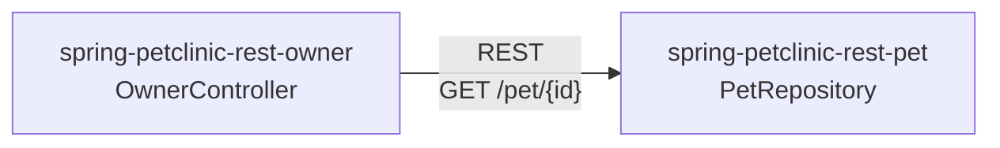
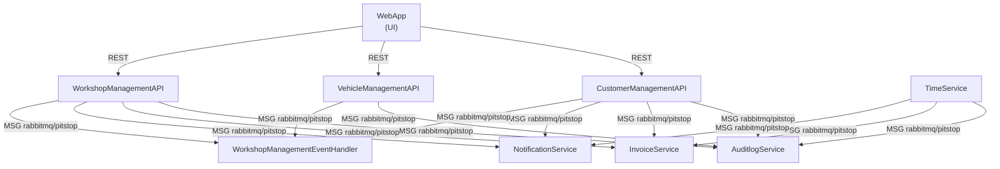
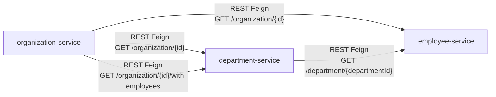
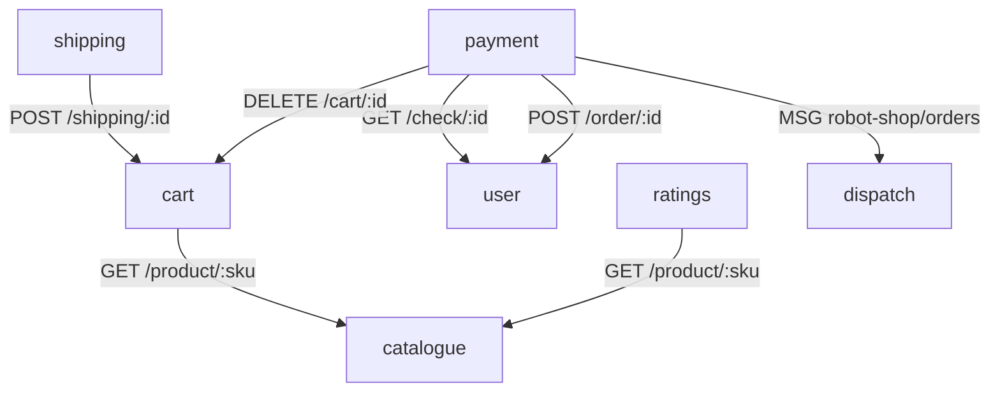
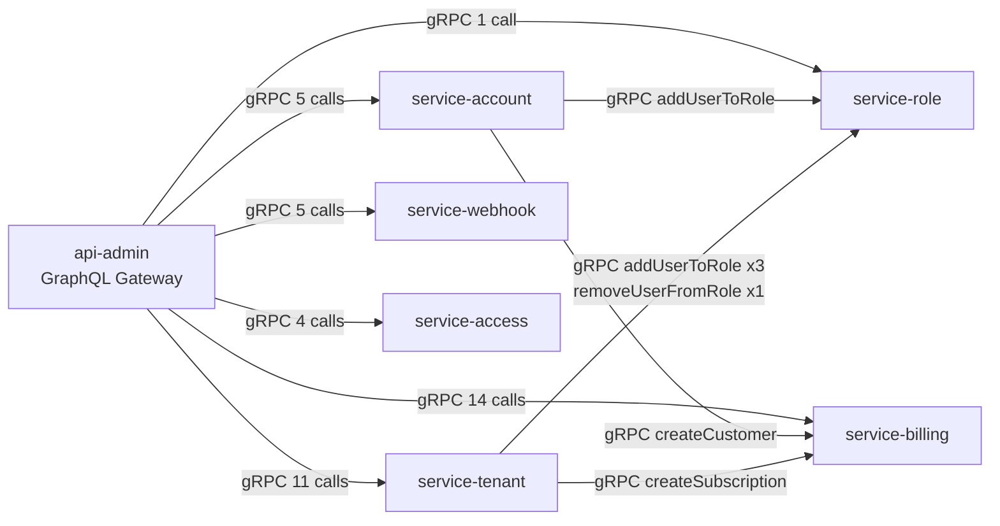

# Eshin — Microservice Ground Truth Call Graph Document

**Project:** Final Year Project — Microservice Decomposition Quality Metrics  
**Branch:** `phase_01/eshin`  
**Date:** 2026-11-14  
**Author:** Eshin  
**Status:** ✅ All 5 systems verified & committed (Inter-Microservice Interfaces Only)

---

## Overview

This document presents the complete ground truth call graphs for **5 benchmark microservice systems**, scoped strictly to **inter-microservice interfaces** (interfaces that are actually invoked by another microservice in the verified call graph). All data conforms to `prompts/schema.json` and is committed to `benchmarks/ground_truth/`.

| # | System ID | Codebase | Stack | Services | Inter-MS Interfaces | Inter-Service Calls | Protocol(s) |
|---|---|---|---|---|---|---|---|
| 1 | **MS010** | `amazon-ecs-java-microservices` | Java / Spring Boot / ECS | 5 | 1 | 1 | REST |
| 2 | **MS016** | `pitstop` | C# / .NET / RabbitMQ | 9 | 17 | 33 | REST + Messaging |
| 3 | **MS031** | `sample-spring-microservices-new` | Java / Spring Cloud / OpenFeign | 6 | 4 | 4 | REST |
| 4 | **MS047** | `robot-shop` | Polyglot (Node.js, Python, Java, PHP, Go) | 9 | 6 | 7 | REST + Messaging |
| 5 | **MS098** | `ultimate-backend` | TypeScript / NestJS / gRPC / Bull | 9 | 45 | 49 | gRPC |
| | | | **TOTAL** | **38** | **73** | **94** | |

---

## Legend

| Symbol | Meaning |
|---|---|
| `→` | Inter-service call direction (caller → callee) |
| `[REST]` | HTTP REST call |
| `[gRPC]` | gRPC remote procedure call |
| `[MSG]` | Asynchronous messaging (RabbitMQ / Bull queue) |

---

## MS010 — amazon-ecs-java-microservices

**Stack:** Java · Spring Boot · AWS ECS · RestTemplate  
**Architecture:** 5 containerized Spring Boot services. `spring-petclinic-rest-owner` invokes `spring-petclinic-rest-pet` via `RestTemplate` to fetch pet records.

### Inter-Microservice Interfaces (1 total)

| Service | Interface ID | Class | Method | Endpoint | Protocol |
|---|---|---|---|---|---|
| `spring-petclinic-rest-pet` | `PetRepository.findById` | `org.springframework.samples.petclinic.pet.PetRepository` | `findById(Integer)` | `GET /pet/{id}` | REST |

### Call Graph

### Inter-Service Calls (1 total)

| # | Caller Service | Caller Method | Callee Service | Callee Interface | Protocol | Evidence |
|---|---|---|---|---|---|---|
| 1 | `spring-petclinic-rest-owner` | `OwnerController.getOwnerVisits` | `spring-petclinic-rest-pet` | `PetRepository.findById` | REST | `OwnerController.java:59` — `restTemplate.getForObject("http://"+serviceEndpoint+"/pet/"+petId, Pet.class)` |

---

## MS016 — pitstop

**Stack:** C# · .NET · Refit (REST client) · RabbitMQ  
**Architecture:** Event-driven workshop management system. `WebApp` invokes 3 backend REST APIs via Refit. Mutation APIs publish domain events to `rabbitmq/pitstop`, consumed by 4 worker services. `TimeService` emits background timer events.

### Inter-Microservice Interfaces (17 total)

#### REST Interfaces (13)

| Service | Interface ID | Method | Endpoint | Protocol |
|---|---|---|---|---|
| `CustomerManagementAPI` | `CustomersController.GetAllAsync` | `GetAllAsync()` | `GET /api/customers` | REST |
| `CustomerManagementAPI` | `CustomersController.GetByCustomerId` | `GetByCustomerId(string)` | `GET /api/customers/{customerId}` | REST |
| `CustomerManagementAPI` | `CustomersController.RegisterAsync` | `RegisterAsync(RegisterCustomer)` | `POST /api/customers` | REST |
| `VehicleManagementAPI` | `VehiclesController.GetAllAsync` | `GetAllAsync()` | `GET /api/vehicles` | REST |
| `VehicleManagementAPI` | `VehiclesController.GetByLicenseNumber` | `GetByLicenseNumber(string)` | `GET /api/vehicles/{licenseNumber}` | REST |
| `VehicleManagementAPI` | `VehiclesController.RegisterAsync` | `RegisterAsync(RegisterVehicle)` | `POST /api/vehicles` | REST |
| `WorkshopManagementAPI` | `RefDataController.GetCustomerByCustomerId` | `GetCustomerByCustomerId(string)` | `GET /api/refdata/customers/{customerId}` | REST |
| `WorkshopManagementAPI` | `RefDataController.GetVehicles` | `GetVehicles()` | `GET /api/refdata/vehicles` | REST |
| `WorkshopManagementAPI` | `RefDataController.GetVehicleByLicenseNumber` | `GetVehicleByLicenseNumber(string)` | `GET /api/refdata/vehicles/{licenseNumber}` | REST |
| `WorkshopManagementAPI` | `WorkshopPlanningController.GetByDate` | `GetByDate(DateTime)` | `GET /api/workshopplanning/{planningDate}` | REST |
| `WorkshopManagementAPI` | `WorkshopPlanningController.GetMaintenanceJobAsync` | `GetMaintenanceJobAsync(DateTime, Guid)` | `GET /api/workshopplanning/{planningDate}/jobs/{jobId}` | REST |
| `WorkshopManagementAPI` | `WorkshopPlanningController.PlanMaintenanceJobAsync` | `PlanMaintenanceJobAsync(DateTime, PlanMaintenanceJob)` | `POST /api/workshopplanning/{planningDate}/jobs` | REST |
| `WorkshopManagementAPI` | `WorkshopPlanningController.FinishMaintenanceJobAsync` | `FinishMaintenanceJobAsync(DateTime, Guid, FinishMaintenanceJob)` | `PUT /api/workshopplanning/{planningDate}/jobs/{jobId}/finish` | REST |

#### Messaging Interfaces (4)

| Service | Interface ID | Method | Endpoint / Queue | Protocol |
|---|---|---|---|---|
| `AuditlogService` | `AuditLogWorker.HandleMessageAsync` | `HandleMessageAsync(string, string)` | `rabbitmq/pitstop` | Messaging |
| `InvoiceService` | `InvoiceWorker.HandleMessageAsync` | `HandleMessageAsync(string, string)` | `rabbitmq/pitstop` | Messaging |
| `NotificationService` | `NotificationWorker.HandleMessageAsync` | `HandleMessageAsync(string, string)` | `rabbitmq/pitstop` | Messaging |
| `WorkshopManagementEventHandler` | `EventHandlerWorker.HandleMessageAsync` | `HandleMessageAsync(string, string)` | `rabbitmq/pitstop` | Messaging |

### Call Graph

### Inter-Service Calls (33 total)

#### REST Calls (16)
1. `WebApp::CustomerManagementController.Index` → `CustomerManagementAPI::CustomersController.GetAllAsync`
2. `WebApp::CustomerManagementController.Details` → `CustomerManagementAPI::CustomersController.GetByCustomerId`
3. `WebApp::CustomerManagementController.Register` → `CustomerManagementAPI::CustomersController.RegisterAsync`
4. `WebApp::VehicleManagementController.Index` → `VehicleManagementAPI::VehiclesController.GetAllAsync`
5. `WebApp::VehicleManagementController.Details` → `VehicleManagementAPI::VehiclesController.GetByLicenseNumber`
6. `WebApp::VehicleManagementController.Details` → `CustomerManagementAPI::CustomersController.GetByCustomerId`
7. `WebApp::VehicleManagementController.New` → `CustomerManagementAPI::CustomersController.GetAllAsync`
8. `WebApp::VehicleManagementController.Register` → `VehicleManagementAPI::VehiclesController.RegisterAsync`
9. `WebApp::WorkshopManagementController.Index` → `WorkshopManagementAPI::WorkshopPlanningController.GetByDate`
10. `WebApp::WorkshopManagementController.Details` → `WorkshopManagementAPI::WorkshopPlanningController.GetMaintenanceJobAsync`
11. `WebApp::WorkshopManagementController.Finish` → `WorkshopManagementAPI::WorkshopPlanningController.GetMaintenanceJobAsync`
12. `WebApp::WorkshopManagementController.RegisterMaintenanceJob` → `WorkshopManagementAPI::RefDataController.GetVehicleByLicenseNumber`
13. `WebApp::WorkshopManagementController.RegisterMaintenanceJob` → `WorkshopManagementAPI::RefDataController.GetCustomerByCustomerId`
14. `WebApp::WorkshopManagementController.RegisterMaintenanceJob` → `WorkshopManagementAPI::WorkshopPlanningController.PlanMaintenanceJobAsync`
15. `WebApp::WorkshopManagementController.FinishMaintenanceJob` → `WorkshopManagementAPI::WorkshopPlanningController.FinishMaintenanceJobAsync`
16. `WebApp::WorkshopManagementController.New` → `WorkshopManagementAPI::RefDataController.GetVehicles`

#### Messaging Calls (17)
17. `CustomerManagementAPI` → `AuditlogService` (`AuditLogWorker.HandleMessageAsync`)
18. `CustomerManagementAPI` → `InvoiceService` (`InvoiceWorker.HandleMessageAsync`)
19. `CustomerManagementAPI` → `NotificationService` (`NotificationWorker.HandleMessageAsync`)
20. `CustomerManagementAPI` → `WorkshopManagementEventHandler` (`EventHandlerWorker.HandleMessageAsync`)
21. `VehicleManagementAPI` → `AuditlogService` (`AuditLogWorker.HandleMessageAsync`)
22. `VehicleManagementAPI` → `WorkshopManagementEventHandler` (`EventHandlerWorker.HandleMessageAsync`)
23. `WorkshopManagementAPI` → `AuditlogService` (`AuditLogWorker.HandleMessageAsync`)
24. `WorkshopManagementAPI` → `InvoiceService` (`InvoiceWorker.HandleMessageAsync`)
25. `WorkshopManagementAPI` → `NotificationService` (`NotificationWorker.HandleMessageAsync`)
26. `WorkshopManagementAPI` → `WorkshopManagementEventHandler` (`EventHandlerWorker.HandleMessageAsync`)
27. `WorkshopManagementAPI` → `AuditlogService` (`AuditLogWorker.HandleMessageAsync`)
28. `WorkshopManagementAPI` → `InvoiceService` (`InvoiceWorker.HandleMessageAsync`)
29. `WorkshopManagementAPI` → `NotificationService` (`NotificationWorker.HandleMessageAsync`)
30. `WorkshopManagementAPI` → `WorkshopManagementEventHandler` (`EventHandlerWorker.HandleMessageAsync`)
31. `TimeService` → `AuditlogService` (`AuditLogWorker.HandleMessageAsync`)
32. `TimeService` → `InvoiceService` (`InvoiceWorker.HandleMessageAsync`)
33. `TimeService` → `NotificationService` (`NotificationWorker.HandleMessageAsync`)

---

## MS031 — sample-spring-microservices-new

**Stack:** Java · Spring Cloud · OpenFeign · Eureka  
**Architecture:** 3 business microservices. `organization-service` aggregates data from `department-service` and `employee-service` via `@FeignClient` stubs. `department-service` invokes `employee-service` to enrich department records.

### Inter-Microservice Interfaces (4 total)

| Service | Interface ID | Class | Method | Endpoint | Protocol |
|---|---|---|---|---|---|
| `department-service` | `DepartmentController.findByOrganization` | `pl.piomin.services.department.controller.DepartmentController` | `findByOrganization` | `GET /organization/{organizationId}` | REST |
| `department-service` | `DepartmentController.findByOrganizationWithEmployees` | `pl.piomin.services.department.controller.DepartmentController` | `findByOrganizationWithEmployees` | `GET /organization/{organizationId}/with-employees` | REST |
| `employee-service` | `EmployeeController.findByDepartment` | `pl.piomin.services.employee.controller.EmployeeController` | `findByDepartment` | `GET /department/{departmentId}` | REST |
| `employee-service` | `EmployeeController.findByOrganization` | `pl.piomin.services.employee.controller.EmployeeController` | `findByOrganization` | `GET /organization/{organizationId}` | REST |

### Call Graph

### Inter-Service Calls (4 total)

| # | Caller Service | Caller Method | Callee Service | Callee Interface | Evidence |
|---|---|---|---|---|---|
| 1 | `department-service` | `DepartmentController.findByOrganizationWithEmployees` | `employee-service` | `EmployeeController.findByDepartment` | `DepartmentController.java:53` |
| 2 | `organization-service` | `OrganizationController.findByIdWithDepartments` | `department-service` | `DepartmentController.findByOrganization` | `OrganizationController.java:56` |
| 3 | `organization-service` | `OrganizationController.findByIdWithDepartmentsAndEmployees` | `department-service` | `DepartmentController.findByOrganizationWithEmployees` | `OrganizationController.java:64` |
| 4 | `organization-service` | `OrganizationController.findByIdWithEmployees` | `employee-service` | `EmployeeController.findByOrganization` | `OrganizationController.java:72` |

---

## MS047 — robot-shop

**Stack:** Polyglot — Node.js · Python · Java · PHP · Go  
**Architecture:** Polyglot e-commerce platform. `payment` coordinates order fulfillment by checking user validity, posting orders, clearing carts, and enqueuing dispatch orders. `cart` validates products against `catalogue`. `shipping` updates cart status. `ratings` queries catalogue.

### Inter-Microservice Interfaces (6 total)

| Service | Interface ID | Class | Method | Endpoint | Protocol |
|---|---|---|---|---|---|
| `catalogue` | `server.get_product_sku` | `server.js` | `get_product_sku` | `GET /product/:sku` | REST |
| `cart` | `server.post_shipping_id` | `server.js` | `post_shipping_id` | `POST /shipping/:id` | REST |
| `cart` | `server.delete_cart_id` | `server.js` | `delete_cart_id` | `DELETE /cart/:id` | REST |
| `user` | `server.get_check_id` | `server.js` | `get_check_id` | `GET /check/:id` | REST |
| `user` | `server.post_order_id` | `server.js` | `post_order_id` | `POST /order/:id` | REST |
| `dispatch` | `main.main` | `main.main` | `main` | `robot-shop/orders` | Messaging |

### Call Graph

### Inter-Service Calls (7 total)

| # | Caller Service | Caller Method | Callee Service | Callee Interface | Protocol | Evidence |
|---|---|---|---|---|---|---|
| 1 | `cart` | `server.js.get_add_id_sku_qty` | `catalogue` | `server.get_product_sku` | REST | `server.js:362` |
| 2 | `shipping` | `Controller.confirm` | `cart` | `server.post_shipping_id` | REST | `Controller.java:137` |
| 3 | `ratings` | `RatingsApiController.put` | `catalogue` | `server.get_product_sku` | REST | `RatingsApiController.php:49` |
| 4 | `payment` | `payment.pay` | `user` | `server.get_check_id` | REST | `payment.py:64` |
| 5 | `payment` | `payment.pay` | `user` | `server.post_order_id` | REST | `payment.py:106` |
| 6 | `payment` | `payment.pay` | `cart` | `server.delete_cart_id` | REST | `payment.py:116` |
| 7 | `payment` | `payment.pay` | `dispatch` | `main.main` | Messaging | `payment.py:101` |

---

## MS098 — ultimate-backend

**Stack:** TypeScript · NestJS · gRPC · GraphQL  
**Architecture:** Multi-tenant SaaS system. `api-admin` acts as a GraphQL API Gateway resolving client operations into downstream gRPC calls across 6 backend microservices. Direct service-to-service gRPC communication occurs between `service-account` / `service-tenant` and `service-role` / `service-billing`.

### Inter-Microservice Interfaces (45 total)

#### service-webhook (5 interfaces)
- `WebhookController.createWebhook` (`WebhookService/CreateWebhook`)
- `WebhookController.deleteWebhook` (`WebhookService/DeleteWebhook`)
- `WebhookController.findWebhook` (`WebhookService/FindWebhook`)
- `WebhookController.readWebhook` (`WebhookService/ReadWebhook`)
- `WebhookController.updateWebhook` (`WebhookService/UpdateWebhook`)

#### service-access (4 interfaces)
- `AccessTokenController.createAccess` (`AccessService/CreateAccess`)
- `AccessTokenController.deleteAccess` (`AccessService/DeleteAccess`)
- `AccessTokenController.findAccess` (`AccessService/FindAccess`)
- `AccessTokenController.readAccess` (`AccessService/ReadAccess`)

#### service-billing (16 interfaces)
- `BillingsController.cancelSubscription` (`BillingService/CancelSubscription`)
- `BillingsController.changeSubscription` (`BillingService/ChangeSubscription`)
- `BillingsController.createCard` (`BillingService/CreateCard`)
- `BillingsController.createCustomer` (`BillingService/CreateCustomer`)
- `BillingsController.createSubscription` (`BillingService/CreateSubscription`)
- `BillingsController.deleteCard` (`BillingService/DeleteCard`)
- `BillingsController.findCards` (`BillingService/FindCards`)
- `BillingsController.findInvoices` (`BillingService/FindInvoices`)
- `BillingsController.findPlans` (`BillingService/FindPlans`)
- `BillingsController.findStripePlans` (`BillingService/FindStripePlans`)
- `BillingsController.findSubscriptions` (`BillingService/FindSubscriptions`)
- `BillingsController.readCard` (`BillingService/ReadCard`)
- `BillingsController.readInvoice` (`BillingService/ReadInvoice`)
- `BillingsController.readPlan` (`BillingService/ReadPlan`)
- `BillingsController.readSubscription` (`BillingService/ReadSubscription`)
- `BillingsController.setDefaultCard` (`BillingService/SetDefaultCard`)

#### service-account (6 interfaces)
- `AccountsController.create` (`AccountService/Create`)
- `AccountsController.forgotPassword` (`AccountService/ForgotPassword`)
- `AccountsController.read` (`AccountService/Read`)
- `AccountsController.resendVerificationCode` (`AccountService/ResendVerificationCode`)
- `AccountsController.verifyAccount` (`AccountService/VerifyAccount`)
- `AccountsController.verifyActivationLink` (`AccountService/VerifyActivationLink`)

#### service-tenant (11 interfaces)
- `MembersController.deleteMember` (`TenantService/DeleteMember`)
- `MembersController.findMembers` (`TenantService/FindMembers`)
- `MembersController.inviteMember` (`TenantService/InviteMember`)
- `MembersController.readMember` (`TenantService/ReadMember`)
- `MembersController.updateMember` (`TenantService/UpdateMember`)
- `TenantsController.createTenant` (`TenantService/CreateTenant`)
- `TenantsController.deleteTenant` (`TenantService/DeleteTenant`)
- `TenantsController.findTenant` (`TenantService/FindTenant`)
- `TenantsController.readTenant` (`TenantService/ReadTenant`)
- `TenantsController.tenantAvailable` (`TenantService/TenantAvailable`)
- `TenantsController.updateTenant` (`TenantService/UpdateTenant`)

#### service-role (3 interfaces)
- `RolesController.addUserToRole` (`RoleService/AddUserToRole`)
- `RolesController.readUserRoles` (`RoleService/ReadUserRoles`)
- `RolesController.removeUserFromRole` (`RoleService/RemoveUserFromRole`)

### Call Graph

### Inter-Service Calls (49 total)
- **42 calls** from `api-admin` GraphQL resolvers to downstream backend gRPC services.
- **7 calls** backend-to-backend via gRPC:
  - `service-account` → `service-role::addUserToRole`
  - `service-account` → `service-billing::createCustomer`
  - `service-tenant` → `service-billing::createSubscription`
  - `service-tenant` → `service-role::addUserToRole` (x3)
  - `service-tenant` → `service-role::removeUserFromRole` (x1)

---

## Verification Summary

| System | Services | Inter-MS Interfaces | Inter-Service Calls | Status |
|---|---|---|---|---|
| **MS010** | 5 | 1 | 1 | ✅ Verified |
| **MS016** | 9 | 17 | 33 | ✅ Verified |
| **MS031** | 6 | 4 | 4 | ✅ Verified |
| **MS047** | 9 | 6 | 7 | ✅ Verified |
| **MS098** | 9 | 45 | 49 | ✅ Verified |
| **TOTAL** | **38** | **73** | **94** | ✅ All Clear |

*Updated: 2026-11-14 · Branch: `phase_01/eshin` · Workspace: `D:\Final Year Project\metric anayasis`*
