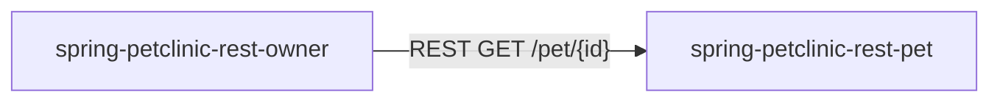
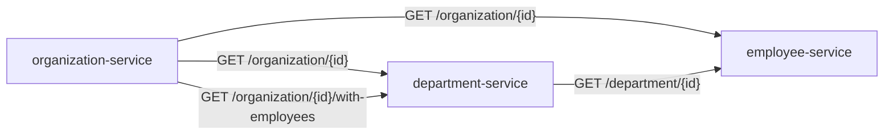
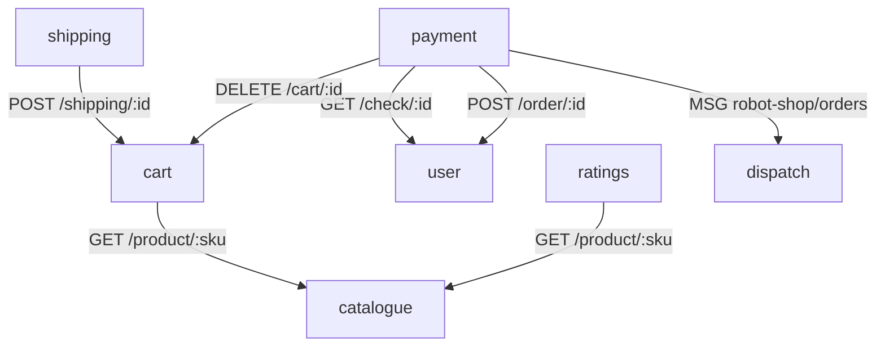

# Inter-Microservice Interfaces Only
**Purpose:** Only the interfaces that are **actually called by another microservice** (i.e. appear as a call target in `inter_service_calls`). Interfaces that are exposed but never called cross-service are excluded.

---

## Summary Table

| System | Total Exposed | Actually Called Cross-Service | Not Called Cross-Service |
|---|---|---|---|
| **MS010** | 9 | **1** | 8 (internal/unused) |
| **MS016** | 18 | **17** | 1 (`RefDataController.GetCustomers`) |
| **MS031** | 16 | **4** | 12 (not called cross-service) |
| **MS047** | 34 | **6** | 28 (not called cross-service) |
| **MS098** | 69 | **45** | 24 (not called cross-service) |
| **TOTAL** | **146** | **73** | **73** |

> [!IMPORTANT]
> Only **73 out of 146** exposed interfaces are actual inter-microservice interfaces. The other 73 are exposed but never called by another service in these systems.

---

---

## MS010 — 1 inter-microservice interface

| Interface | Destination Service | Endpoint | Protocol | Called By |
|---|---|---|---|---|
| `PetRepository.findById` | `spring-petclinic-rest-pet` | `GET /pet/{id}` | REST | `spring-petclinic-rest-owner` → `OwnerController.getOwnerVisits` |

### Call Graph (inter-MS only)

**❌ Not called cross-service (exposed but internal/unused):**
- `OwnerController.getOwnerVisits`, `OwnerRepository.findById`, `OwnerRepository.findByLastName`
- `PetRepository.findPetTypes`, `ApplicationController.home`, `CrashController.triggerException`
- `VetRepository.findAll`, `VisitRepository.findByPetId`

---

---

## MS016 — 17 inter-microservice interfaces

### REST Interfaces (13)

| Interface | Destination Service | Endpoint | Called By |
|---|---|---|---|
| `CustomersController.GetAllAsync` | `CustomerManagementAPI` | `GET /api/customers` | `WebApp::Index`, `WebApp::New` |
| `CustomersController.GetByCustomerId` | `CustomerManagementAPI` | `GET /api/customers/{customerId}` | `WebApp::Details` (×2) |
| `CustomersController.RegisterAsync` | `CustomerManagementAPI` | `POST /api/customers` | `WebApp::Register` |
| `VehiclesController.GetAllAsync` | `VehicleManagementAPI` | `GET /api/vehicles` | `WebApp::Index` |
| `VehiclesController.GetByLicenseNumber` | `VehicleManagementAPI` | `GET /api/vehicles/{licenseNumber}` | `WebApp::Details` |
| `VehiclesController.RegisterAsync` | `VehicleManagementAPI` | `POST /api/vehicles` | `WebApp::Register` |
| `WorkshopPlanningController.GetByDate` | `WorkshopManagementAPI` | `GET /api/workshopplanning/{date}` | `WebApp::Index` |
| `WorkshopPlanningController.GetMaintenanceJobAsync` | `WorkshopManagementAPI` | `GET /api/workshopplanning/{date}/jobs/{jobId}` | `WebApp::Details`, `WebApp::Finish` |
| `WorkshopPlanningController.PlanMaintenanceJobAsync` | `WorkshopManagementAPI` | `POST /api/workshopplanning/{date}/jobs` | `WebApp::RegisterMaintenanceJob` |
| `WorkshopPlanningController.FinishMaintenanceJobAsync` | `WorkshopManagementAPI` | `PUT /api/workshopplanning/{date}/jobs/{jobId}/finish` | `WebApp::FinishMaintenanceJob` |
| `RefDataController.GetVehicleByLicenseNumber` | `WorkshopManagementAPI` | `GET /api/refdata/vehicles/{licenseNumber}` | `WebApp::RegisterMaintenanceJob` |
| `RefDataController.GetCustomerByCustomerId` | `WorkshopManagementAPI` | `GET /api/refdata/customers/{customerId}` | `WebApp::RegisterMaintenanceJob` |
| `RefDataController.GetVehicles` | `WorkshopManagementAPI` | `GET /api/refdata/vehicles` | `WebApp::New` |

### Messaging Interfaces (4)

| Interface | Destination Service | Queue | Called By (publishers) |
|---|---|---|---|
| `AuditLogWorker.HandleMessageAsync` | `AuditlogService` | `rabbitmq/pitstop` | `CustomerManagementAPI`, `VehicleManagementAPI`, `WorkshopManagementAPI` (×2), `TimeService` |
| `InvoiceWorker.HandleMessageAsync` | `InvoiceService` | `rabbitmq/pitstop` | `CustomerManagementAPI`, `WorkshopManagementAPI` (×2), `TimeService` |
| `NotificationWorker.HandleMessageAsync` | `NotificationService` | `rabbitmq/pitstop` | `CustomerManagementAPI`, `WorkshopManagementAPI` (×2), `TimeService` |
| `EventHandlerWorker.HandleMessageAsync` | `WorkshopManagementEventHandler` | `rabbitmq/pitstop` | `CustomerManagementAPI`, `VehicleManagementAPI`, `WorkshopManagementAPI` (×2) |

**❌ Not called cross-service:**
- `RefDataController.GetCustomers` — exposed but no caller found in ground truth

---

---

## MS031 — 4 inter-microservice interfaces

| Interface | Destination Service | Endpoint | Called By |
|---|---|---|---|
| `EmployeeController.findByDepartment` | `employee-service` | `GET /department/{departmentId}` | `department-service` → `DepartmentController.findByOrganizationWithEmployees` |
| `DepartmentController.findByOrganization` | `department-service` | `GET /organization/{organizationId}` | `organization-service` → `OrganizationController.findByIdWithDepartments` |
| `DepartmentController.findByOrganizationWithEmployees` | `department-service` | `GET /organization/{organizationId}/with-employees` | `organization-service` → `OrganizationController.findByIdWithDepartmentsAndEmployees` |
| `EmployeeController.findByOrganization` | `employee-service` | `GET /organization/{organizationId}` | `organization-service` → `OrganizationController.findByIdWithEmployees` |

### Call Graph (inter-MS only)

**❌ Not called cross-service (12 interfaces):**
- `EmployeeController.add`, `findAll`, `findById`
- `DepartmentController.add`, `findAll`, `findById`
- `OrganizationController.add`, `findAll`, `findById`, `findByIdWithDepartments`, `findByIdWithDepartmentsAndEmployees`, `findByIdWithEmployees`

---

---

## MS047 — 6 inter-microservice interfaces

| Interface | Destination Service | Endpoint | Protocol | Called By |
|---|---|---|---|---|
| `server.get_product_sku` | `catalogue` | `GET /product/:sku` | REST | `cart` → `get_add_id_sku_qty` · `ratings` → `RatingsApiController.put` |
| `server.post_shipping_id` | `cart` | `POST /shipping/:id` | REST | `shipping` → `Controller.confirm` |
| `server.get_check_id` | `user` | `GET /check/:id` | REST | `payment` → `pay` |
| `server.post_order_id` | `user` | `POST /order/:id` | REST | `payment` → `pay` |
| `server.delete_cart_id` | `cart` | `DELETE /cart/:id` | REST | `payment` → `pay` |
| `main.main` | `dispatch` | `robot-shop/orders` | Messaging | `payment` → `pay` |

### Call Graph (inter-MS only)

**❌ Not called cross-service (28 interfaces — health/admin endpoints, unused routes):**
- `catalogue`: `get_health`, `get_products`, `get_products_cat`, `get_categories`, `get_search_text`
- `user`: `get_health`, `get_uniqueid`, `get_users`, `post_login`, `post_register`, `get_history_id`
- `cart`: `get_health`, `get_cart_id`, `get_add_id_sku_qty`, `get_update_id_sku_qty`, `get_item_delete_id_sku`
- `shipping`: `health`, `count`, `codes`, `cities`, `match`, `caclc`
- `ratings`: `HealthController.__invoke`, `RatingsApiController.get`
- `payment`: `payment.health`

---

---

## MS098 — 45 inter-microservice interfaces

### service-webhook — 5 called (all 5 interfaces called)

| Interface | gRPC Endpoint | Called By |
|---|---|---|
| `WebhookController.createWebhook` | `WebhookService/CreateWebhook` | `api-admin` → `create` |
| `WebhookController.updateWebhook` | `WebhookService/UpdateWebhook` | `api-admin` → `update` |
| `WebhookController.deleteWebhook` | `WebhookService/DeleteWebhook` | `api-admin` → `remove` |
| `WebhookController.readWebhook` | `WebhookService/ReadWebhook` | `api-admin` → `webhook` |
| `WebhookController.findWebhook` | `WebhookService/FindWebhook` | `api-admin` → `webhooks` |

### service-access — 4 called (out of 5)

| Interface | gRPC Endpoint | Called By |
|---|---|---|
| `AccessTokenController.createAccess` | `AccessService/CreateAccess` | `api-admin` → `accessToken` (create) |
| `AccessTokenController.deleteAccess` | `AccessService/DeleteAccess` | `api-admin` → `accessToken` (delete) |
| `AccessTokenController.findAccess` | `AccessService/FindAccess` | `api-admin` → `accessToken` (find) |
| `AccessTokenController.readAccess` | `AccessService/ReadAccess` | `api-admin` → `accessToken` (read) |

❌ `AccessTokenController.hasRights` — exposed but not called in ground truth

### service-billing — 16 called (out of 19)

| Interface | gRPC Endpoint | Called By |
|---|---|---|
| `BillingsController.changeSubscription` | `BillingService/ChangeSubscription` | `api-admin` |
| `BillingsController.cancelSubscription` | `BillingService/CancelSubscription` | `api-admin` |
| `BillingsController.readInvoice` | `BillingService/ReadInvoice` | `api-admin` |
| `BillingsController.findInvoices` | `BillingService/FindInvoices` | `api-admin` |
| `BillingsController.readSubscription` | `BillingService/ReadSubscription` | `api-admin` |
| `BillingsController.findSubscriptions` | `BillingService/FindSubscriptions` | `api-admin` |
| `BillingsController.readCard` | `BillingService/ReadCard` | `api-admin` |
| `BillingsController.findCards` | `BillingService/FindCards` | `api-admin` |
| `BillingsController.createCard` | `BillingService/CreateCard` | `api-admin` |
| `BillingsController.deleteCard` | `BillingService/DeleteCard` | `api-admin` |
| `BillingsController.setDefaultCard` | `BillingService/SetDefaultCard` | `api-admin` |
| `BillingsController.readPlan` | `BillingService/ReadPlan` | `api-admin` |
| `BillingsController.findPlans` | `BillingService/FindPlans` | `api-admin` |
| `BillingsController.findStripePlans` | `BillingService/FindStripePlans` | `api-admin` |
| `BillingsController.createCustomer` | `BillingService/CreateCustomer` | `service-account` → `execute` |
| `BillingsController.createSubscription` | `BillingService/CreateSubscription` | `service-tenant` → `execute` |

❌ Not called: `createPlan`, `deleteCustomer`, `readCustomer`, `readStripePlan`

### service-account — 6 called (out of 13)

| Interface | gRPC Endpoint | Called By |
|---|---|---|
| `AccountsController.create` | `AccountService/Create` | `api-admin` → `register` |
| `AccountsController.forgotPassword` | `AccountService/ForgotPassword` | `api-admin` → `sendResetPasswordEmail` |
| `AccountsController.resendVerificationCode` | `AccountService/ResendVerificationCode` | `api-admin` → `sendVerificationEmail` |
| `AccountsController.verifyAccount` | `AccountService/VerifyAccount` | `api-admin` → `verifyAccount` |
| `AccountsController.verifyActivationLink` | `AccountService/VerifyActivationLink` | `api-admin` → `verifyActivationLink` |
| `AccountsController.read` | `AccountService/Read` | `api-admin` → `fullName` · `api-admin` → `owner` |

❌ Not called: `delete`, `login`, `logout`, `readSession`, `search`, `update`, `updatePassword`

### service-tenant — 11 called (out of 12)

| Interface | gRPC Endpoint | Called By |
|---|---|---|
| `MembersController.inviteMember` | `TenantService/InviteMember` | `api-admin` → `invite` |
| `MembersController.updateMember` | `TenantService/UpdateMember` | `api-admin` → `update` |
| `MembersController.deleteMember` | `TenantService/DeleteMember` | `api-admin` → `delete` |
| `MembersController.readMember` | `TenantService/ReadMember` | `api-admin` → `member` |
| `MembersController.findMembers` | `TenantService/FindMembers` | `api-admin` → `members` |
| `TenantsController.createTenant` | `TenantService/CreateTenant` | `api-admin` → `create` |
| `TenantsController.updateTenant` | `TenantService/UpdateTenant` | `api-admin` → `update` |
| `TenantsController.deleteTenant` | `TenantService/DeleteTenant` | `api-admin` → `delete` |
| `TenantsController.tenantAvailable` | `TenantService/TenantAvailable` | `api-admin` → `tenantAvailable` |
| `TenantsController.readTenant` | `TenantService/ReadTenant` | `api-admin` → `tenant` |
| `TenantsController.findTenant` | `TenantService/FindTenant` | `api-admin` → `tenants` |

❌ Not called: `MembersController.acceptMemberInvitation`

### service-role — 3 called (out of 5)

| Interface | gRPC Endpoint | Called By |
|---|---|---|
| `RolesController.readUserRoles` | `RoleService/ReadUserRoles` | `api-admin` → `roles` |
| `RolesController.addUserToRole` | `RoleService/AddUserToRole` | `service-account`, `service-tenant` (×3) |
| `RolesController.removeUserFromRole` | `RoleService/RemoveUserFromRole` | `service-tenant` → `remove-member.handler` |

❌ Not called: `hasRights`, *(1 more)*

### service-notification — 0 called (pure consumer / worker, not invoked in verified call graph)

---

---

## Cross-System Inter-MS Interface Count

```mermaid
xychart-beta
    title "Exposed vs Actually Called Cross-Service"
    x-axis ["MS010", "MS016", "MS031", "MS047", "MS098"]
    y-axis "Count" 0 --> 70
    bar [9, 18, 16, 34, 69]
    bar [1, 17, 4, 6, 45]
```

| System | Exposed | Called | Usage % |
|---|---|---|---|
| MS010 | 9 | 1 | **11%** |
| MS016 | 18 | 17 | **94%** |
| MS031 | 16 | 4 | **25%** |
| MS047 | 34 | 6 | **18%** |
| MS098 | 69 | 45 | **65%** |
| **Total** | **146** | **73** | **50%** |

> [!NOTE]
> **MS016 (pitstop)** has the highest usage — almost every exposed interface is called by another service. This is because it is a tightly-coupled event-driven system where every service plays a specific role.
>
> **MS010** and **MS031** have the lowest usage — most exposed endpoints are there for external clients, not for inter-service communication.
