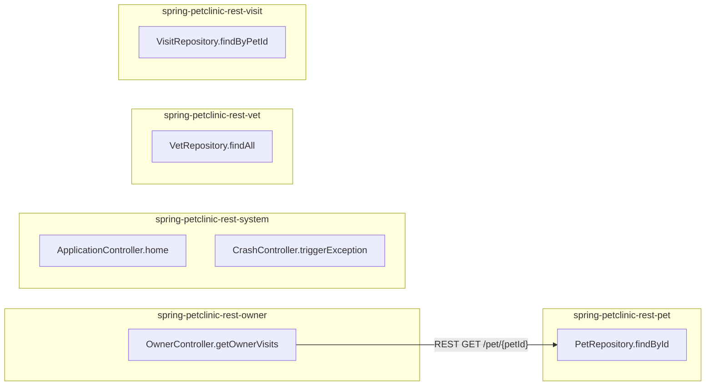

# Ground Truth Call Graph & Interface Specification: MS010

- **System ID**: `MS010`
- **System Name**: `amazon-ecs-java-microservices`
- **Source Repository**: `https://github.com/aws-samples/amazon-ecs-java-microservices.git`
- **Codebase Path**: `codebases/microservices/MS010_amazon-ecs-java-microservices/2_ECS_Java_Spring_PetClinic_Microservices`
- **Partition Reference**: `outputs/MS010/output.json`
- **Extraction Schema**: `prompts/schema.json`
- **Ground Truth JSON**: `benchmarks/ground_truth/MS010.json`
- **Status**: Verified

---

## 1. System Overview

`MS010` is an AWS reference implementation illustrating the decomposition of the classic Spring PetClinic application into 5 independent containerized microservices deployed on Amazon EC2 Container Service (ECS):
1. **`spring-petclinic-rest-owner`**: Manages customer/pet-owner profiles and aggregates pet visits.
2. **`spring-petclinic-rest-pet`**: Manages pet entities and pet types.
3. **`spring-petclinic-rest-system`**: Provides system utility endpoints (root banner, health, exception simulation).
4. **`spring-petclinic-rest-vet`**: Manages veterinary specialists and clinic schedules.
5. **`spring-petclinic-rest-visit`**: Manages medical visit logs per pet.

Communication between microservices and external clients is mediated by HTTP REST. Spring Data REST (`@RepositoryRestResource`) is used to dynamically expose data repositories over HTTP, complemented by standard Spring MVC `@RestController` endpoints.

---

## 2. Microservice Interfaces & Endpoints

### 2.1. `spring-petclinic-rest-owner`
- **Canonical Classes**: 14 classes (`OwnerApplication`, `OwnerController`, `OwnerRepository`, domain entities).
- **Exposed Interfaces**:

| Interface ID | Canonical Class Name | Method | Parameters | Return Type | Protocol | Endpoint |
|---|---|---|---|---|---|---|
| `OwnerController.getOwnerVisits` | `org.springframework.samples.petclinic.owner.OwnerController` | `getOwnerVisits` | `["int"]` | `List<Visit>` | REST | `GET /owner/{ownerId}/getVisits` |
| `OwnerRepository.findById` | `org.springframework.samples.petclinic.owner.OwnerRepository` | `findById` | `["Integer"]` | `Owner` | REST | `GET /owner/{id}` |
| `OwnerRepository.findByLastName` | `org.springframework.samples.petclinic.owner.OwnerRepository` | `findByLastName` | `["String"]` | `List<Owner>` | REST | `GET /owner/search/findByLastName` |

- **Notes**:
  - `OwnerController.getOwnerVisits` is a Spring `@RestController` endpoint returning visits for all pets belonging to a specified owner.
  - `OwnerRepository` is annotated with `@RepositoryRestResource(collectionResourceRel = "owner", path = "owner")`, exposing declared query methods over REST.

---

### 2.2. `spring-petclinic-rest-pet`
- **Canonical Classes**: 14 classes (`PetApplication`, `PetController`, `PetRepository`, domain entities).
- **Exposed Interfaces**:

| Interface ID | Canonical Class Name | Method | Parameters | Return Type | Protocol | Endpoint |
|---|---|---|---|---|---|---|
| `PetRepository.findById` | `org.springframework.samples.petclinic.pet.PetRepository` | `findById` | `["Integer"]` | `Pet` | REST | `GET /pet/{id}` |
| `PetRepository.findPetTypes` | `org.springframework.samples.petclinic.pet.PetRepository` | `findPetTypes` | `[]` | `List<PetType>` | REST | `GET /pet/search/findPetTypes` |

- **Notes**:
  - `PetController` is an empty `@RestController` shell. 
  - All HTTP endpoints are served through Spring Data REST on `@RepositoryRestResource(collectionResourceRel = "pet", path = "pet")`.
  - `PetRepository.findById` serves `GET /pet/{id}`, which is the target of cross-service requests from `OwnerController`.

---

### 2.3. `spring-petclinic-rest-system`
- **Canonical Classes**: 15 classes (`SystemApplication`, `ApplicationController`, `CrashController`, `CacheConfig`, domain entities).
- **Exposed Interfaces**:

| Interface ID | Canonical Class Name | Method | Parameters | Return Type | Protocol | Endpoint |
|---|---|---|---|---|---|---|
| `ApplicationController.home` | `org.springframework.samples.petclinic.system.ApplicationController` | `home` | `[]` | `String` | REST | `GET /` |
| `CrashController.triggerException` | `org.springframework.samples.petclinic.system.CrashController` | `triggerException` | `[]` | `String` | REST | `GET /oups` |

- **Notes**:
  - `ApplicationController` serves the root landing message `GET /`.
  - `CrashController` demonstrates error page handling by throwing a deliberate runtime exception on `GET /oups`.

---

### 2.4. `spring-petclinic-rest-vet`
- **Canonical Classes**: 14 classes (`VetApplication`, `VetController`, `VetRepository`, domain entities).
- **Exposed Interfaces**:

| Interface ID | Canonical Class Name | Method | Parameters | Return Type | Protocol | Endpoint |
|---|---|---|---|---|---|---|
| `VetRepository.findAll` | `org.springframework.samples.petclinic.vet.VetRepository` | `findAll` | `[]` | `List<Vet>` | REST | `GET /vet` |

- **Notes**:
  - `VetController` is an empty `@RestController` stub.
  - `VetRepository` exposes `GET /vet` via `@RepositoryRestResource(collectionResourceRel = "vet", path = "vet")` and `@Cacheable("vets")`.

---

### 2.5. `spring-petclinic-rest-visit`
- **Canonical Classes**: 14 classes (`VisitApplication`, `VisitController`, `VisitRepository`, domain entities).
- **Exposed Interfaces**:

| Interface ID | Canonical Class Name | Method | Parameters | Return Type | Protocol | Endpoint |
|---|---|---|---|---|---|---|
| `VisitRepository.findByPetId` | `org.springframework.samples.petclinic.visit.VisitRepository` | `findByPetId` | `["Integer"]` | `List<Visit>` | REST | `GET /visit/search/findByPetId` |

- **Notes**:
  - `VisitController` has all its controller methods commented out.
  - `VisitRepository` exposes `GET /visit/search/findByPetId?petId={petId}` via `@RepositoryRestResource(collectionResourceRel = "visit", path = "visit")`.

---

## 3. Inter-Service Call Graph



### Call Edge Details

#### Edge 1: `OwnerController.getOwnerVisits` $\to$ `PetRepository.findById`
- **Source Microservice**: `spring-petclinic-rest-owner`
- **Source Class**: `org.springframework.samples.petclinic.owner.OwnerController`
- **Source Method**: `getOwnerVisits` (entrypoint method invoking helper `getPetVisits`)
- **Target Microservice**: `spring-petclinic-rest-pet`
- **Target Class**: `org.springframework.samples.petclinic.pet.PetRepository`
- **Target Interface ID**: `PetRepository.findById`
- **Protocol**: `REST`
- **Invocation Mechanism**: Synchronous HTTP call via `org.springframework.web.client.RestTemplate`
- **Evidence**:
  ```java
  // OwnerController.java, lines 58-59
  RestTemplate restTemplate = new RestTemplate();
  Pet pet = restTemplate.getForObject("http://" + serviceEndpoint + "/pet/" + petId, Pet.class);
  ```

---

## 4. Verification and Validation Checklist

- [x] Every microservice key matches `outputs/MS010/output.json`.
- [x] Every class name matches canonical class lists in `output.json`.
- [x] Every `dst_interface_id` matches an existing entry in `microservices[dst_service].exposed_interfaces`.
- [x] No intra-service self-calls (`src_service != dst_service`).
- [x] Checked for asynchronous messaging (RabbitMQ/Kafka/JMS): None present.
- [x] Validated against `prompts/schema.json` with zero errors.
