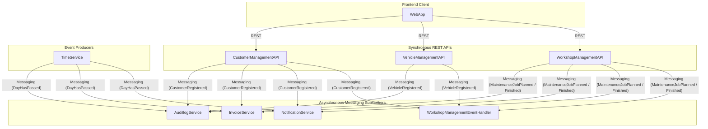

# Ground Truth Call Graph & Interface Specification: MS016

- **System ID**: `MS016`
- **System Name**: `pitstop`
- **Source Repository**: `https://github.com/EdwinVW/pitstop.git`
- **Codebase Path**: `codebases/microservices/MS016_pitstop/src`
- **Partition Reference**: `outputs/MS016/output.json`
- **Extraction Schema**: `prompts/schema.json`
- **Ground Truth JSON**: `benchmarks/ground_truth/MS016.json`
- **Status**: Verified

---

## 1. System Overview

`MS016` (**Pitstop**) is an enterprise garage management system built with C# and .NET 8 / ASP.NET Core. It implements a hybrid microservices architecture combining:
1. **Synchronous HTTP REST APIs**: For front-end queries, entity lookup, and direct commands.
2. **Asynchronous Event-Driven Messaging**: Using RabbitMQ (`Infrastructure.Messaging`) for eventual consistency across bounded contexts.

The system is decomposed into **9 microservices**:
1. **`CustomerManagementAPI`**: ASP.NET Core Web API for customer CRUD operations and emitting `CustomerRegistered`.
2. **`VehicleManagementAPI`**: ASP.NET Core Web API for vehicle registry and emitting `VehicleRegistered`.
3. **`WorkshopManagementAPI`**: ASP.NET Core Web API managing workshop jobs, reference data lookups, and event-sourced planning (`PlanMaintenanceJob`, `FinishMaintenanceJob`).
4. **`AuditlogService`**: Background worker logging every message/event traveling through the RabbitMQ exchange.
5. **`InvoiceService`**: Background worker tracking finished jobs and customer registrations, automatically preparing invoices when a day passes.
6. **`NotificationService`**: Background worker notifying customers of upcoming maintenance jobs when day transitions occur.
7. **`TimeService`**: Periodic time-advancement service emitting `DayHasPassed` events into the message bus.
8. **`WorkshopManagementEventHandler`**: Event handler maintaining denormalized read-models (customers and vehicles) for `WorkshopManagementAPI`.
9. **`WebApp`**: ASP.NET Core MVC web frontend serving Razor views to end users and orchestrating backend operations via Refit HTTP clients.

---

## 2. Microservice Interfaces & Endpoints

### 2.1. `AuditlogService`
- **Role**: Event audit consumer.
- **Exposed Interfaces**:

| Interface ID | Canonical Class Name | Method | Parameters | Return Type | Protocol | Endpoint |
|---|---|---|---|---|---|---|
| `AuditLogWorker.HandleMessageAsync` | `AuditLogWorker` | `HandleMessageAsync` | `["string", "string"]` | `bool` | Messaging | `rabbitmq/pitstop` |

- **Notes**:
  - Implements `IMessageHandlerCallback` to consume all events routed through the message bus.
  - Lifecycle methods (`StartAsync`, `StopAsync`) are excluded from exposed interfaces.

---

### 2.2. `CustomerManagementAPI`
- **Role**: Customer management REST API.
- **Exposed Interfaces**:

| Interface ID | Canonical Class Name | Method | Parameters | Return Type | Protocol | Endpoint |
|---|---|---|---|---|---|---|
| `CustomersController.GetAllAsync` | `CustomersController` | `GetAllAsync` | `[]` | `List<Customer>` | REST | `GET /api/customers` |
| `CustomersController.GetByCustomerId` | `CustomersController` | `GetByCustomerId` | `["string"]` | `Customer` | REST | `GET /api/customers/{customerId}` |
| `CustomersController.RegisterAsync` | `CustomersController` | `RegisterAsync` | `["RegisterCustomer"]` | `Customer` | REST | `POST /api/customers` |

---

### 2.3. `InvoiceService`
- **Role**: Billing and invoice preparation event consumer.
- **Exposed Interfaces**:

| Interface ID | Canonical Class Name | Method | Parameters | Return Type | Protocol | Endpoint |
|---|---|---|---|---|---|---|
| `InvoiceWorker.HandleMessageAsync` | `InvoiceWorker` | `HandleMessageAsync` | `["string", "string"]` | `bool` | Messaging | `rabbitmq/pitstop` |

- **Notes**:
  - Consumes `CustomerRegistered`, `MaintenanceJobPlanned`, `MaintenanceJobFinished`, and `DayHasPassed`.

---

### 2.4. `NotificationService`
- **Role**: Customer reminder and notification event consumer.
- **Exposed Interfaces**:

| Interface ID | Canonical Class Name | Method | Parameters | Return Type | Protocol | Endpoint |
|---|---|---|---|---|---|---|
| `NotificationWorker.HandleMessageAsync` | `NotificationWorker` | `HandleMessageAsync` | `["string", "string"]` | `bool` | Messaging | `rabbitmq/pitstop` |

- **Notes**:
  - Consumes `CustomerRegistered`, `MaintenanceJobPlanned`, `MaintenanceJobFinished`, and `DayHasPassed`.

---

### 2.5. `TimeService`
- **Role**: Background timer emitter.
- **Exposed Interfaces**: `[]`
- **Notes**:
  - Pure background timer (`TimeWorker`) publishing `DayHasPassed` every 10 seconds / 24 hours. Exposes no inbound APIs.

---

### 2.6. `VehicleManagementAPI`
- **Role**: Vehicle registry REST API.
- **Exposed Interfaces**:

| Interface ID | Canonical Class Name | Method | Parameters | Return Type | Protocol | Endpoint |
|---|---|---|---|---|---|---|
| `VehiclesController.GetAllAsync` | `VehiclesController` | `GetAllAsync` | `[]` | `List<Vehicle>` | REST | `GET /api/vehicles` |
| `VehiclesController.GetByLicenseNumber` | `VehiclesController` | `GetByLicenseNumber` | `["string"]` | `Vehicle` | REST | `GET /api/vehicles/{licenseNumber}` |
| `VehiclesController.RegisterAsync` | `VehiclesController` | `RegisterAsync` | `["RegisterVehicle"]` | `Vehicle` | REST | `POST /api/vehicles` |

---

### 2.7. `WebApp`
- **Role**: User-facing web frontend.
- **Exposed Interfaces**: `[]`
- **Notes**:
  - In accordance with calibration rules, pure frontend client applications that expose no backend operations to other services have an empty `exposed_interfaces` array (`[]`).

---

### 2.8. `WorkshopManagementAPI`
- **Role**: Workshop planning, job orchestration, and ref-data query API.
- **Exposed Interfaces**:

| Interface ID | Canonical Class Name | Method | Parameters | Return Type | Protocol | Endpoint |
|---|---|---|---|---|---|---|
| `RefDataController.GetCustomers` | `RefDataController` | `GetCustomers` | `[]` | `List<Customer>` | REST | `GET /api/refdata/customers` |
| `RefDataController.GetCustomerByCustomerId` | `RefDataController` | `GetCustomerByCustomerId` | `["string"]` | `Customer` | REST | `GET /api/refdata/customers/{customerId}` |
| `RefDataController.GetVehicles` | `RefDataController` | `GetVehicles` | `[]` | `List<Vehicle>` | REST | `GET /api/refdata/vehicles` |
| `RefDataController.GetVehicleByLicenseNumber` | `RefDataController` | `GetVehicleByLicenseNumber` | `["string"]` | `Vehicle` | REST | `GET /api/refdata/vehicles/{licenseNumber}` |
| `WorkshopPlanningController.GetByDate` | `WorkshopPlanningController` | `GetByDate` | `["DateTime"]` | `WorkshopPlanningDTO` | REST | `GET /api/workshopplanning/{planningDate}` |
| `WorkshopPlanningController.GetMaintenanceJobAsync` | `WorkshopPlanningController` | `GetMaintenanceJobAsync` | `["DateTime", "Guid"]` | `MaintenanceJobDTO` | REST | `GET /api/workshopplanning/{planningDate}/jobs/{jobId}` |
| `WorkshopPlanningController.PlanMaintenanceJobAsync` | `WorkshopPlanningController` | `PlanMaintenanceJobAsync` | `["DateTime", "PlanMaintenanceJob"]` | `WorkshopPlanningDTO` | REST | `POST /api/workshopplanning/{planningDate}/jobs` |
| `WorkshopPlanningController.FinishMaintenanceJobAsync` | `WorkshopPlanningController` | `FinishMaintenanceJobAsync` | `["DateTime", "Guid", "FinishMaintenanceJob"]` | `void` | REST | `PUT /api/workshopplanning/{planningDate}/jobs/{jobId}/finish` |

---

### 2.9. `WorkshopManagementEventHandler`
- **Role**: Read-model projection event consumer.
- **Exposed Interfaces**:

| Interface ID | Canonical Class Name | Method | Parameters | Return Type | Protocol | Endpoint |
|---|---|---|---|---|---|---|
| `EventHandlerWorker.HandleMessageAsync` | `EventHandlerWorker` | `HandleMessageAsync` | `["string", "string"]` | `bool` | Messaging | `rabbitmq/pitstop` |

- **Notes**:
  - Consumes `CustomerRegistered`, `VehicleRegistered`, `MaintenanceJobPlanned`, and `MaintenanceJobFinished` to populate local SQL Server tables for `WorkshopManagementAPI`.

---

## 3. Inter-Service Call Graph

---

## 4. Call Edge Inventory (33 Edges)

### 4.1. Synchronous REST Calls from `WebApp` (16 Edges)

1. **`PitStop.WebApp.Controllers.CustomerManagementController.Index` $\to$ `CustomersController.GetAllAsync`**
   - Protocol: `REST`
   - Evidence: `CustomerManagementController.cs:23: Customers = await _customerManagementAPI.GetCustomers()`
2. **`PitStop.WebApp.Controllers.CustomerManagementController.Details` $\to$ `CustomersController.GetByCustomerId`**
   - Protocol: `REST`
   - Evidence: `CustomerManagementController.cs:36: Customer = await _customerManagementAPI.GetCustomerById(id)`
3. **`PitStop.WebApp.Controllers.CustomerManagementController.Register` $\to$ `CustomersController.RegisterAsync`**
   - Protocol: `REST`
   - Evidence: `CustomerManagementController.cs:60: await _customerManagementAPI.RegisterCustomer(cmd)`
4. **`VehicleManagementController.Index` $\to$ `VehiclesController.GetAllAsync`**
   - Protocol: `REST`
   - Evidence: `VehicleManagementController.cs:26: Vehicles = await _vehicleManagementAPI.GetVehicles()`
5. **`VehicleManagementController.Details` $\to$ `VehiclesController.GetByLicenseNumber`**
   - Protocol: `REST`
   - Evidence: `VehicleManagementController.cs:37: Vehicle vehicle = await _vehicleManagementAPI.GetVehicleByLicenseNumber(licenseNumber)`
6. **`VehicleManagementController.Details` $\to$ `CustomersController.GetByCustomerId`**
   - Protocol: `REST`
   - Evidence: `VehicleManagementController.cs:38: Customer customer = await _customerManagementAPI.GetCustomerById(vehicle.OwnerId)`
7. **`VehicleManagementController.New` $\to$ `CustomersController.GetAllAsync`**
   - Protocol: `REST`
   - Evidence: `VehicleManagementController.cs:55: var customers = await _customerManagementAPI.GetCustomers()`
8. **`VehicleManagementController.Register` $\to$ `VehiclesController.RegisterAsync`**
   - Protocol: `REST`
   - Evidence: `VehicleManagementController.cs:74: await _vehicleManagementAPI.RegisterVehicle(cmd)`
9. **`WorkshopManagementController.Index` $\to$ `WorkshopPlanningController.GetByDate`**
   - Protocol: `REST`
   - Evidence: `WorkshopManagementController.cs:34: WorkshopPlanning planning = await _workshopManagementAPI.GetWorkshopPlanning(dateStr)`
10. **`WorkshopManagementController.Details` $\to$ `WorkshopPlanningController.GetMaintenanceJobAsync`**
    - Protocol: `REST`
    - Evidence: `WorkshopManagementController.cs:53: MaintenanceJob = await _workshopManagementAPI.GetMaintenanceJob(dateStr, jobId)`
11. **`WorkshopManagementController.Finish` $\to$ `WorkshopPlanningController.GetMaintenanceJobAsync`**
    - Protocol: `REST`
    - Evidence: `WorkshopManagementController.cs:84: MaintenanceJob job = await _workshopManagementAPI.GetMaintenanceJob(dateStr, jobId)`
12. **`WorkshopManagementController.RegisterMaintenanceJob` $\to$ `RefDataController.GetVehicleByLicenseNumber`**
    - Protocol: `REST`
    - Evidence: `WorkshopManagementController.cs:110: Vehicle vehicle = await _workshopManagementAPI.GetVehicleByLicenseNumber(inputModel.SelectedVehicleLicenseNumber)`
13. **`WorkshopManagementController.RegisterMaintenanceJob` $\to$ `RefDataController.GetCustomerByCustomerId`**
    - Protocol: `REST`
    - Evidence: `WorkshopManagementController.cs:111: Customer customer = await _workshopManagementAPI.GetCustomerById(vehicle.OwnerId)`
14. **`WorkshopManagementController.RegisterMaintenanceJob` $\to$ `WorkshopPlanningController.PlanMaintenanceJobAsync`**
    - Protocol: `REST`
    - Evidence: `WorkshopManagementController.cs:116: await _workshopManagementAPI.PlanMaintenanceJob(dateStr, planMaintenanceJobCommand)`
15. **`WorkshopManagementController.FinishMaintenanceJob` $\to$ `WorkshopPlanningController.FinishMaintenanceJobAsync`**
    - Protocol: `REST`
    - Evidence: `WorkshopManagementController.cs:158: await _workshopManagementAPI.FinishMaintenanceJob(dateStr, inputModel.Id.ToString("D"), cmd)`
16. **`WorkshopManagementController.New` $\to$ `RefDataController.GetVehicles`**
    - Protocol: `REST`
    - Evidence: `WorkshopManagementController.cs:176: var vehicles = await _workshopManagementAPI.GetVehicles()`

---

### 4.2. Asynchronous Messaging Calls (RabbitMQ Events) (17 Edges)

#### Event: `CustomerRegistered` (from `CustomerManagementAPI` -> `CustomersController.RegisterAsync`)
17. $\to$ `AuditlogService` (`AuditLogWorker.HandleMessageAsync`)
18. $\to$ `InvoiceService` (`InvoiceWorker.HandleMessageAsync`)
19. $\to$ `NotificationService` (`NotificationWorker.HandleMessageAsync`)
20. $\to$ `WorkshopManagementEventHandler` (`EventHandlerWorker.HandleMessageAsync`)

#### Event: `VehicleRegistered` (from `VehicleManagementAPI` -> `VehiclesController.RegisterAsync`)
21. $\to$ `AuditlogService` (`AuditLogWorker.HandleMessageAsync`)
22. $\to$ `WorkshopManagementEventHandler` (`EventHandlerWorker.HandleMessageAsync`)

#### Event: `MaintenanceJobPlanned` (from `WorkshopManagementAPI` -> `PlanMaintenanceJobCommandHandler.HandleCommandAsync`)
23. $\to$ `AuditlogService` (`AuditLogWorker.HandleMessageAsync`)
24. $\to$ `InvoiceService` (`InvoiceWorker.HandleMessageAsync`)
25. $\to$ `NotificationService` (`NotificationWorker.HandleMessageAsync`)
26. $\to$ `WorkshopManagementEventHandler` (`EventHandlerWorker.HandleMessageAsync`)

#### Event: `MaintenanceJobFinished` (from `WorkshopManagementAPI` -> `FinishMaintenanceJobCommandHandler.HandleCommandAsync`)
27. $\to$ `AuditlogService` (`AuditLogWorker.HandleMessageAsync`)
28. $\to$ `InvoiceService` (`InvoiceWorker.HandleMessageAsync`)
29. $\to$ `NotificationService` (`NotificationWorker.HandleMessageAsync`)
30. $\to$ `WorkshopManagementEventHandler` (`EventHandlerWorker.HandleMessageAsync`)

#### Event: `DayHasPassed` (from `TimeService` -> `TimeWorker.Worker`)
31. $\to$ `AuditlogService` (`AuditLogWorker.HandleMessageAsync`)
32. $\to$ `InvoiceService` (`InvoiceWorker.HandleMessageAsync`)
33. $\to$ `NotificationService` (`NotificationWorker.HandleMessageAsync`)

---

## 5. Verification Checklist

- [x] All 9 service identifiers match keys in `outputs/MS016/output.json`.
- [x] Every class name matches canonical class lists from the partition.
- [x] Target interface IDs match an existing entry in the target service's `exposed_interfaces`.
- [x] Strict separation of `src_service != dst_service` across all 33 call entries.
- [x] Verified zero validation errors against `prompts/schema.json`.
