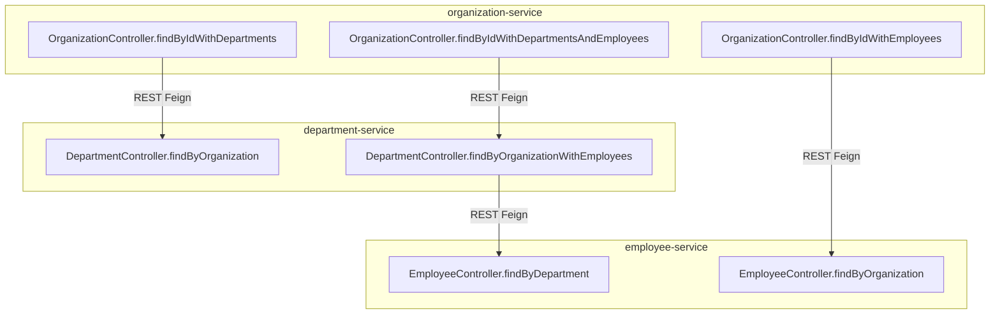

# Ground Truth Call Graph & Interface Specification: MS031

- **System ID**: `MS031`
- **System Name**: `sample-spring-microservices-new`
- **Source Repository**: `https://github.com/piomin/sample-spring-microservices-new.git`
- **Codebase Path**: `codebases/microservices/MS031_sample-spring-microservices-new`
- **Partition Reference**: `outputs/MS031/output.json`
- **Extraction Schema**: `prompts/schema.json`
- **Ground Truth JSON**: `benchmarks/ground_truth/MS031.json`
- **Status**: Verified

---

## 1. System Overview

`MS031` is a reference Spring Boot and Spring Cloud microservices architecture authored by Piotr Mińkowski. It demonstrates inter-service REST communication using **Spring Cloud OpenFeign** and centralized discovery via **Spring Cloud Netflix Eureka** and **Spring Cloud Gateway**.

The system consists of **6 microservices**:
1. **`employee-service`**: Microservice managing employee records.
2. **`department-service`**: Microservice managing departments, invoking `employee-service` via `@FeignClient` to assemble department staff rosters.
3. **`organization-service`**: Microservice managing organizations, invoking `department-service` and `employee-service` via `@FeignClient` to assemble organizational hierarchies.
4. **`discovery-service`**: Centralized Eureka Service Registry.
5. **`config-service`**: Centralized Spring Cloud Config Server.
6. **`gateway-service`**: Spring Cloud Gateway routing external requests to backend services.

---

## 2. Microservice Interfaces & Endpoints

### 2.1. `employee-service`
- **Canonical Class**: `pl.piomin.services.employee.controller.EmployeeController`
- **Exposed Interfaces**:

| Interface ID | Canonical Class Name | Method | Parameters | Return Type | Protocol | Endpoint |
|---|---|---|---|---|---|---|
| `EmployeeController.add` | `pl.piomin.services.employee.controller.EmployeeController` | `add` | `["Employee"]` | `Employee` | REST | `POST /` |
| `EmployeeController.findAll` | `pl.piomin.services.employee.controller.EmployeeController` | `findAll` | `[]` | `List<Employee>` | REST | `GET /` |
| `EmployeeController.findByDepartment` | `pl.piomin.services.employee.controller.EmployeeController` | `findByDepartment` | `["Long"]` | `List<Employee>` | REST | `GET /department/{departmentId}` |
| `EmployeeController.findById` | `pl.piomin.services.employee.controller.EmployeeController` | `findById` | `["Long"]` | `Employee` | REST | `GET /{id}` |
| `EmployeeController.findByOrganization` | `pl.piomin.services.employee.controller.EmployeeController` | `findByOrganization` | `["Long"]` | `List<Employee>` | REST | `GET /organization/{organizationId}` |

---

### 2.2. `department-service`
- **Canonical Class**: `pl.piomin.services.department.controller.DepartmentController`
- **Exposed Interfaces**:

| Interface ID | Canonical Class Name | Method | Parameters | Return Type | Protocol | Endpoint |
|---|---|---|---|---|---|---|
| `DepartmentController.add` | `pl.piomin.services.department.controller.DepartmentController` | `add` | `["Department"]` | `Department` | REST | `POST /` |
| `DepartmentController.findAll` | `pl.piomin.services.department.controller.DepartmentController` | `findAll` | `[]` | `List<Department>` | REST | `GET /` |
| `DepartmentController.findById` | `pl.piomin.services.department.controller.DepartmentController` | `findById` | `["Long"]` | `Department` | REST | `GET /{id}` |
| `DepartmentController.findByOrganization` | `pl.piomin.services.department.controller.DepartmentController` | `findByOrganization` | `["Long"]` | `List<Department>` | REST | `GET /organization/{organizationId}` |
| `DepartmentController.findByOrganizationWithEmployees` | `pl.piomin.services.department.controller.DepartmentController` | `findByOrganizationWithEmployees` | `["Long"]` | `List<Department>` | REST | `GET /organization/{organizationId}/with-employees` |

- **Design Decision**: `EmployeeClient` is an outgoing OpenFeign client interface (`@FeignClient(name = "employee-service")`) used to invoke `employee-service`; it is excluded from `department-service`'s `exposed_interfaces`.

---

### 2.3. `organization-service`
- **Canonical Class**: `pl.piomin.services.organization.controller.OrganizationController`
- **Exposed Interfaces**:

| Interface ID | Canonical Class Name | Method | Parameters | Return Type | Protocol | Endpoint |
|---|---|---|---|---|---|---|
| `OrganizationController.add` | `pl.piomin.services.organization.controller.OrganizationController` | `add` | `["Organization"]` | `Organization` | REST | `POST /` |
| `OrganizationController.findAll` | `pl.piomin.services.organization.controller.OrganizationController` | `findAll` | `[]` | `List<Organization>` | REST | `GET /` |
| `OrganizationController.findById` | `pl.piomin.services.organization.controller.OrganizationController` | `findById` | `["Long"]` | `Organization` | REST | `GET /{id}` |
| `OrganizationController.findByIdWithDepartments` | `pl.piomin.services.organization.controller.OrganizationController` | `findByIdWithDepartments` | `["Long"]` | `Organization` | REST | `GET /{id}/with-departments` |
| `OrganizationController.findByIdWithDepartmentsAndEmployees` | `pl.piomin.services.organization.controller.OrganizationController` | `findByIdWithDepartmentsAndEmployees` | `["Long"]` | `Organization` | REST | `GET /{id}/with-departments-and-employees` |
| `OrganizationController.findByIdWithEmployees` | `pl.piomin.services.organization.controller.OrganizationController` | `findByIdWithEmployees` | `["Long"]` | `Organization` | REST | `GET /{id}/with-employees` |

- **Design Decision**: `DepartmentClient` and `EmployeeClient` are outgoing Feign client interfaces and are excluded from `organization-service`'s `exposed_interfaces`.

---

### 2.4. Infrastructure Microservices
- **`discovery-service`**: `exposed_interfaces: []` (Eureka Discovery Registry)
- **`config-service`**: `exposed_interfaces: []` (Spring Cloud Config Server)
- **`gateway-service`**: `exposed_interfaces: []` (Spring Cloud Gateway router)

---

## 3. Inter-Service Call Graph

---

## 4. Call Edge Inventory (4 Edges)

1. **`DepartmentController.findByOrganizationWithEmployees` $\to$ `EmployeeController.findByDepartment`**
   - **Source**: `department-service` (`pl.piomin.services.department.controller.DepartmentController`)
   - **Target**: `employee-service` (`pl.piomin.services.employee.controller.EmployeeController`)
   - **Target Interface ID**: `EmployeeController.findByDepartment`
   - **Protocol**: `REST`
   - **Evidence**: `DepartmentController.java:53: departments.forEach(d -> d.setEmployees(employeeClient.findByDepartment(d.getId())));`

2. **`OrganizationController.findByIdWithDepartments` $\to$ `DepartmentController.findByOrganization`**
   - **Source**: `organization-service` (`pl.piomin.services.organization.controller.OrganizationController`)
   - **Target**: `department-service` (`pl.piomin.services.department.controller.DepartmentController`)
   - **Target Interface ID**: `DepartmentController.findByOrganization`
   - **Protocol**: `REST`
   - **Evidence**: `OrganizationController.java:56: organization.setDepartments(departmentClient.findByOrganization(organization.getId()));`

3. **`OrganizationController.findByIdWithDepartmentsAndEmployees` $\to$ `DepartmentController.findByOrganizationWithEmployees`**
   - **Source**: `organization-service` (`pl.piomin.services.organization.controller.OrganizationController`)
   - **Target**: `department-service` (`pl.piomin.services.department.controller.DepartmentController`)
   - **Target Interface ID**: `DepartmentController.findByOrganizationWithEmployees`
   - **Protocol**: `REST`
   - **Evidence**: `OrganizationController.java:64: organization.setDepartments(departmentClient.findByOrganizationWithEmployees(organization.getId()));`

4. **`OrganizationController.findByIdWithEmployees` $\to$ `EmployeeController.findByOrganization`**
   - **Source**: `organization-service` (`pl.piomin.services.organization.controller.OrganizationController`)
   - **Target**: `employee-service` (`pl.piomin.services.employee.controller.EmployeeController`)
   - **Target Interface ID**: `EmployeeController.findByOrganization`
   - **Protocol**: `REST`
   - **Evidence**: `OrganizationController.java:72: organization.setEmployees(employeeClient.findByOrganization(organization.getId()));`

---

## 5. Verification Checklist

- [x] All 6 microservice keys match `outputs/MS031/output.json`.
- [x] All canonical class names match partition strings.
- [x] Outgoing Feign client interfaces excluded from exposed interfaces.
- [x] Infrastructure servers configured with `[]`.
- [x] All 4 OpenFeign inter-service invocations fully traced and verified.
- [x] Zero schema validation errors against `prompts/schema.json`.
