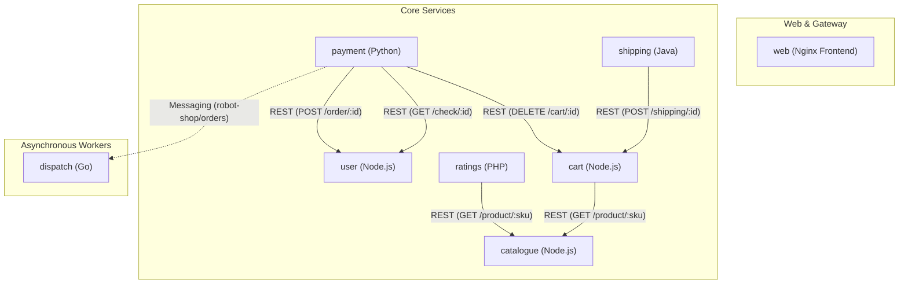

# Ground Truth Call Graph & Interface Specification: MS047

- **System ID**: `MS047`
- **System Name**: `robot-shop`
- **Source Repository**: `https://github.com/instana/robot-shop.git`
- **Codebase Path**: `codebases/microservices/MS047_robot-shop`
- **Partition Reference**: `outputs/MS047/output.json`
- **Extraction Schema**: `prompts/schema.json`
- **Ground Truth JSON**: `benchmarks/ground_truth/MS047.json`
- **Status**: Verified

---

## 1. System Overview

`MS047` (**Stan's Robot Shop**) is an e-commerce sample microservices application developed by Instana. It demonstrates a polyglot architecture with services implemented across diverse programming languages and runtimes, including Node.js, Python, Java (Spring Boot), PHP (Lumen), and Go. Communication is conducted via synchronous HTTP REST APIs and asynchronous messaging queues using RabbitMQ.

The system is decomposed into **9 microservices**:
1. **`catalogue`**: Node.js / Express microservice that queries MongoDB for product items and categories.
2. **`user`**: Node.js / Express microservice handling user authentication, profile data, registration, and order history storage.
3. **`cart`**: Node.js / Express microservice maintaining active shopping carts in Redis.
4. **`shipping`**: Java / Spring Boot microservice computing shipping costs and confirming deliveries against MySQL data.
5. **`ratings`**: PHP / Lumen microservice providing product review and rating capabilities backed by MySQL.
6. **`payment`**: Python / Flask microservice processing customer payments and orchestrating order completion.
7. **`dispatch`**: Go daemon listening to AMQP RabbitMQ queues to dispatch and fulfill completed orders.
8. **`web`**: Nginx reverse proxy serving the static AngularJS frontend and routing traffic to downstream backend microservices.
9. **`mongodb`**: Database container initialization and seed scripts.

---

## 2. Microservice Interfaces & Endpoints

### 2.1. `catalogue`
- **Runtime**: Node.js / Express
- **Exposed Interfaces**:

| Interface ID | Canonical Class Name | Method | Parameters | Return Type | Protocol | Endpoint |
|---|---|---|---|---|---|---|
| `server.get_health` | `server.js` | `get_health` | `[]` | `object` | REST | `GET /health` |
| `server.get_products` | `server.js` | `get_products` | `[]` | `List<object>` | REST | `GET /products` |
| `server.get_product_sku` | `server.js` | `get_product_sku` | `["string"]` | `object` | REST | `GET /product/:sku` |
| `server.get_products_cat` | `server.js` | `get_products_cat` | `["string"]` | `List<object>` | REST | `GET /products/:cat` |
| `server.get_categories` | `server.js` | `get_categories` | `[]` | `List<string>` | REST | `GET /categories` |
| `server.get_search_text` | `server.js` | `get_search_text` | `["string"]` | `List<object>` | REST | `GET /search/:text` |

---

### 2.2. `user`
- **Runtime**: Node.js / Express
- **Exposed Interfaces**:

| Interface ID | Canonical Class Name | Method | Parameters | Return Type | Protocol | Endpoint |
|---|---|---|---|---|---|---|
| `server.get_health` | `server.js` | `get_health` | `[]` | `object` | REST | `GET /health` |
| `server.get_uniqueid` | `server.js` | `get_uniqueid` | `[]` | `object` | REST | `GET /uniqueid` |
| `server.get_check_id` | `server.js` | `get_check_id` | `["string"]` | `string` | REST | `GET /check/:id` |
| `server.get_users` | `server.js` | `get_users` | `[]` | `List<object>` | REST | `GET /users` |
| `server.post_login` | `server.js` | `post_login` | `["object"]` | `object` | REST | `POST /login` |
| `server.post_register` | `server.js` | `post_register` | `["object"]` | `string` | REST | `POST /register` |
| `server.post_order_id` | `server.js` | `post_order_id` | `["string", "object"]` | `string` | REST | `POST /order/:id` |
| `server.get_history_id` | `server.js` | `get_history_id` | `["string"]` | `object` | REST | `GET /history/:id` |

---

### 2.3. `cart`
- **Runtime**: Node.js / Express
- **Exposed Interfaces**:

| Interface ID | Canonical Class Name | Method | Parameters | Return Type | Protocol | Endpoint |
|---|---|---|---|---|---|---|
| `server.get_health` | `server.js` | `get_health` | `[]` | `object` | REST | `GET /health` |
| `server.get_cart_id` | `server.js` | `get_cart_id` | `["string"]` | `object` | REST | `GET /cart/:id` |
| `server.delete_cart_id` | `server.js` | `delete_cart_id` | `["string"]` | `string` | REST | `DELETE /cart/:id` |
| `server.get_add_id_sku_qty` | `server.js` | `get_add_id_sku_qty` | `["string", "string", "int"]` | `object` | REST | `GET /add/:id/:sku/:qty` |
| `server.get_update_id_sku_qty` | `server.js` | `get_update_id_sku_qty` | `["string", "string", "int"]` | `object` | REST | `GET /update/:id/:sku/:qty` |
| `server.get_item_delete_id_sku` | `server.js` | `get_item_delete_id_sku` | `["string", "string"]` | `object` | REST | `GET /item/delete/:id/:sku` |
| `server.post_shipping_id` | `server.js` | `post_shipping_id` | `["string", "object"]` | `object` | REST | `POST /shipping/:id` |

---

### 2.4. `shipping`
- **Runtime**: Java / Spring Boot
- **Exposed Interfaces**:

| Interface ID | Canonical Class Name | Method | Parameters | Return Type | Protocol | Endpoint |
|---|---|---|---|---|---|---|
| `Controller.health` | `com.instana.robotshop.shipping.Controller` | `health` | `[]` | `String` | REST | `GET /health` |
| `Controller.count` | `com.instana.robotshop.shipping.Controller` | `count` | `[]` | `String` | REST | `GET /count` |
| `Controller.codes` | `com.instana.robotshop.shipping.Controller` | `codes` | `[]` | `List<Code>` | REST | `GET /codes` |
| `Controller.cities` | `com.instana.robotshop.shipping.Controller` | `cities` | `["String"]` | `List<City>` | REST | `GET /cities/{code}` |
| `Controller.match` | `com.instana.robotshop.shipping.Controller` | `match` | `["String", "String"]` | `List<City>` | REST | `GET /match/{code}/{text}` |
| `Controller.caclc` | `com.instana.robotshop.shipping.Controller` | `caclc` | `["long"]` | `Ship` | REST | `GET /calc/{id}` |
| `Controller.confirm` | `com.instana.robotshop.shipping.Controller` | `confirm` | `["String", "String"]` | `String` | REST | `POST /confirm/{id}` |

---

### 2.5. `ratings`
- **Runtime**: PHP / Lumen
- **Exposed Interfaces**:

| Interface ID | Canonical Class Name | Method | Parameters | Return Type | Protocol | Endpoint |
|---|---|---|---|---|---|---|
| `HealthController.__invoke` | `Instana.RobotShop.Ratings.Controller.HealthController` | `__invoke` | `[]` | `JsonResponse` | REST | `GET /_health` |
| `RatingsApiController.put` | `Instana.RobotShop.Ratings.Controller.RatingsApiController` | `put` | `["string", "int"]` | `JsonResponse` | REST | `PUT /api/rate/{sku}/{score}` |
| `RatingsApiController.get` | `Instana.RobotShop.Ratings.Controller.RatingsApiController` | `get` | `["string"]` | `JsonResponse` | REST | `GET /api/fetch/{sku}` |

---

### 2.6. `payment`
- **Runtime**: Python / Flask
- **Exposed Interfaces**:

| Interface ID | Canonical Class Name | Method | Parameters | Return Type | Protocol | Endpoint |
|---|---|---|---|---|---|---|
| `payment.health` | `payment` | `health` | `[]` | `string` | REST | `GET /health` |
| `payment.pay` | `payment` | `pay` | `["string"]` | `object` | REST | `POST /pay/<id>` |

---

### 2.7. `dispatch`
- **Runtime**: Go
- **Exposed Interfaces**:

| Interface ID | Canonical Class Name | Method | Parameters | Return Type | Protocol | Endpoint |
|---|---|---|---|---|---|---|
| `main.main` | `main.main` | `main` | `["object"]` | `void` | Messaging | `robot-shop/orders` |

- **Notes**:
  - Pure background AMQP worker consuming order payloads from RabbitMQ queue `orders`.

---

### 2.8. `mongodb`
- **Runtime**: Shell / MongoDB Seed
- **Exposed Interfaces**: `[]`
- **Notes**:
  - Contains database initialization and load scripts (`dump.sh`). Exposes no application service endpoints.

---

### 2.9. `web`
- **Runtime**: Nginx / AngularJS
- **Exposed Interfaces**: `[]`
- **Notes**:
  - Frontend proxy and static client assets. Exposes no inbound backend service RPC/REST interfaces.

---

## 3. Architecture Call Graph

---

## 4. Call Edge Inventory (7 Edges)

### 4.1. Synchronous REST Calls (6 Edges)

1. **`cart` $\to$ `catalogue`**
   - Caller: `server.js` (`get_add_id_sku_qty`)
   - Target: `catalogue` -> `server.js` (`server.get_product_sku`)
   - Protocol: `REST`
   - Evidence: `server.js:362: request('http://' + catalogueHost + ':8080/product/' + sku, (err, res, body) => {`

2. **`shipping` $\to$ `cart`**
   - Caller: `com.instana.robotshop.shipping.Controller` (`confirm`)
   - Target: `cart` -> `server.js` (`server.post_shipping_id`)
   - Protocol: `REST`
   - Evidence: `Controller.java:137: String cart = helper.addToCart(id, body);`

3. **`ratings` $\to$ `catalogue`**
   - Caller: `Instana.RobotShop.Ratings.Controller.RatingsApiController` (`put`)
   - Target: `catalogue` -> `server.js` (`server.get_product_sku`)
   - Protocol: `REST`
   - Evidence: `RatingsApiController.php:49: if (false === $this->catalogueService->checkSKU($sku))`

4. **`payment` $\to$ `user` (User Check)**
   - Caller: `payment` (`pay`)
   - Target: `user` -> `server.js` (`server.get_check_id`)
   - Protocol: `REST`
   - Evidence: `payment.py:64: req = requests.get('http://{user}:8080/check/{id}'.format(user=USER, id=id))`

5. **`payment` $\to$ `user` (Record Order)**
   - Caller: `payment` (`pay`)
   - Target: `user` -> `server.js` (`server.post_order_id`)
   - Protocol: `REST`
   - Evidence: `payment.py:106: req = requests.post('http://{user}:8080/order/{id}'.format(user=USER, id=id), ...)`

6. **`payment` $\to$ `cart` (Clear Cart)**
   - Caller: `payment` (`pay`)
   - Target: `cart` -> `server.js` (`server.delete_cart_id`)
   - Protocol: `REST`
   - Evidence: `payment.py:116: req = requests.delete('http://{cart}:8080/cart/{id}'.format(cart=CART, id=id))`

---

### 4.2. Asynchronous Messaging Calls (1 Edge)

7. **`payment` $\to$ `dispatch` (Order Fulfillment)**
   - Caller: `payment` (`pay`)
   - Target: `dispatch` -> `main.main` (`main.main`)
   - Protocol: `Messaging`
   - Evidence: `payment.py:101: queueOrder({ 'orderid': orderid, 'user': id, 'cart': cart })`

---

## 5. Verification Checklist

- [x] All 9 service identifiers match keys in `outputs/MS047/output.json`.
- [x] Every class name (`server.js`, `com.instana.robotshop.shipping.Controller`, `Instana.RobotShop.Ratings.Controller.*`, `payment`, `main.main`) matches canonical class lists from the partition.
- [x] Target interface IDs match an existing entry in the target service's `exposed_interfaces`.
- [x] Strict separation of `src_service != dst_service` across all 7 call entries.
- [x] Verified zero validation errors against `prompts/schema.json` and partition structure.
