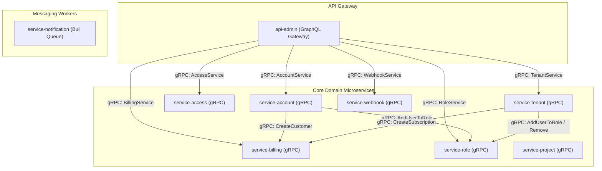

# Ground Truth Call Graph & Interface Specification: MS098

- **System ID**: `MS098`
- **System Name**: `ultimate-backend`
- **Source Repository**: `https://github.com/juicycleff/ultimate-backend.git`
- **Codebase Path**: `codebases/microservices/MS098_ultimate-backend/apps`
- **Partition Reference**: `outputs/MS098/output.json`
- **Extraction Schema**: `prompts/schema.json`
- **Ground Truth JSON**: `benchmarks/ground_truth/MS098.json`
- **Status**: Verified

---

## 1. System Overview

`MS098` (**Ultimate Backend**) is an enterprise multi-tenant SaaS backend framework developed using TypeScript and NestJS. It employs a Command Query Responsibility Segregation (CQRS) and Event Sourcing architecture. Communication between components utilizes:
1. **gRPC Protocol**: High-performance RPC transport (`@nestjs/microservices` with protobuf contracts from `@ultimatebackend/proto-schema`) for internal service-to-service communication.
2. **GraphQL Gateway (`api-admin`)**: Apollo GraphQL API Gateway aggregating downstream microservices for dashboard and administrative clients.
3. **Asynchronous Messaging**: Event distribution and asynchronous background job queues using Bull (Redis) for email and notification delivery.

The system is decomposed into **9 microservices**:
1. **`api-admin`**: The API Gateway application exposing GraphQL queries, mutations, and field resolvers, delegating inbound requests to downstream backend gRPC services via `ctx.rpc`.
2. **`service-access`**: Access token and client credential lifecycle management, validating tenant access rights via gRPC `AccessService`.
3. **`service-account`**: User identity, credential verification, profile queries, and session management via gRPC `AccountService`.
4. **`service-billing`**: Subscription lifecycle, Stripe customer integration, credit card tokens, plans, and invoice management via gRPC `BillingService`.
5. **`service-tenant`**: Multi-tenant workspace management and team membership invitations via gRPC `TenantService`.
6. **`service-role`**: Role-Based Access Control (RBAC) and Casbin policy evaluation via gRPC `RoleService`.
7. **`service-webhook`**: Webhook registration, delivery endpoints, and subscription management via gRPC `WebhookService`.
8. **`service-project`**: Project resource and workspace isolation service via gRPC `ProjectService`.
9. **`service-notification`**: Background email queuing and notification processor powered by Bull (`AuthProcess`).

---

## 2. Microservice Interfaces & Endpoints

### 2.1. `service-access`
- **Canonical Class**: `src/access-token/access-token.controller.ts`
- **Exposed Interfaces**:

| Interface ID | Method | Parameters | Return Type | Protocol | Endpoint |
|---|---|---|---|---|---|
| `AccessTokenController.createAccess` | `createAccess` | `["CreateAccessRequest", "any"]` | `CreateAccessResponse` | `gRPC` | `AccessService/CreateAccess` |
| `AccessTokenController.deleteAccess` | `deleteAccess` | `["DeleteAccessRequest", "any"]` | `DeleteAccessResponse` | `gRPC` | `AccessService/DeleteAccess` |
| `AccessTokenController.findAccess` | `findAccess` | `["FindAccessRequest", "any"]` | `FindAccessResponse` | `gRPC` | `AccessService/FindAccess` |
| `AccessTokenController.hasRights` | `hasRights` | `["HasRightsRequest", "any"]` | `HasRightsResponse` | `gRPC` | `AccessService/HasRights` |
| `AccessTokenController.readAccess` | `readAccess` | `["ReadAccessRequest", "any"]` | `ReadAccessResponse` | `gRPC` | `AccessService/ReadAccess` |

---

### 2.2. `service-account`
- **Canonical Class**: `src/accounts/accounts.controller.ts`
- **Exposed Interfaces**:

| Interface ID | Method | Parameters | Return Type | Protocol | Endpoint |
|---|---|---|---|---|---|
| `AccountsController.create` | `create` | `["CreateRequest", "any"]` | `CreateResponse` | `gRPC` | `AccountService/Create` |
| `AccountsController.delete` | `delete` | `["DeleteRequest", "any"]` | `DeleteResponse` | `gRPC` | `AccountService/Delete` |
| `AccountsController.login` | `login` | `["LoginRequest", "any"]` | `LoginResponse` | `gRPC` | `AccountService/Login` |
| `AccountsController.logout` | `logout` | `["LogoutRequest", "any"]` | `LogoutResponse` | `gRPC` | `AccountService/Logout` |
| `AccountsController.read` | `read` | `["ReadRequest", "any"]` | `ReadResponse` | `gRPC` | `AccountService/Read` |
| `AccountsController.readSession` | `readSession` | `["ReadSessionRequest", "any"]` | `ReadSessionResponse` | `gRPC` | `AccountService/ReadSession` |
| `AccountsController.search` | `search` | `["SearchRequest", "any"]` | `SearchResponse` | `gRPC` | `AccountService/Search` |
| `AccountsController.resendVerificationCode` | `resendVerificationCode` | `["ResendVerificationCodeRequest", "any"]` | `ResendVerificationCodeResponse` | `gRPC` | `AccountService/ResendVerificationCode` |
| `AccountsController.update` | `update` | `["UpdateRequest", "any"]` | `UpdateResponse` | `gRPC` | `AccountService/Update` |
| `AccountsController.updatePassword` | `updatePassword` | `["UpdatePasswordRequest", "any"]` | `UpdatePasswordResponse` | `gRPC` | `AccountService/UpdatePassword` |
| `AccountsController.verifyAccount` | `verifyAccount` | `["VerifyAccountRequest", "any"]` | `VerifyAccountResponse` | `gRPC` | `AccountService/VerifyAccount` |
| `AccountsController.verifyActivationLink` | `verifyActivationLink` | `["VerifyActivationLinkRequest", "any"]` | `VerifyActivationLinkResponse` | `gRPC` | `AccountService/VerifyActivationLink` |
| `AccountsController.forgotPassword` | `forgotPassword` | `["ForgotPasswordRequest", "any"]` | `ForgotPasswordResponse` | `gRPC` | `AccountService/ForgotPassword` |

---

### 2.3. `service-billing`
- **Canonical Class**: `src/billings/billings.controller.ts`
- **Exposed Interfaces**:

| Interface ID | Method | Parameters | Return Type | Protocol | Endpoint |
|---|---|---|---|---|---|
| `BillingsController.cancelSubscription` | `cancelSubscription` | `["CancelSubscriptionRequest", "any"]` | `CancelSubscriptionResponse` | `gRPC` | `BillingService/CancelSubscription` |
| `BillingsController.changeSubscription` | `changeSubscription` | `["ChangeSubscriptionRequest", "any"]` | `ChangeSubscriptionResponse` | `gRPC` | `BillingService/ChangeSubscription` |
| `BillingsController.createCard` | `createCard` | `["CreateCardRequest", "any"]` | `CreateCardResponse` | `gRPC` | `BillingService/CreateCard` |
| `BillingsController.createCustomer` | `createCustomer` | `["CreateCustomerRequest", "any"]` | `CreateCustomerResponse` | `gRPC` | `BillingService/CreateCustomer` |
| `BillingsController.createPlan` | `createPlan` | `["CreatePlanRequest", "any"]` | `CreatePlanResponse` | `gRPC` | `BillingService/CreatePlan` |
| `BillingsController.createSubscription` | `createSubscription` | `["CreateSubscriptionRequest", "any"]` | `CreateSubscriptionResponse` | `gRPC` | `BillingService/CreateSubscription` |
| `BillingsController.deleteCard` | `deleteCard` | `["DeleteCardRequest", "any"]` | `DeleteCardResponse` | `gRPC` | `BillingService/DeleteCard` |
| `BillingsController.deleteCustomer` | `deleteCustomer` | `["DeleteCustomerRequest", "any"]` | `DeleteCustomerResponse` | `gRPC` | `BillingService/DeleteCustomer` |
| `BillingsController.findCards` | `findCards` | `["FindCardsRequest", "any"]` | `FindCardsResponse` | `gRPC` | `BillingService/FindCards` |
| `BillingsController.findInvoices` | `findInvoices` | `["FindInvoicesRequest", "any"]` | `FindInvoicesResponse` | `gRPC` | `BillingService/FindInvoices` |
| `BillingsController.findPlans` | `findPlans` | `["FindPlansRequest", "any"]` | `FindPlansResponse` | `gRPC` | `BillingService/FindPlans` |
| `BillingsController.findStripePlans` | `findStripePlans` | `["FindStripePlansRequest", "any"]` | `FindStripePlansResponse` | `gRPC` | `BillingService/FindStripePlans` |
| `BillingsController.findSubscriptions` | `findSubscriptions` | `["FindSubscriptionsRequest", "any"]` | `FindSubscriptionsResponse` | `gRPC` | `BillingService/FindSubscriptions` |
| `BillingsController.readCard` | `readCard` | `["ReadCardRequest", "any"]` | `ReadCardResponse` | `gRPC` | `BillingService/ReadCard` |
| `BillingsController.readCustomer` | `readCustomer` | `["ReadCustomerRequest", "any"]` | `ReadCustomerResponse` | `gRPC` | `BillingService/ReadCustomer` |
| `BillingsController.readInvoice` | `readInvoice` | `["ReadInvoiceRequest", "any"]` | `ReadInvoiceResponse` | `gRPC` | `BillingService/ReadInvoice` |
| `BillingsController.readPlan` | `readPlan` | `["ReadPlanRequest", "any"]` | `ReadPlanResponse` | `gRPC` | `BillingService/ReadPlan` |
| `BillingsController.readStripePlan` | `readStripePlan` | `["ReadStripePlanRequest", "any"]` | `ReadStripePlanResponse` | `gRPC` | `BillingService/ReadStripePlan` |
| `BillingsController.readSubscription` | `readSubscription` | `["ReadSubscriptionRequest", "any"]` | `ReadSubscriptionResponse` | `gRPC` | `BillingService/ReadSubscription` |
| `BillingsController.setDefaultCard` | `setDefaultCard` | `["SetDefaultCardRequest", "any"]` | `SetDefaultCardResponse` | `gRPC` | `BillingService/SetDefaultCard` |

---

### 2.4. `service-tenant`
- **Canonical Classes**: `src/tenants/tenants.controller.ts`, `src/members/members.controller.ts`
- **Exposed Interfaces**:

| Interface ID | Method | Parameters | Return Type | Protocol | Endpoint |
|---|---|---|---|---|---|
| `TenantsController.createTenant` | `createTenant` | `["CreateTenantRequest", "any"]` | `CreateTenantResponse` | `gRPC` | `TenantService/CreateTenant` |
| `TenantsController.deleteTenant` | `deleteTenant` | `["DeleteTenantRequest", "any"]` | `DeleteTenantResponse` | `gRPC` | `TenantService/DeleteTenant` |
| `TenantsController.findTenant` | `findTenant` | `["FindTenantRequest", "any"]` | `FindTenantResponse` | `gRPC` | `TenantService/FindTenant` |
| `TenantsController.readTenant` | `readTenant` | `["ReadTenantRequest", "any"]` | `ReadTenantResponse` | `gRPC` | `TenantService/ReadTenant` |
| `TenantsController.tenantAvailable` | `tenantAvailable` | `["TenantAvailableRequest", "any"]` | `TenantAvailableResponse` | `gRPC` | `TenantService/TenantAvailable` |
| `TenantsController.updateTenant` | `updateTenant` | `["UpdateTenantRequest", "any"]` | `UpdateTenantResponse` | `gRPC` | `TenantService/UpdateTenant` |
| `MembersController.acceptMemberInvitation` | `acceptMemberInvitation` | `["AcceptMemberInvitationRequest", "any"]` | `AcceptMemberInvitationResponse` | `gRPC` | `TenantService/AcceptMemberInvitation` |
| `MembersController.deleteMember` | `deleteMember` | `["DeleteMemberRequest", "any"]` | `DeleteMemberResponse` | `gRPC` | `TenantService/DeleteMember` |
| `MembersController.findMembers` | `findMembers` | `["FindMemberRequest", "any"]` | `FindMemberResponse` | `gRPC` | `TenantService/FindMembers` |
| `MembersController.inviteMember` | `inviteMember` | `["InviteMemberRequest", "any"]` | `InviteMemberResponse` | `gRPC` | `TenantService/InviteMember` |
| `MembersController.readMember` | `readMember` | `["ReadMemberRequest", "any"]` | `ReadMemberResponse` | `gRPC` | `TenantService/ReadMember` |
| `MembersController.updateMember` | `updateMember` | `["UpdateMemberRequest", "any"]` | `UpdateMemberResponse` | `gRPC` | `TenantService/UpdateMember` |

---

### 2.5. `service-role`
- **Canonical Class**: `src/roles/roles.controller.ts`
- **Exposed Interfaces**:

| Interface ID | Method | Parameters | Return Type | Protocol | Endpoint |
|---|---|---|---|---|---|
| `RolesController.hasRights` | `hasRights` | `["HasRightsRequest", "any"]` | `HasRightsResponse` | `gRPC` | `RoleService/HasRights` |
| `RolesController.readUserRoles` | `readUserRoles` | `["ReadUserRolesRequest", "Map<string"]` | `ReadUserRolesResponse` | `gRPC` | `RoleService/ReadUserRoles` |
| `RolesController.addUserToRole` | `addUserToRole` | `["AddUserToRoleRequest", "Map<string"]` | `AddUserToRoleResponse` | `gRPC` | `RoleService/AddUserToRole` |
| `RolesController.addTenantRoles` | `addTenantRoles` | `["AddTenantRolesRequest", "any"]` | `AddTenantRolesResponse` | `gRPC` | `RoleService/AddTenantRoles` |
| `RolesController.createRole` | `createRole` | `["CreateRoleRequest", "any"]` | `CreateRoleResponse` | `gRPC` | `RoleService/CreateRole` |
| `RolesController.readRole` | `readRole` | `["ReadRoleRequest", "any"]` | `ReadRoleResponse` | `gRPC` | `RoleService/ReadRole` |
| `RolesController.removeUserFromRole` | `removeUserFromRole` | `["RemoveUserFromRoleRequest", "any"]` | `RemoveUserFromRoleResponse` | `gRPC` | `RoleService/RemoveUserFromRole` |
| `RolesController.addPolicy` | `addPolicy` | `["AddPolicyRequest", "any"]` | `AddPolicyResponse` | `gRPC` | `RoleService/AddPolicy` |

---

### 2.6. `service-webhook`
- **Canonical Class**: `src/webhook/webhook.controller.ts`
- **Exposed Interfaces**:

| Interface ID | Method | Parameters | Return Type | Protocol | Endpoint |
|---|---|---|---|---|---|
| `WebhookController.createWebhook` | `createWebhook` | `["CreateWebhookRequest", "any"]` | `CreateWebhookResponse` | `gRPC` | `WebhookService/CreateWebhook` |
| `WebhookController.deleteWebhook` | `deleteWebhook` | `["DeleteWebhookRequest", "any"]` | `DeleteWebhookResponse` | `gRPC` | `WebhookService/DeleteWebhook` |
| `WebhookController.findWebhook` | `findWebhook` | `["FindWebhookRequest", "any"]` | `FindWebhookResponse` | `gRPC` | `WebhookService/FindWebhook` |
| `WebhookController.readWebhook` | `readWebhook` | `["ReadWebhookRequest", "any"]` | `ReadWebhookResponse` | `gRPC` | `WebhookService/ReadWebhook` |
| `WebhookController.updateWebhook` | `updateWebhook` | `["UpdateWebhookRequest", "any"]` | `UpdateWebhookResponse` | `gRPC` | `WebhookService/UpdateWebhook` |

---

### 2.7. `service-project`
- **Canonical Class**: `src/projects/projects.controller.ts`
- **Exposed Interfaces**:

| Interface ID | Method | Parameters | Return Type | Protocol | Endpoint |
|---|---|---|---|---|---|
| `ProjectsController.createProject` | `createProject` | `["CreateProjectRequest", "any"]` | `CreateProjectResponse` | `gRPC` | `ProjectService/CreateProject` |
| `ProjectsController.deleteProject` | `deleteProject` | `["DeleteProjectRequest", "any"]` | `DeleteProjectResponse` | `gRPC` | `ProjectService/DeleteProject` |
| `ProjectsController.findProjects` | `findProjects` | `["FindProjectsRequest", "any"]` | `FindProjectsResponse` | `gRPC` | `ProjectService/FindProjects` |
| `ProjectsController.readProject` | `readProject` | `["ReadProjectRequest", "any"]` | `ReadProjectResponse` | `gRPC` | `ProjectService/ReadProject` |
| `ProjectsController.updateProject` | `updateProject` | `["UpdateProjectRequest", "any"]` | `UpdateProjectResponse` | `gRPC` | `ProjectService/UpdateProject` |

---

### 2.8. `service-notification`
- **Canonical Class**: `src/email/queue/auth.process.ts`
- **Exposed Interfaces**:

| Interface ID | Method | Parameters | Return Type | Protocol | Endpoint |
|---|---|---|---|---|---|
| `AuthProcess.processUserRegister` | `processUserRegister` | `["Job<UserEntity>"]` | `void` | `Messaging` | `notification_queue` |

---

### 2.9. `api-admin`
- **Exposed Interfaces**: `[]`
- **Notes**: Modeled as an external API Gateway orchestrator, delegating client GraphQL operations to downstream microservices via gRPC.

---

## 3. Architecture Call Graph

---

## 4. Call Edge Inventory (49 Edges)

### 4.1. Direct Backend-to-Backend Calls (7 Edges)

1. **`service-account` $\to$ `service-role` (`addUserToRole`)**
   - **Caller**: [`register-user.handler.ts:145`](file:///D:/Final%20Year%20Project/metric%20anayasis/codebases/microservices/MS098_ultimate-backend/apps/service-account/src/accounts/cqrs/commands/handlers/account/register-user.handler.ts#L144-L152) (`execute`)
   - **Callee**: `service-role` $\to$ `RolesController.addUserToRole`
   - **Protocol**: `gRPC`
   - **Evidence**: `this.roleClient.svc.addUserToRole({ domain: '*', userId: result.id.toString(), actor: 'user', role: 'customer' })`

2. **`service-account` $\to$ `service-billing` (`createCustomer`)**
   - **Caller**: [`register-user.handler.ts:153`](file:///D:/Final%20Year%20Project/metric%20anayasis/codebases/microservices/MS098_ultimate-backend/apps/service-account/src/accounts/cqrs/commands/handlers/account/register-user.handler.ts#L153-L164) (`execute`)
   - **Callee**: `service-billing` $\to$ `BillingsController.createCustomer`
   - **Protocol**: `gRPC`
   - **Evidence**: `this.billingClient.svc.createCustomer({ currency: '', number: '', name: `${result.firstname} ${result.lastname}`, email: ... })`

3. **`service-tenant` $\to$ `service-billing` (`createSubscription`)**
   - **Caller**: [`create-tenant.handler.ts:105`](file:///D:/Final%20Year%20Project/metric%20anayasis/codebases/microservices/MS098_ultimate-backend/apps/service-tenant/src/tenants/cqrs/command/handlers/tenant/create-tenant.handler.ts#L104-L114) (`execute`)
   - **Callee**: `service-billing` $\to$ `BillingsController.createSubscription`
   - **Protocol**: `gRPC`
   - **Evidence**: `this.billingService.svc.createSubscription({ planId: input.planId, tenantId: normalizedName, customerId: user.settings.stripeId, ... })`

4. **`service-tenant` $\to$ `service-role` (`addUserToRole` in create-tenant)**
   - **Caller**: [`create-tenant.handler.ts:127`](file:///D:/Final%20Year%20Project/metric%20anayasis/codebases/microservices/MS098_ultimate-backend/apps/service-tenant/src/tenants/cqrs/command/handlers/tenant/create-tenant.handler.ts#L127-L135) (`execute`)
   - **Callee**: `service-role` $\to$ `RolesController.addUserToRole`
   - **Protocol**: `gRPC`
   - **Evidence**: `this.roleService.svc.addUserToRole({ role: 'owner', domain: tenant.normalizedName, actor: 'user', userId: user.id.toString() })`

5. **`service-tenant` $\to$ `service-role` (`addUserToRole` in accept-invitation)**
   - **Caller**: [`accept-invitation.handler.ts:67`](file:///D:/Final%20Year%20Project/metric%20anayasis/codebases/microservices/MS098_ultimate-backend/apps/service-tenant/src/members/cqrs/command/handlers/member/accept-invitation.handler.ts#L67-L75) (`execute`)
   - **Callee**: `service-role` $\to$ `RolesController.addUserToRole`
   - **Protocol**: `gRPC`
   - **Evidence**: `this.roleService.svc.addUserToRole({ role: member.role, domain: tenant.normalizedName, actor: 'user', userId: user.id.toString() })`

6. **`service-tenant` $\to$ `service-role` (`removeUserFromRole` in remove-member)**
   - **Caller**: [`remove-member.handler.ts:93`](file:///D:/Final%20Year%20Project/metric%20anayasis/codebases/microservices/MS098_ultimate-backend/apps/service-tenant/src/members/cqrs/command/handlers/member/remove-member.handler.ts#L93-L96) (`execute`)
   - **Callee**: `service-role` $\to$ `RolesController.removeUserFromRole`
   - **Protocol**: `gRPC`
   - **Evidence**: `this.roleService.svc.removeUserFromRole({ tenantId, userId: member.userId.toString() })`

7. **`service-tenant` $\to$ `service-role` (`addUserToRole` in invite-member)**
   - **Caller**: [`invite-member.handler.ts:111`](file:///D:/Final%20Year%20Project/metric%20anayasis/codebases/microservices/MS098_ultimate-backend/apps/service-tenant/src/members/cqrs/command/handlers/member/invite-member.handler.ts#L111-L119) (`execute`)
   - **Callee**: `service-role` $\to$ `RolesController.addUserToRole`
   - **Protocol**: `gRPC`
   - **Evidence**: `this.roleService.svc.addUserToRole({ role: 'owner', domain: tenant.normalizedName, actor: 'user', userId: user.id.toString() })`

---

### 4.2. API Gateway (`api-admin`) gRPC Calls (42 Edges)

#### To `service-access` (4 Edges)
8. `api-admin` (`access-token-mutation.resolver.ts:30` / `delete`) $\to$ `AccessTokenController.deleteAccess`
9. `api-admin` (`access-token-mutation.resolver.ts:54` / `create`) $\to$ `AccessTokenController.createAccess`
10. `api-admin` (`access-token.resolver.ts:38` / `accessTokens`) $\to$ `AccessTokenController.findAccess`
11. `api-admin` (`access-token.resolver.ts:62` / `accessToken`) $\to$ `AccessTokenController.readAccess`

#### To `service-account` (7 Edges)
12. `api-admin` (`accounts-mutation.resolver.ts:96` / `register`) $\to$ `AccountsController.create`
13. `api-admin` (`accounts-mutation.resolver.ts:104` / `sendResetPasswordEmail`) $\to$ `AccountsController.forgotPassword`
14. `api-admin` (`accounts-mutation.resolver.ts:114` / `sendVerificationEmail`) $\to$ `AccountsController.resendVerificationCode`
15. `api-admin` (`accounts-mutation.resolver.ts:142` / `verifyAccount`) $\to$ `AccountsController.verifyAccount`
16. `api-admin` (`accounts-mutation.resolver.ts:163` / `verifyActivationLink`) $\to$ `AccountsController.verifyActivationLink`
17. `api-admin` (`tenant-members.resolver.ts:86` / `fullName`) $\to$ `AccountsController.read`
18. `api-admin` (`tenants.resolver.ts:102` / `owner`) $\to$ `AccountsController.read`

#### To `service-billing` (14 Edges)
19. `api-admin` (`billings-mutation.resolver.ts:31` / `changeSubscription`) $\to$ `BillingsController.changeSubscription`
20. `api-admin` (`billings-mutation.resolver.ts:59` / `cancelSubscription`) $\to$ `BillingsController.cancelSubscription`
21. `api-admin` (`billings.resolver.ts:34` / `invoice`) $\to$ `BillingsController.readInvoice`
22. `api-admin` (`billings.resolver.ts:49` / `invoices`) $\to$ `BillingsController.findInvoices`
23. `api-admin` (`billings.resolver.ts:73` / `subscription`) $\to$ `BillingsController.readSubscription`
24. `api-admin` (`billings.resolver.ts:91` / `subscriptions`) $\to$ `BillingsController.findSubscriptions`
25. `api-admin` (`cards.resolver.ts:33` / `card`) $\to$ `BillingsController.readCard`
26. `api-admin` (`cards.resolver.ts:48` / `cards`) $\to$ `BillingsController.findCards`
27. `api-admin` (`cards.resolver.ts:83` / `create`) $\to$ `BillingsController.createCard`
28. `api-admin` (`cards.resolver.ts:106` / `delete`) $\to$ `BillingsController.deleteCard`
29. `api-admin` (`cards.resolver.ts:122` / `setDefault`) $\to$ `BillingsController.setDefaultCard`
30. `api-admin` (`plans.resolver.ts:24` / `plan`) $\to$ `BillingsController.readPlan`
31. `api-admin` (`plans.resolver.ts:30` / `plans`) $\to$ `BillingsController.findPlans`
32. `api-admin` (`plans.resolver.ts:39` / `prices`) $\to$ `BillingsController.findStripePlans`

#### To `service-tenant` (11 Edges)
33. `api-admin` (`tenant-members-mutation.resolver.ts:32` / `invite`) $\to$ `MembersController.inviteMember`
34. `api-admin` (`tenant-members-mutation.resolver.ts:58` / `update`) $\to$ `MembersController.updateMember`
35. `api-admin` (`tenant-members-mutation.resolver.ts:84` / `delete`) $\to$ `MembersController.deleteMember`
36. `api-admin` (`tenant-members.resolver.ts:39` / `member`) $\to$ `MembersController.readMember`
37. `api-admin` (`tenant-members.resolver.ts:59` / `members`) $\to$ `MembersController.findMembers`
38. `api-admin` (`tenants-mutation.resolver.ts:36` / `create`) $\to$ `TenantsController.createTenant`
39. `api-admin` (`tenants-mutation.resolver.ts:55` / `update`) $\to$ `TenantsController.updateTenant`
40. `api-admin` (`tenants-mutation.resolver.ts:80` / `delete`) $\to$ `TenantsController.deleteTenant`
41. `api-admin` (`tenants.resolver.ts:41` / `tenantAvailable`) $\to$ `TenantsController.tenantAvailable`
42. `api-admin` (`tenants.resolver.ts:64` / `tenant`) $\to$ `TenantsController.readTenant`
43. `api-admin` (`tenants.resolver.ts:84` / `tenants`) $\to$ `TenantsController.findTenant`

#### To `service-role` (1 Edge)
44. `api-admin` (`users.resolver.ts:45` / `roles`) $\to$ `RolesController.readUserRoles`

#### To `service-webhook` (5 Edges)
45. `api-admin` (`webhooks-mutation.resolver.ts:62` / `create`) $\to$ `WebhookController.createWebhook`
46. `api-admin` (`webhooks-mutation.resolver.ts:81` / `update`) $\to$ `WebhookController.updateWebhook`
47. `api-admin` (`webhooks-mutation.resolver.ts:106` / `remove`) $\to$ `WebhookController.deleteWebhook`
48. `api-admin` (`webhooks.resolver.ts:14` / `webhook`) $\to$ `WebhookController.readWebhook`
49. `api-admin` (`webhooks.resolver.ts:31` / `webhooks`) $\to$ `WebhookController.findWebhook`

---

## 5. Verification Checklist

- [x] All 9 service identifiers match keys in `outputs/MS098/output.json`.
- [x] Every class name matches canonical class lists from the partition.
- [x] Target interface IDs match an existing entry in the target service's `exposed_interfaces`.
- [x] Strict separation of `src_service != dst_service` across all 49 call entries.
- [x] Verified zero validation errors against `prompts/schema.json` and partition structure.
